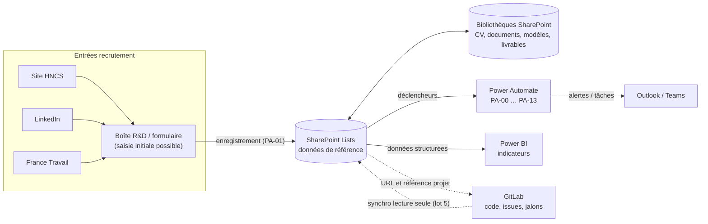
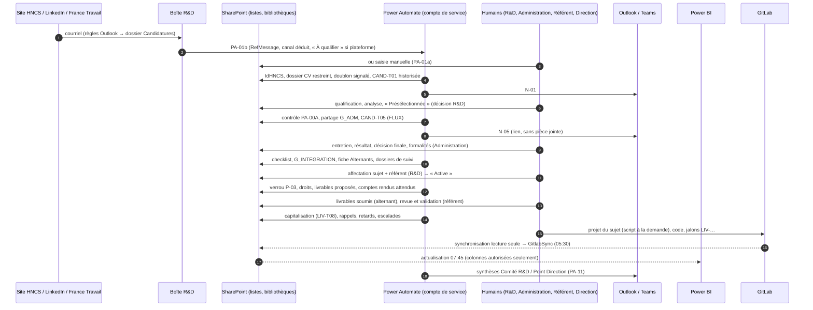
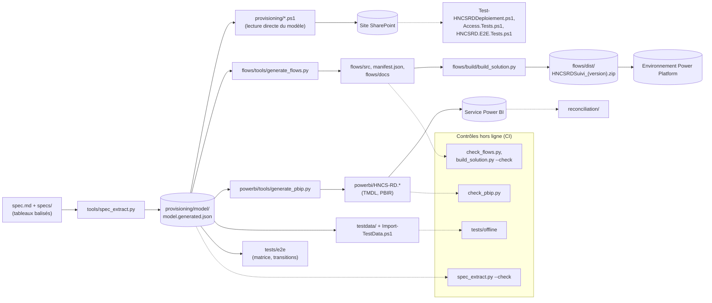

# Architecture : Système de suivi R&D HNCS

> Public : lecteur technique (architecte, administrateur Microsoft 365, développeur Power Platform). Ce document
> résume et relie ; il ne remplace pas la spécification [`spec.md`](../spec.md) (**v1.7.1**), source de vérité
> unique, à laquelle renvoient les liens de section. Installation : [`docs/installation.md`](installation.md) ;
> exploitation : [`docs/exploitation.md`](exploitation.md).

## 1. Vue d'ensemble

Le système outille le Département R&D de HNCS Groupe sous Microsoft 365 : recrutement des alternants, intégration,
affectations, livrables, comptes rendus, écoles et partenariats, capitalisation et reporting. Il repose
exclusivement sur des services standard de Microsoft 365 (SharePoint, Power Automate avec connecteurs standard,
Outlook, Teams, Power BI) et sur GitLab pour le code.

Vue d'ensemble (spec [2.1](../spec.md#21-vue-densemble)) :

Le catalogue des flux va en réalité de PA-00A à **PA-14** (PA-14 : arbitrage du portefeuille de sujets, [8.3](../spec.md#83-catalogue-des-flux)) ; la
légende « PA-00 … PA-13 » est celle du schéma d'architecture source.

## 2. Composants

| Composant | Rôle | Ce qu'il ne fait pas | Spec |
| --- | --- | --- | --- |
| **Site SharePoint « HNCS-R&D »** (`/sites/HNCS-RD`, `STS#3` sans groupe Microsoft 365, français, Paris) | Référentiel central : 26 listes et 6 bibliothèques documentaires, versionnées, à héritage rompu ; groupes `HNCS-RD-*` ; niveau « HNCS - Contribution sans suppression » | ne stocke ni code ni secret ; ne contient aucune donnée métier dans les listes système | P-05, [2.2](../spec.md#22-conventions-de-nommage), [4](../spec.md#4-modèle-de-données--listes-sharepoint), [5](../spec.md#5-bibliothèques-documentaires), [7](../spec.md#7-sécurité--groupes-niveaux-dautorisation-matrice-daccès) |
| **Listes techniques** `Parametres`, `TransitionsStatuts`, `HistoriqueStatuts`, `JournalFlux`, `ModelesActions`, `GitlabSync` | Paramètres métier modifiables, table des transitions autorisées, historique des statuts, journal d'erreurs et de reprise, modèles de checklists, miroir GitLab | | [4.3](../spec.md#43-listes) |
| **Power Automate** : solution `HNCSRDSuivi` | Flux PA-00A à PA-14 (33 définitions techniques), exécutés sous le **compte de service** : contrôle a posteriori des transitions, champs protégés, identifiants, permissions par élément et dossier, notifications, rappels, synthèses | ne prend **aucune** décision humaine (P-01) ; ne supprime jamais définitivement | [8](../spec.md#8-flux-power-automate--contrats) |
| **Outlook / Teams** | Notifications N-01 à N-99 depuis la boîte partagée R&D (objet `[HNCS-R&D][N-xx]`), messages Teams aux personnes nommées si `Fonction.NotificationsTeams` = Oui ; équipe Teams « HNCS R&D » distincte | jamais de CV en pièce jointe ; fichiers Teams non référents (H-44) | [7.5](../spec.md#75-sécurité-des-données-personnelles), [8.1](../spec.md#81-socle-commun-sapplique-à-tous-les-flux), `specs/notifications.md` |
| **Boîte partagée R&D** | Réception des candidatures (dossier `Candidatures`, PA-01b) et expéditeur des notifications | aucune API LinkedIn / France Travail (P-06) | H-04 |
| **Power BI** : projet PBIP `powerbi/` (TMDL + PBIR), espace « HNCS-R&D Pilotage » | Indicateurs (60 mesures, 8 pages), RLS / OLS par rôle, audiences de l'application ; source REST SharePoint (`GetList`, `$select` limité), actualisation quotidienne 07:45, après les flux planifiés du matin | lecture seule ; aucune colonne `perso` / `confidentiel` (sauf `NomAffichage`, masquée) | [9](../spec.md#9-modèle-power-bi-et-mesures-dax) |
| **GitLab** : groupe `hncs-rd` | Référence du code, des issues, MR et jalons ; un projet par sujet (`New-GitlabProjetSujet.ps1`, à la demande d'un humain) ; synchronisation planifiée en lecture vers `GitlabSync` (lot 5), lignes orphelines conservées et marquées `Orpheline` | n'écrit aucun statut métier SharePoint | [10](../spec.md#10-intégration-gitlab-et-infrastructure) |
| **Outillage du dépôt** | Spec lisible par machine, extracteur, scripts PnP.PowerShell, générateurs, tests hors ligne et de bout en bout, CI | | [12](../spec.md#12-stratégie-de-test-et-critères-dacceptation), [14](../spec.md#14-sous-spécifications-et-journal-des-modifications) |

## 3. Flux de données : de la candidature au reporting

Mécanique commune à chaque changement de statut ([6.1](../spec.md#61-règles-générales), [8.1](../spec.md#81-socle-commun-sapplique-à-tous-les-flux)) :

1. une personne modifie un élément d'une liste à statut contrôlé ; le flux de la liste se déclenche sur **toute**
   modification humaine, jamais sur une écriture du compte de service (anti-boucle) ; pour une liste servie par
   plusieurs flux, chacun ne traite que ses statuts cibles (partition disjointe [8.2](../spec.md#82-partition-des-statuts-cibles)) ;
2. le flux **rétablit d'abord les colonnes techniques** modifiées par la personne (valeurs de la version précédente,
   N-92), puis détermine s'il y a transition en comparant `Statut` au **dernier `StatutApres` accepté** dans
   `HistoriqueStatuts` (à défaut d'historique : création, `∅`) ;
3. **PA-00A** vérifie le couple (De, Vers) dans `TransitionsStatuts`, le rôle de l'acteur (appartenance directe aux
   groupes SharePoint par API REST, ou personne désignée `ITEM_AUTEUR` / `ITEM_VALIDEUR`) et renvoie les contrôles
   `G_*` à évaluer ; toute erreur technique vaut refus ;
4. **PA-00B** valide (copie de commodité `StatutPrecedent`, `DateStatut`) ou annule (statut rétabli à partir de
   l'historique, N-90 ; création refusée → corbeille du site), et écrit `HistoriqueStatuts` dans tous les cas ;
5. le flux exécute les effets du statut cible ; en cas d'échec, la portée `Erreur` appelle **PA-00C** (`JournalFlux`
   « À reprendre », N-99) ;
6. chaque matin, **PA-00E** rapproche le statut de chaque élément de la dernière transition acceptée et rétablit tout
   écart (motif « Rapprochement quotidien »), puis envoie la synthèse N-98 ; un élément sans aucune transition
   acceptée qui n'est pas une création (saisi avant le lot 2 ou importé) n'est jamais traité comme une création :
   PA-00D adopte son statut courant par une entrée `REPRISE` ([6.1](../spec.md#61-règles-générales), point 3 ter, H-57).

Règle structurante (P-09, H-17) : **aucune colonne technique n'est une source de confiance**. Les colonnes `flux`
(`StatutPrecedent`, `DateStatut`, `Empreinte*`, dates et décideurs tracés…) restent modifiables par l'interface ou
l'API au niveau Contribution ; le système ne s'y fie donc pas. La référence est `HistoriqueStatuts`, que seul le
compte de service écrit, et toute modification humaine d'une colonne technique est rétablie.

## 4. Modèle de données (résumé)

Le modèle complet (colonnes, types, marqueurs `flux` / `perso` / `confidentiel` / `hidden`, règles de validation)
est dans la spec [4](../spec.md#4-modèle-de-données--listes-sharepoint) (diagramme des relations [4.1](../spec.md#41-vue-des-relations)) et [5](../spec.md#5-bibliothèques-documentaires). Résumé par domaine ([4.2](../spec.md#42-domaines-et-lots)) :

| Domaine | Listes (lot) | Bibliothèques (toutes lot 1) |
| --- | --- | --- |
| A. Recrutement | `Offres`, `Candidatures`, `Entretiens` (1) | `Recrutement` (« 01 - Recrutement », dossiers `/{AAAA}/{CAND}/`) |
| B. Gestion des alternants | `Alternants`, `Poles`, `Referents`, `Affectations`, `ActionsIntegration` (1) ; `BilansAlternance` (3) | `Administration` (« 02 »), `SuiviAlternants` (« 05 », `/{ALT}/` et `/_Evaluations/`) |
| C. Production R&D | `SujetsRD`, `Livrables`, `RegistreModeles`, `DomainesCibles` (1) ; `ComptesRendus`, `CommunicationsRD`, `RessourcesTechniques` (3) ; `Mobilisations` (4) | `ModelesRD` (« 03 »), `LivrablesRD` (« 04 », `/{SUJ}/`) |
| D. Écoles et partenariats | `Etablissements` (1) ; `Conventions`, `InteractionsEcoles` (3) | `EcolesPartenariats` (« 06 ») |
| T. Technique | `Parametres`, `TransitionsStatuts`, `HistoriqueStatuts`, `JournalFlux`, `ModelesActions` (1) ; `GitlabSync` (5) | - |

Conventions structurantes ([2.2](../spec.md#22-conventions-de-nommage) à [2.4](../spec.md#24-conventions-de-lecture-des-tableaux-de-colonnes)) :

- nom interne = URL, PascalCase ASCII, **jamais renommé** ; titres affichés en français ;
- identifiant métier `IdHNCS` = `{PREFIXE}-{AAAA}-{NNNN}` (ID SharePoint), indexé sans contrainte d'unicité
  SharePoint (unicité par construction, vérifiée par les tests) ; les colonnes de recherche affichent l'`IdHNCS` de la
  cible, jamais un nom ; les dossiers sont nommés par `IdHNCS` ;
- colonnes implicites des listes à statut : `Statut`, `StatutPrecedent` (copie du dernier statut validé, pour les
  vues ; masquée), `DateStatut` ;
- empreintes `Empreinte*` (JSON compact, [6.5](../spec.md#65-formats-des-empreintes-p-09) ; colonnes `Text`, ou `Note` pour `EmpreinteRevue` et
  `EmpreinteCommentaire`) pour les champs protégés ;
- identifiants **réservés** des référentiels initiaux (plage `0001` à `0099` de 2026, `POL-Px`), posés par le
  provisionnement ;
- une colonne de recherche ne cible qu'une liste de lot inférieur ou égal (sinon elle porte `lot=<n>`).

Statuts et transitions : 8 objets à transitions contrôlées (Candidature, Livrable, CompteRendu, Affectation,
Alternant, Communication, Convention, Sujet ; tableaux `### TRANSITIONS:`), contrôles `G_*` ([6.6](../spec.md#66-catalogue-des-contrôles)) ; les changements
de statut et de résultat des entretiens sont historisés sans table de transitions ([6.1, point 7](../spec.md#61-règles-générales)).

## 5. Sécurité

### 5.1 Groupes et niveaux ([7.1](../spec.md#71-groupes-sharepoint), [7.2](../spec.md#72-niveaux-dautorisation))

Huit groupes SharePoint `HNCS-RD-Proprietaires` (G_PROP), `-DirectionRD` (G_DRD), `-EquipeRD` (G_RD),
`-Administration` (G_ADM), `-Referents` (G_REF), `-Alternants` (G_ALT), `-Direction` (G_DIR), `-RelationEcoles`
(G_ECO), alimentés en **membres directs** (H-14), car PA-00A vérifie les rôles par l'API REST des groupes du site.
Niveaux : Contrôle total (FC), « HNCS - Contribution sans suppression » (CSS = permissions de `Contributor` sans
`DeleteListItems` ni `DeleteVersions`), Lecture (R), désignés par `RoleTypeKind` (indépendant de la langue).

### 5.2 Matrice et permissions par élément ([7.3](../spec.md#73-matrice-daccès), [7.4](../spec.md#74-permissions-au-niveau-élément-ou-dossier-posées-par-les-flux))

- L'héritage est rompu **sans copie** sur toutes les listes et bibliothèques du modèle ; seules les attributions de la
  matrice existent (site : G_PROP FC, autres R). Les listes système héritent du site et ne doivent contenir aucune
  donnée métier ; les groupes par défaut du site restent vides.
- `IL(x)` : accès ciblé posé **par les flux** sur un élément ou un dossier (héritage copié puis complété), par exemple
  candidature transmise → G_ADM (ou le seul destinataire, H-45) ; dossier de suivi d'un alternant → alternant et
  référents ; `_Evaluations` → sans l'alternant ; dossier `LivrablesRD/{SUJ}` → alternant de l'affectation active.
  `R+IL(x)` : lecture de la liste et écriture ciblée. Une cellule `-` n'exclut pas ces accès nominatifs.
- Aucun flux ne retire de droits : le retrait est une action humaine de la checklist de clôture (H-18).
- Au lot 1, ces attributions sont posées à la main par G_PROP (H-50, [`docs/exploitation.md`, section 5](exploitation.md#5-procédure-manuelle-provisoire-du-lot-1-h-50)).

### 5.3 Données personnelles (P-04, [7.5](../spec.md#75-sécurité-des-données-personnelles)) et champs protégés (P-09)

- CV et pièces de recrutement dans des dossiers restreints ; notifications par lien, jamais de pièce jointe ; envois
  larges limités aux identifiants, statuts et agrégats ; `HistoriqueStatuts` / `JournalFlux` sans donnée de candidat.
- La Direction Générale (G_DIR) n'a accès à aucune liste nominative dans SharePoint ; ses indicateurs passent par
  Power BI.
- Power BI : `$select` explicite sans colonne `perso` / `confidentiel` (seule exception `Alternants.Title` →
  `NomAffichage`, masquée par OLS aux rôles `Direction` et `RelationEcoles` et absente de tous les visuels) ; RLS
  par rôle (`Administration`, `RelationEcoles`, `Referent`, et filtrage des tables techniques `Parametres` et
  `HistoriqueStatuts` pour `Direction`, `RelationEcoles` et `Referent`) ; une personne relève d'un seul rôle ;
  audiences de l'application pour les pages.
- P-09 : les champs qui portent une décision (réviseur, valideur, échéance, DoD, décision de partenariat, référent
  principal, caractère bloquant d'une formalité…) sont comparés à leur empreinte par le flux responsable à **chaque**
  modification humaine ; une modification non habilitée est rétablie, journalisée et notifiée (N-92 / N-91). Les
  empreintes sont elles-mêmes des colonnes techniques protégées ; une empreinte vide est initialisée sans
  rétablissement (PA-00D chaque heure à partir du lot 2, H-55).
- Synchronisation GitLab : application Entra à permissions « Selected » (`Lists.SelectedOperations.Selected`, ou
  repli `Sites.Selected` avec risque accepté, H-31) ; aucun secret dans SharePoint ni dans le dépôt.

## 6. Principes non négociables et leur mise en œuvre

| Code | Principe | Mise en œuvre technique | Vérification |
| --- | --- | --- | --- |
| P-01 | Les décisions humaines ne sont jamais automatisées | Le rôle `FLUX` n'apparaît sur aucune transition dont l'arrivée est une décision humaine (`DECISIONS_HUMAINES`, exception explicite `CAND-T02`) ; les flux n'avancent un statut qu'en conséquence d'une action humaine enregistrée (ex. CAND-T05 après « Présélectionnée ») | `tools/spec_extract.py`, `tests/offline/test_spec_model.py`, `flows/tools/check_flows.py` (statuts écrits par les flux) |
| P-02 | « Intégrée » seulement si les formalités sont au bon stade | Double barrière : règle de validation de `Candidatures` (dates) + contrôle `G_INTEGRATION` exécuté par PA-04, qui annule la transition | `tests/offline/test_testdata.py`, S-04, S-17 |
| P-03 | Un changement de sujet ou de référent crée une nouvelle affectation | `EmpreinteVerrou` figée à l'activation ; PA-05 rétablit toute modification (N-91) ; remplacement via `AffectationRemplacee`, ancienne affectation seulement terminée | S-06, `test_testdata.py` (chaîne de remplacement) |
| P-04 | CV et données personnelles cloisonnés | Matrice [7.3](../spec.md#73-matrice-daccès), permissions par élément, marqueurs `perso` / `confidentiel`, `$select` Power BI, OLS, notifications par lien | `test_security_matrix.py`, `test_powerbi_contract.py`, `powerbi/tools/check_pbip.py`, `Access.Tests.ps1`, S-02, S-09, S-15 |
| P-05 | SharePoint référentiel central ; GitLab référence du code | SharePoint ne stocke que liens et métadonnées GitLab ; synchronisation en lecture vers la seule liste `GitlabSync` | `gitlab/sync/tests` |
| P-06 | Aucune API LinkedIn / France Travail présumée | Saisie manuelle ou courriels du dossier `Candidatures` (PA-01b), canal par règles `Canal.Regles`, sinon « À qualifier » | S-01, S-11 |
| P-07 | Historique jamais écrasé | Versioning partout, `HistoriqueStatuts` à chaque transition, commentaires en ajout seul (`appendonly`), niveau CSS sans suppression, corbeille 93 jours | `Test-HNCSRDDeploiement.ps1` (versioning, niveaux), S-07 |
| P-08 | Connecteurs standard uniquement | Quatre références de connexion `hncs_sharepoint`, `hncs_outlook`, `hncs_teams`, `hncs_o365users` | `flows/tools/check_flows.py`, `test_flows_contract.py` |
| P-09 | Champs de décision protégés ; aucune colonne technique n'est une source de confiance | Empreintes [6.5](../spec.md#65-formats-des-empreintes-p-09) comparées à chaque modification humaine par PA-04, PA-05, PA-07, PA-08, PA-10 ; rétablissement et N-92 ; empreinte vide = initialisation sans rétablissement (PA-00D) ; colonnes `flux` rétablies depuis la version précédente ; statut de référence = dernière transition acceptée de `HistoriqueStatuts` ; rapprochement quotidien par PA-00E | S-13, S-23, `test_testdata.py` |

Au lot 1, sans les flux du lot 2, les contrôles P-01 à P-03 et P-09 ne sont pas effectifs (H-50).

## 7. Organisation du dépôt

| Dossier / fichier | Rôle | Lot |
| --- | --- | --- |
| `spec.md` | Spécification de référence ; tableaux balisés lus par machine (`### LST:`, `### ENUM`, `### TRANSITIONS:`, `### MATRICE`…) | 0 |
| `specs/` | Sous-spécifications : vues SharePoint, référentiels initiaux (paramètres, seeds), notifications (lues par machine) ; détail des visuels Power BI | 0 |
| `tools/spec_extract.py` | Extracteur : spec → `provisioning/model/model.generated.json`, avec contrôles de cohérence ; `--check` | 0 |
| `provisioning/` | Scripts PnP.PowerShell rejouables (`Deploy-HNCSRD.ps1`, `Set-HNCSRDMembres.ps1`, `Grant-HNCSRDServiceAccount.ps1`, `Test-HNCSRDDeploiement.ps1`), module `HNCSRD.Provisioning`, modèle généré, configurations d'exemple, tests des fonctions pures | 1+ |
| `flows/` | Flux : générateur (`tools/generate_flows.py`, définitions par domaine), définitions `src/<Id>/workflow.json`, `manifest.json`, fiches `docs/PA-xx.md`, modèles HTML `templates/N-xx.html`, contrôle `tools/check_flows.py`, construction `build/build_solution.py` → `dist/` (non versionné), import `deploy/` | 1-5 |
| `powerbi/` | Projet PBIP (modèle TMDL, rapport PBIR), générateur et contrôle (`tools/`), `MESURES.md`, publication `deploy/Publish-HNCSRDPowerBI.ps1` | 4 |
| `gitlab/` | Script de création de projet, modèles d'issues / MR / README, synchronisation Python et ses tests, pipeline `ci/.gitlab-ci.yml` | 3, 5 |
| `testdata/` | Jeu de test fictif (`data/<Liste>.json`), personas d'exemple, `Import-TestData.ps1` | 1 |
| `tests/offline/` | Tests de cohérence hors ligne (Python, bibliothèque standard) | 0+ |
| `tests/e2e/` | Scénarios de recette (`scenarios.md`), tests Pester 5 (`Access.Tests.ps1`, `HNCSRD.E2E.Tests.ps1`), réconciliation Power BI (`reconciliation/`) | 1+ |
| `docs/` | Installation, exploitation, architecture ; `guides/` par rôle | 1-5 |
| `.github/workflows/ci.yml` | CI : extracteur, tests hors ligne, synchro GitLab, contrôles des flux et de la solution, contrôle PBIP, analyse PowerShell 5.1 et 7, tests Pester du provisionnement | - |

## 8. Chaîne de cohérence : de la spec aux tests

- **Rien n'est codé en dur** dans les scripts de provisionnement : listes, colonnes, vues, groupes, matrice,
  paramètres et transitions viennent du modèle généré.
- Les flux et le PBIP sont **générés** : on modifie la spec ou le générateur, jamais les fichiers produits
  (`generate_flows.py --check`, `check_pbip.py` détectent une dérive).
- `tests/offline` vérifie que scripts, flux, modèle Power BI et jeu de test ne référencent que des listes, colonnes,
  statuts et transitions de la spec ; partition des statuts disjointe ; aucune transition de décision humaine avec
  `FLUX` ; aucune colonne `perso` / `confidentiel` dans Power BI ; syntaxe PowerShell et JSON ; valeurs attendues des
  mesures sur le jeu de test (`test_reconciliation.py`).
- Sur le tenant : `Test-HNCSRDDeploiement.ps1` (site ↔ modèle), `Access.Tests.ps1` (matrice persona par persona),
  `HNCSRD.E2E.Tests.ps1` (scénarios), réconciliation des mesures Power BI.
- Règle de changement ([14.2](../spec.md#142-règle-de-changement)) : spec (version + journal) → `spec_extract.py` → tests hors ligne verts → artefacts
  régénérés → redéploiement ([`docs/exploitation.md`, section 8](exploitation.md#8-ajouter-ou-modifier-une-valeur-de-statut-et-toute-évolution-du-modèle)).

## 9. Correspondance avec les documents sources

Les documents sources sont **confidentiels** et ne sont pas versionnés, le dépôt étant public (H-30 ; `.gitignore` :
`*.docx`, `Processus.md`). La spec en reprend ce qui est nécessaire et trace les écarts.

| Document source | Version de référence | Repris dans | Correspondances et écarts tracés |
| --- | --- | --- | --- |
| `Processus.md` | version de référence non datée dans la spec (H-35) | flux PA-01 à PA-09 (numérotation **identique**), statuts | H-01 (numérotation), H-02, H-03 (statuts), [3](../spec.md#3-énumérations-valeurs-contrôlées) « Correspondance avec les documents sources » |
| `Cadrage_Fonctionnel_Automatisation_R&D_HNCS.docx` | v0.1 du 14/10/2026 (H-35) | annexe A (statuts), RACI (cadrage 9.2 → spec [7.6](../spec.md#76-matrice-raci-et-implémentation)), scénarios de recette (cadrage 10.1 → S-01 à S-10), objectifs à un an (cadrage 2.4 → table `Objectifs`), Definition of Done | H-01 : PA-01→PA-01, PA-02→PA-01 + PA-02b, PA-03→PA-02, PA-04→PA-03, PA-05→PA-04, PA-06→PA-10, PA-07→PA-05, PA-08→PA-06, PA-09→PA-07, PA-10→PA-08, PA-11→PA-09, PA-12→PA-11 ; décisions à confirmer : [13](../spec.md#13-hypothèses-et-décisions-à-confirmer) |
| Schéma « Architecture cible, Système de suivi R&D HNCS » | - | [2.1](../spec.md#21-vue-densemble) (diagramme ci-dessus) | composants identiques ; PA-14 et PA-00F ajoutés par les revues de la spec ([14.3](../spec.md#143-journal)) |

Toutes les hypothèses implémentées en attendant un arbitrage sont listées au [13](../spec.md#13-hypothèses-et-décisions-à-confirmer) de la spec (H-01 à H-54), avec
l'impact d'un arbitrage différent et la personne qui doit le confirmer.
