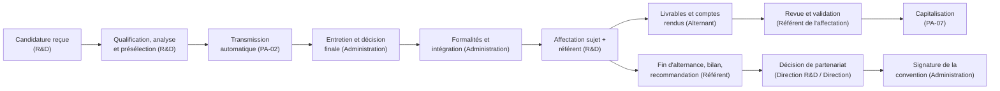

# Guides utilisateurs — Système de suivi R&D HNCS

Ces guides expliquent, rôle par rôle, comment utiliser le système de suivi R&D de HNCS Groupe :

- le site SharePoint **HNCS-R&D** est le référentiel central (listes, bibliothèques de documents, historique) ;
- les flux **Power Automate** (PA-00 à PA-14) contrôlent les changements de statut et les champs protégés, posent les droits
  d'accès, envoient les notifications et les rappels ;
- **Outlook / Teams** portent les notifications (objet toujours préfixé `[HNCS-R&D][N-xx]`). L'équipe Teams « HNCS R&D »
  (canaux Général, Comité R&D, Alternants) sert aux échanges ; ses fichiers ne sont **pas** la référence (H-44) ;
- **GitLab** reste la référence du code, des issues, des merge requests et des jalons ;
- **Power BI** sert au pilotage, en lecture seule.

> Les guides décrivent le comportement défini par la spécification [`spec.md`](../../spec.md) (version **1.3.0**), qui fait
> foi en cas d'écart. Les codes cités entre parenthèses (`CAND-T04`, `N-05`, `PA-02`, `G_INTEGRATION`, `H-09`…) permettent
> au support de retrouver la règle exacte dans la spec.

## Choisir son guide

| Vous êtes… | Groupe SharePoint | Guide |
| --- | --- | --- |
| Membre de l'équipe R&D (analyse des candidatures, affectations, portefeuille) | `HNCS-RD-EquipeRD` | [Équipe R&D](equipe-rd.md) |
| Membre de l'administration (par exemple Karine) | `HNCS-RD-Administration` | [Administration](administration.md) |
| Expert référent d'un pôle (encadrement, revue des livrables) | `HNCS-RD-Referents` | [Référent](referent.md) |
| Alternant ou stagiaire | `HNCS-RD-Alternants` | [Alternant](alternant.md) |
| Direction R&D | `HNCS-RD-DirectionRD` (souvent aussi `HNCS-RD-EquipeRD`) | [Direction](direction.md), partie « Direction R&D » |
| Direction Générale | `HNCS-RD-Direction` | [Direction](direction.md), partie « Direction Générale » |
| Responsable de la relation écoles (pôle 4) | `HNCS-RD-RelationEcoles` | Pas de guide dédié dans cette version : les sections « Écoles, conventions » du guide [Administration](administration.md) s'appliquent (mêmes droits sur les écoles, conventions et échanges) ; rôle Power BI `RelationEcoles` (pages 3 et 5) |
| Administrateur de la plateforme / IT, support | `HNCS-RD-Proprietaires` | Documentation d'exploitation (`docs/exploitation.md`) |

Une même personne peut appartenir à plusieurs groupes (spec § 7.1) : elle cumule alors les droits et lit plusieurs guides.
En revanche, dans Power BI, une personne ne relève que d'**un seul** rôle (§ 9.6).

## Le parcours en un coup d'œil

## Qui fait quoi

### Matrice RACI (spec § 7.6)

R = réalise ; A = responsable final / approbateur ; C = consulté ; I = informé. Matrice indicative reprise du cadrage (§ 9.2).

| Activité | Dir. Générale | Dir. R&D | Équipe R&D | Admin. | Référent | Alternant | IT / Support | Où le système la matérialise |
| --- | --- | --- | --- | --- | --- | --- | --- | --- |
| Valider la cible et le budget | A | R | C | C | C | I | C | Lot 0, hypothèses § 13 (hors outil) |
| Enregistrer et analyser les candidatures | I | A | R | C | C | — | C | CAND-T01 à T03, PA-01, PA-02 |
| Présélectionner et transférer le dossier | I | A | R | C | C | — | I | CAND-T04, T05, T06 ; PA-02 ; N-05 |
| Planifier les entretiens et saisir l'issue | A/C | C | C | R | C | — | I | Liste Entretiens ; CAND-T07 à T10 ; PA-03 |
| Valider la sélection et les formalités | A* | C | C | R | C | — | C | CAND-T11 à T14, T17 ; `G_INTEGRATION` ; PA-04 |
| Suivre école et convention | A/C | A | C | R/C | I | I | I | Écoles, conventions, échanges ; PA-10 |
| Affecter alternant, référent et sujet | I | A | R | C | C | I | I | AFF-T02 ; PA-05 |
| Produire et valider un livrable | I | C | C | — | A/R | R | I | LIV-T01 à T10 ; `G_VALIDEUR_LEGITIME` ; PA-07 |
| Valider une communication externe | A* | A/R | C | C | C | I | — | COM-T05 ; PA-12 |
| Gérer les droits et maintenir la plateforme | I | C | I | C | I | I | A/R | Provisioning, supervision PA-00E |
| Publier le reporting de gouvernance | I | A/R | C | C | C | I | C | PA-11 (N-42 ; N-43 relayée par la Direction R&D) ; Power BI |

\* responsable final à confirmer (H-06, H-11).

### Étape par étape

« Agit / décide » désigne la personne qui change le statut ; le système ne fait qu'exécuter les conséquences (§ 6, § 8.4).

| Étape | Agit / décide | Ce que fait le système | Qui est informé |
| --- | --- | --- | --- |
| Enregistrer une candidature (site HNCS, LinkedIn, France Travail, spontanée) | Équipe R&D (saisie manuelle) ou dépôt du courriel dans la boîte R&D | PA-01 : identifiant `CAND-…`, dossier CV sécurisé, signalement de doublon ; courriel de plateforme → identité « À qualifier » | N-01 : responsable d'analyse ou équipe R&D |
| Qualifier l'identité, attribuer, analyser | Équipe R&D | PA-02 : contrôle `G_IDENTITE`, dates d'analyse ; PA-02b : relance après 5 jours | N-03, N-09 |
| **Présélectionner** (pertinence du CV) | Équipe R&D | PA-02 : ouvre l'accès à l'administration, transmet, passe à « Transmise à l'administration » | N-05 : administration |
| **Écarter après analyse** (avec motif) | Équipe R&D | PA-02 : dates, tâche « informer le candidat » | N-06, N-08 |
| Planifier un entretien, saisir le **résultat** | Administration | PA-03 : statut « Entretien planifié » puis « Entretien réalisé », historique ; PA-03b : rappels | N-10, N-11 (sans commentaire), N-14 |
| **Décision finale** (Retenue / Non retenue, y compris refus sans entretien) | Administration (« Décideur final » renseigné) | PA-03 / PA-02 : dates, notifications | N-12, N-13, N-06 |
| **Lancer les formalités** | Administration | PA-04 : checklist FORM-01 à FORM-06, dossier administratif | N-15, N-19 (rappels), N-17 |
| **Confirmer l'intégration** | Administration | PA-04 : contrôle `G_INTEGRATION`, fiche alternant, dossiers | N-16 |
| Accueil (compte, accès, poste) | Support / IT (ACC-01 à ACC-03), référent (ACC-04), équipe R&D (ACC-05) | PA-04b : passage à « Actif » à la date de début | N-18 |
| Proposer, **arbitrer** un sujet R&D | Proposition : équipe R&D, référent ; arbitrage (Priorisé, Suspendu, Abandonné) : Direction R&D ou Direction | PA-14 : contrôle du motif, historique | N-47 |
| **Affecter** un alternant à un sujet et un référent | Équipe R&D | PA-05 : verrouillage, droits, livrables proposés, premier compte rendu, référent principal mis à jour | N-20 |
| Changer de sujet ou de référent | Équipe R&D (nouvelle affectation ; décision pour chaque livrable encore ouvert) | PA-05 : termine l'ancienne affectation sans l'écraser | N-20, N-22 |
| Produire, déposer, **soumettre** un livrable | Alternant | PA-07b : rattache le document ; PA-06 : rappels et retards | N-23, N-24, N-25 |
| **Valider** un livrable ou **demander des corrections** | Référent de l'affectation, désigné « Réviseur » | PA-07 : contrôle `G_VALIDEUR_LEGITIME`, trace la décision, tente la capitalisation | N-26, N-27, N-28 |
| Rédiger et remettre un compte rendu | Alternant | PA-08b : crée les comptes rendus attendus, relance, constate « Non remis » | N-30, N-31, N-32, N-33 |
| **Valider** un compte rendu ou demander un complément | Référent de l'affectation (valideur) | PA-08 : date de validation | N-34 |
| Signaler une affectation « À risque » / « Bloquée » | Référent ou équipe R&D | PA-05 : escalade | N-21 : Direction R&D |
| Prolonger une alternance | Équipe R&D ou administration | PA-04 : contrôle `G_DATE_FIN_REPORTEE` | — |
| Enregistrer la **fin effective** d'une alternance | Équipe R&D ou administration | PA-09 : termine les affectations, checklist de clôture, bilan | N-35, N-37, N-22 |
| Bilan d'alternance et **recommandation** de partenariat | Référent | PA-09 : action d'évaluation PART-01, école « Partenariat à évaluer » si recommandée | N-38 |
| **Décision de partenariat ou de sponsoring** | Direction R&D ou Direction Générale | PA-10 : trace le décideur et la date, rétablit toute modification non autorisée | N-39 |
| Constater la **signature** d'une convention (avec preuve, après décision pour un partenariat) | Administration ou relation écoles | PA-10 : contrôles de preuve et de décision ; école « Partenaire actif » si partenariat / sponsoring | N-40 (échéances) |
| Rédiger une communication | Équipe R&D, référent, Direction R&D (un alternant peut en être l'auteur) | PA-12 : droits de l'auteur, notifications | N-44 |
| **Valider une communication externe** | Direction R&D ou Direction Générale | PA-12 : date de validation | N-45 |
| Rouvrir une candidature clôturée ou non retenue | Direction R&D uniquement | PA-02 : retour à « À analyser » | N-03 |
| Gouvernance (Comité R&D, Point Direction, revue trimestrielle) | Direction R&D (prépare et relaie), Direction Générale ; le Comité R&D réunit Direction R&D, équipe R&D et référents (H-53) | PA-11 : synthèses automatiques | N-42, N-43 |

### Circuit d'escalade (spec § 7.7)

| Situation | Niveau 1 | Niveau 2 | Niveau 3 |
| --- | --- | --- | --- |
| Livrable en retard | Propriétaire, dès J+1 (N-24) | Réviseur, dès J+1 (N-24) | Comité R&D au-delà de 7 jours de retard (N-42) |
| Compte rendu non remis | Alternant, la veille de l'échéance (N-30) | Référent (N-31) | Comité R&D (N-42) |
| Blocage signalé dans un compte rendu | Référent (N-32) | Direction R&D (N-33) | Point Direction si arbitrage requis (N-43) |
| Affectation « À risque » / « Bloquée » | Direction R&D (N-21) | Comité R&D (N-42) | Point Direction (N-43) |
| Candidature sans traitement | Responsable d'analyse (N-09) | Équipe R&D (N-09 sans responsable) | Comité R&D (compteurs N-42) |
| Action de checklist en retard | Responsable (N-19) | Comité R&D (N-42) | — |
| Erreur de flux | Support (N-99) | Support et propriétaires (N-98 quotidien) | — |

### Les décisions humaines (jamais automatisées)

Principe P-01 : aucun flux ne prend ces décisions. Les flux notifient, tracent et n'exécutent que les conséquences d'une
décision enregistrée par une personne habilitée (spec § 6.1, tableau `DECISIONS_HUMAINES`).

| Décision | Objet et statut | Qui décide |
| --- | --- | --- |
| Pertinence du CV (présélection) | Candidature → « Présélectionnée » | Équipe R&D |
| Refus après analyse, après entretien ou sans entretien | Candidature → « Non retenue » | Équipe R&D (après analyse) ; administration (après transmission) |
| Décision finale de sélection | Candidature → « Retenue » | Administration |
| Autorisation de lancer les formalités | Candidature → « Formalités en cours » | Administration |
| Confirmation de l'intégration | Candidature → « Intégrée » | Administration |
| Clôture pour un autre motif | Candidature → « Clôturée » | Équipe R&D ; administration |
| Réouverture | Candidature → « À analyser » (depuis « Non retenue » ou « Clôturée ») | Direction R&D |
| Arbitrage du portefeuille | Sujet → « Priorisé », « Suspendu », « Abandonné » | Direction R&D ; Direction Générale |
| Validation d'un livrable / demande de corrections | Livrable → « Validé » / « Corrections demandées » | Référent de l'affectation désigné réviseur |
| Suspension ou abandon d'un livrable | Livrable → « Suspendu / abandonné » | Équipe R&D ; réviseur |
| Validation d'un compte rendu / demande de complément | Compte rendu → « Validé » / « À compléter » | Référent de l'affectation |
| Affectation d'un alternant à un sujet et un référent | Affectation → « Active » | Équipe R&D |
| Fin effective de l'alternance | Alternant → « Terminé » | Équipe R&D ; administration |
| Validation d'une communication externe | Communication → « Validée » | Direction R&D ; Direction Générale |
| Décision de partenariat ou de sponsoring | Champ « Décision de partenariat » d'une convention | Direction R&D ; Direction Générale |
| Constat de signature avec preuve | Convention → « Signée / active » | Administration ; relation écoles |

## Repères communs à tous les guides

### Identifiants

Chaque élément reçoit un identifiant métier stable (colonne `IdHNCS`) au format `PRÉFIXE-AAAA-NNNN` : `CAND-2026-0042`
(candidature), `ALT-…` (alternant), `SUJ-…` (sujet), `AFF-…` (affectation), `LIV-…` (livrable), `CR-…` (compte rendu),
`ACT-…` (action), `CONV-…` (convention), `COM-…` (communication). Les dossiers documentaires sont nommés par cet identifiant,
jamais par le nom d'une personne. Les colonnes de recherche affichent l'identifiant de la cible (spec § 2.2).

### Changer un statut, c'est agir

Le champ « Statut » est l'outil de travail : poser un statut déclenche le flux correspondant. Le contrôle est fait **juste
après** l'enregistrement (SharePoint n'empêche pas la saisie, H-17) :

- si le changement est autorisé (bon statut de départ, bon rôle, contrôles satisfaits), il est historisé et ses effets sont
  exécutés (dates, droits, notifications) ;
- s'il ne l'est pas, le statut est **rétabli en quelques secondes** à sa valeur précédente et vous recevez **N-90**
  « Changement de statut refusé » (statut demandé, motif du refus, marche à suivre). Vos autres saisies sont conservées :
  seul le statut est rétabli. Actualisez la page pour voir le statut réel ;
- si c'est une **création** qui est refusée (par exemple un rôle non habilité à créer ce type d'élément), l'élément est placé
  dans la **corbeille du site** (récupérable pendant 93 jours) et vous recevez N-90 (§ 6.1-3 bis).

### Les champs protégés (P-09)

Certains champs portent ou qualifient une décision : réviseur et valideur, échéance d'un livrable, cases de la Definition of
Done, décision de partenariat, référent principal d'un alternant, caractère bloquant d'une formalité… Ils ne sont modifiables que par les rôles
habilités. Une modification par une autre personne est **rétablie** par le flux et signalée par **N-92** « modification d'un
champ protégé annulée » (champ concerné, rôle habilité, valeur rétablie). Les champs verrouillés d'une affectation active et
le référent principal dérivé sont signalés par **N-91**.

### Les règles de validation de liste

Certaines règles sont vérifiées par SharePoint **au moment de l'enregistrement** : l'élément n'est pas enregistré et un message
s'affiche en haut du formulaire. Exemples : « Motif obligatoire pour « Non retenue » ou « Clôturée » ; dates de démarrage et de
fin (cohérentes) obligatoires pour « Intégrée ». » Complétez le champ indiqué et enregistrez à nouveau.

### Pas de suppression, un historique complet

Les utilisateurs métier ont le niveau « HNCS - Contribution sans suppression » : on ne supprime ni élément ni version (P-07).
On corrige en changeant un statut avec un motif (« Clôturée » + « Doublon », « Suspendu / abandonné » + motif…). Toutes les
listes et bibliothèques sont versionnées ; chaque transition (et chaque changement de statut ou de résultat d'un entretien) est
inscrite dans « Historique des statuts ». Les commentaires de revue de livrable et de compte rendu sont en **ajout seul** :
chaque nouveau commentaire s'ajoute aux précédents, qui restent visibles.

### Notifications

- Expéditeur : la boîte partagée R&D ; objet `[HNCS-R&D][N-xx] …` ; doublées d'un message Teams pour les destinataires
  nominatifs lorsque le paramètre `Fonction.NotificationsTeams` vaut Oui (valeur initiale).
- Elles contiennent toujours un **lien** vers l'élément SharePoint. **Jamais** de CV ni de document confidentiel en pièce
  jointe, ni de recopie d'un avis ou d'un commentaire d'évaluation : l'accès passe par les droits SharePoint (spec § 7.5).
- Les notifications envoyées à des groupes larges (Direction, comité) ne contiennent que des identifiants, des statuts et des
  agrégats.

### Où ranger les documents

Chaque document métier a sa bibliothèque numérotée (« 01 — Recrutement » à « 06 — Écoles et partenariats »), rangé dans le
dossier nommé par l'identifiant de l'objet. **Aucun document métier ne doit être déposé dans la bibliothèque « Documents »
créée par défaut avec le site** (ni dans les autres listes système comme « Pages du site ») : ces espaces sont lisibles par
tous les groupes et ne sont pas protégés par les droits du système (spec § 7.2). Les fichiers de l'équipe Teams ne sont pas
non plus la référence (H-44).

### Données personnelles

Les CV, les avis d'analyse, les commentaires d'entretien et les évaluations sont cloisonnés (P-04) : chacun ne voit que ce que
son rôle exige. La Direction Générale n'a accès à aucune liste nominative dans SharePoint. Power BI n'importe aucune donnée
personnelle ni confidentielle et **aucun visuel n'affiche de nom de personne**. Aucune durée de conservation n'est appliquée
automatiquement tant qu'elle n'est pas validée (H-10).

### Power BI

Rapport « HNCS-RD », publié comme application dans l'espace « HNCS-R&D Pilotage », actualisé **chaque jour à 06:00** (la date de dernière actualisation
est affichée sur la vue exécutive) : une modification faite dans la journée apparaît le lendemain. Les données visibles dépendent
de votre rôle (`Direction`, `PilotageRD`, `Administration`, `RelationEcoles`, `Referent`, § 9.6) ; les **pages** visibles
dépendent de votre audience dans l'application (Direction : 1, 3, 4, 5, 6 ; Administration : 2, 3, 5 ; RelationEcoles : 3, 5 ;
Referent : 3, 4, 7 ; PilotageRD : toutes, § 9.7). Les alternants n'ont pas accès au rapport (H-19).

### Disponibilité par lot

| Lot | Ce qui devient disponible |
| --- | --- |
| 1 | Listes et bibliothèques de base, attribution automatique des identifiants ; saisie et suivi manuels avec historique. Les contrôles automatiques (statuts, verrouillage, champs protégés) ne sont **pas encore actifs** ; les partages par élément sont faits à la main par les propriétaires de la plateforme (H-50) |
| 2 | Automatisations prioritaires : contrôle des statuts et des champs protégés, transmission, entretiens, intégration, affectations, échéances et revue des livrables (PA-00 à PA-07) |
| 3 | Comptes rendus, bilans, conventions, échanges avec les écoles, communications, arbitrage des sujets ; PA-08 à PA-12 et PA-14 ; modèles GitLab |
| 4 | Rapport Power BI ; mobilisations commerciales |
| 5 | Synchronisation GitLab (lecture), conservation (PA-13, en mode signalement) |
