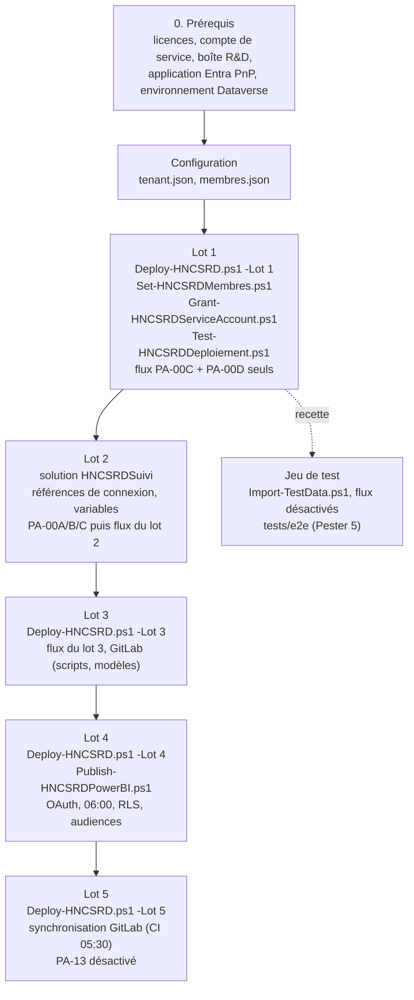

# Guide d'installation : Système de suivi R&D HNCS

> Public : administrateur Microsoft 365 / IT. Installation de bout en bout sur un tenant Microsoft 365, lot par lot
> (spec [11](../spec.md#11-découpage-en-lots-0-à-5)). La spécification [`spec.md`](../spec.md) (**v1.7.0**) fait foi en cas d'écart ; ce guide ne fait
> qu'enchaîner les commandes des scripts livrés (`provisioning/`, `flows/`, `powerbi/`, `gitlab/`, `testdata/`,
> `tests/`), avec leurs paramètres réels.
>
> Règles d'usage :
>
> - commandes données pour **PowerShell 7.4+** (`pwsh`), lancées **depuis la racine du dépôt** ;
> - toujours installer d'abord sur un **site de recette** (URL contenant `recette`, `test`, `qualif` ou `dev`), puis
>   rejouer à l'identique en production avec une autre configuration ;
> - toujours simuler avec `-WhatIf` avant une écriture ;
> - exploitation courante, reprise d'erreurs et procédure manuelle du lot 1 : [`docs/exploitation.md`](exploitation.md) ;
>   architecture : [`docs/architecture.md`](architecture.md).

## Sommaire

1. Vue d'ensemble et ordre d'installation
2. Prérequis : licences, comptes, ressources, outils
3. Préparation de la configuration (`tenant.json`, `membres.json`)
4. Lot 1 : Socle SharePoint, membres, contrôle, PA-00C / PA-00D
5. Lot 2 : Solution de flux et automatisations prioritaires
6. Lot 3 : Suivi opérationnel complet et outillage GitLab
7. Lot 4 : Power BI
8. Lot 5 : Synchronisation GitLab et conservation
9. Jeu de test et tests de bout en bout (recette)
10. Rejouabilité : que se passe-t-il si je relance ?
11. Retour arrière
12. Check-list de recette (S-01 à S-15)
13. Prise en main par rôle
14. Points ouverts connus à la date de ce guide

---

## 1. Vue d'ensemble et ordre d'installation



| Lot | Ce qui est installé (spec [11](../spec.md#11-découpage-en-lots-0-à-5)) | Condition de sortie ([11](../spec.md#11-découpage-en-lots-0-à-5)) | Section |
| --- | --- | --- | --- |
| 0 : Cadrage | Rien sur le tenant : contrôle du modèle et de la configuration (`-Lot 0`) | Accord des responsables métier et administratifs sur [13](../spec.md#13-hypothèses-et-décisions-à-confirmer) | 3 |
| 1 : Socle SharePoint | Site, groupes, niveau CSS, listes et bibliothèques de lot 1, vues, validations, index, permissions, référentiels ; flux **PA-00C et PA-00D** ; procédure manuelle de partage (H-50) | Scénarios de bout en bout testés, y compris les droits d'accès | 4 |
| 2 : Automatisations prioritaires | PA-00A, PA-00B, PA-00E, PA-00F, PA-01a/b, PA-02/02b, PA-03/03b, PA-04/04b, PA-05, PA-06, PA-07/07b | Tests réussis, journal d'erreurs opérationnel, **responsable support désigné** | 5 |
| 3 : Suivi opérationnel complet | Listes de lot 3 ; PA-08, PA-09, PA-10, PA-11, PA-12, PA-14 ; `gitlab/scripts`, `gitlab/templates` | Validation par la R&D, les référents et les acteurs support | 6 |
| 4 : Power BI | Liste `Mobilisations` ; `powerbi/` | Réconciliation des indicateurs et validation des droits | 7 |
| 5 : Stabilisation | `GitlabSync`, `gitlab/sync`, `gitlab/ci` ; PA-13 (désactivé) ; `docs/exploitation.md` | Responsables, procédure de support et backlog établis | 8 |

Le déploiement SharePoint est **cumulatif** : `-Lot n` déploie tous les objets de lot ≤ n. La liste
`TransitionsStatuts` est toujours synchronisée **en entier**, quel que soit le lot (les lignes d'objets non encore
déployés sont inertes). Il n'existe aucun objet SharePoint propre au lot 2 : `-Lot 2` équivaut à `-Lot 1`.

---

## 2. Prérequis

### 2.1 Licences (H-15, H-16)

| Besoin | Exigence | Référence |
| --- | --- | --- |
| Utilisateurs métier | Licence Microsoft 365 donnant accès à SharePoint, Outlook et Teams | [2](../spec.md#2-architecture-et-conventions-de-nommage) |
| Flux | Power Automate inclus dans Microsoft 365, **connecteurs standard uniquement** : SharePoint, Office 365 Outlook, Office 365 Users, Microsoft Teams. Aucun connecteur premium (HTTP, Dataverse premium, API tierces) sans validation budgétaire | P-08, H-15 |
| Compte de service | Licence Microsoft 365 avec Power Automate (connecteurs standard) et messagerie | H-13 |
| Solution de flux | Environnement Power Platform **avec Dataverse** (celui de l'environnement par défaut est accepté). Sans Dataverse : mode « import de package hérité » flux par flux, connexions à réassocier à la main | H-15, [8.1](../spec.md#81-socle-commun-sapplique-à-tous-les-flux) |
| Rapport | **Power BI Pro** pour les publics du rapport ; selon la configuration du tenant, les API de définition d'éléments Fabric utilisées par le script peuvent exiger un espace sur capacité (Fabric, Premium ou PPU) ; à défaut, publication manuelle depuis Desktop | H-15, H-16, `powerbi/README.md`, section 7 |
| GitLab | Instance existante ; les labels à portée `rd::…::…` ne sont exclusifs qu'avec GitLab Premium (sans effet sur les scripts) | [10.2](../spec.md#102-conventions-gitlab) |

Les alternants n'ont aucun accès au rapport Power BI (H-19) : aucune licence Power BI n'est nécessaire pour eux.

### 2.2 Comptes et ressources à créer avant le lot 1

| # | Ressource | Détail | Réf. |
| --- | --- | --- | --- |
| C1 | **Compte de service** `svc-hncs-rd@<domaine>` | Licencié (2.1) ; mot de passe sans expiration **ou** procédure de renouvellement ; MFA / accès conditionnel compatibles avec des connexions de flux ; droit **« Envoyer en tant que »** sur la boîte partagée R&D (C2) ; membre **direct** de `HNCS-RD-Proprietaires` (posé par `Set-HNCSRDMembres.ps1`, contrôlé par `Grant-HNCSRDServiceAccount.ps1`). Toutes les connexions des flux utilisent ce compte, propriétaire des flux | H-13, H-14, [8.1](../spec.md#81-socle-commun-sapplique-à-tous-les-flux) |
| C2 | **Boîte partagée R&D** (ex. `rd@<domaine>`) | Expéditeur de toutes les notifications (`Destinataires.BoiteRD`) ; dossier **`Candidatures`** surveillé par PA-01b ; les règles Outlook qui y déposent les courriels (formulaire du site balisé `[CANDIDATURE-SITE]`, notifications LinkedIn / France Travail) sont définies par la R&D ; la rétention de cette boîte est hors périmètre | [8.1](../spec.md#81-socle-commun-sapplique-à-tous-les-flux), PA-01b, H-04, H-10 |
| C3 | **Application Entra pour PnP.PowerShell** (obligatoire : l'application multi-tenant PnP n'existe plus) | `Register-PnPEntraIDAppForInteractiveLogin -ApplicationName "HNCS-RD Provisioning" -Tenant <tenant>.onmicrosoft.com`, puis reporter l'identifiant dans `PnPClientId`. Permissions déléguées SharePoint `AllSites.FullControl` ; pour l'étape `Teams`, Microsoft Graph `Group.ReadWrite.All`, `Channel.Create`, `TeamsTab.Create`. Mode automatisation : certificat de l'application et permissions **d'application** équivalentes | `provisioning/README.md` |
| C4 | **Comptes d'administration** | Administrateur SharePoint (création du site via `TenantAdminUrl`) et **administrateur de collection de sites** HNCS-RD (le compte exécutant doit être `SiteOwner` ou administrateur de collection : la rupture d'héritage retire toute attribution directe non prévue) | `provisioning/README.md` |
| C5 | **Environnement Power Platform avec Dataverse** | Un environnement de recette et un de production (ou l'environnement par défaut) pour la solution `HNCSRDSuivi` | [8.1](../spec.md#81-socle-commun-sapplique-à-tous-les-flux), H-15 |
| C6 | **Espace Power BI** « HNCS-R&D Pilotage » | Créé par le script de publication s'il n'existe pas (`-CapacityId` facultatif) | [9.1](../spec.md#91-projet), H-16 |
| C7 | **GitLab** (lots 3 et 5) | Groupe `hncs-rd` (le script ne crée aucun groupe) ; jetons et application Entra : section 8 | [10](../spec.md#10-intégration-gitlab-et-infrastructure) |
| C8 | **Comptes de recette** | Un compte de test par persona de `testdata/personas.sample.json` (site de recette uniquement) | [12](../spec.md#12-stratégie-de-test-et-critères-dacceptation), `testdata/README.md` |
| C9 | **Adresses fonctionnelles** | Administration (`Destinataires.Administration`, Carine, H-05), Direction R&D, Direction Générale, **support des flux** (destinataire de N-99 / N-98) | `specs/referentiels-initiaux.md` |

### 2.3 Outils du poste d'installation

| Outil | Version | Usage |
| --- | --- | --- |
| PowerShell | **7.4+** (`pwsh`), vérifiée par les scripts de `provisioning/` ; fichiers analysables par Windows PowerShell 5.1 | provisionnement, jeu de test, tests E2E |
| PnP.PowerShell | **2.12+** (ou 3.x) : `Install-Module PnP.PowerShell -Scope CurrentUser` | SharePoint |
| Python | 3.12, bibliothèque standard uniquement | `tools/spec_extract.py`, `tests/offline`, génération et construction des flux, Power BI, synchronisation GitLab, réconciliation |
| Power Platform CLI (`pac`) | - | import de la solution (`pac solution import --settings-file`, encapsulé par `flows/deploy/Import-HNCSRDFlows.ps1`) |
| Pester | **5.5+** : `Install-Module Pester -MinimumVersion 5.5.0 -Scope CurrentUser` | `tests/e2e/*.Tests.ps1` |
| Az.Accounts (défaut) ou MicrosoftPowerBIMgmt | - | jeton de publication Power BI (`-Auth Az` / `-Auth PowerBIMgmt`) |
| Power BI Desktop | 2025 ou ultérieur (PBIP, TMDL, PBIR) | facultatif : contrôle ou publication manuelle |

### 2.4 Vérifier le dépôt avant toute installation

```powershell
python tools/spec_extract.py --check                 # le modèle généré est à jour de la spec
python -m unittest discover -s tests/offline -v      # cohérence spec / scripts / flux / Power BI / jeu de test
python flows/tools/check_flows.py                    # contrat des flux (code 0 attendu)
python flows/build/build_solution.py --check         # la solution se construit (aucun fichier écrit)
python powerbi/tools/check_pbip.py                   # « 0 erreur(s) » attendu
python -m unittest discover -s gitlab/sync/tests -v  # synchronisation GitLab
```

Ce sont les contrôles de la CI GitHub (`.github/workflows/ci.yml`), qui analyse aussi tous les scripts PowerShell
avec les parseurs 5.1 et 7. N'installer qu'un commit dont la CI est verte.

---

## 3. Préparation de la configuration

### 3.1 Copier les modèles

```powershell
Copy-Item provisioning/config/tenant.sample.json  provisioning/config/tenant.json
Copy-Item provisioning/config/membres.sample.json provisioning/config/membres.json
```

`tenant.json`, `membres.json`, `testdata/personas.json`, `tests/e2e/config.json` et `provisioning/logs/` sont
**ignorés par git** (ils contiennent des adresses réelles) : ne jamais les committer, car le dépôt est public (H-30).
Prévoir **un jeu de fichiers par environnement** (recette, production).

### 3.2 `tenant.json`

| Clé | Contenu | Utilisée par |
| --- | --- | --- |
| `TenantName` | nom court du tenant (`contoso`) ; `<TenantName>.onmicrosoft.com` sert de `-Tenant` en mode certificat | connexion PnP |
| `TenantAdminUrl` | `https://<tenant>-admin.sharepoint.com` | étape `Site` |
| `SiteUrl` | `https://<tenant>.sharepoint.com/sites/HNCS-RD` (recette : URL avec un marqueur de recette) | tous les scripts |
| `SiteOwner` | propriétaire du site créé | étape `Site` |
| `PnPClientId` | identifiant de l'application Entra C3 | connexion PnP |
| `CertificatePath` / `CertificateThumbprint` | facultatifs : mode certificat (mot de passe du `.pfx` dans `-CertificatePassword` ou la variable d'environnement `HNCSRD_CERT_PASSWORD`) ; vides = connexion interactive | connexion PnP |
| `ServiceAccountEmail` | compte de service C1 | membres, contrôle du compte de service |
| `Parametres.BoiteRD`, `EmailAdministration`, `EmailDirectionRD`, `EmailDirection`, `EmailSupport` | remplacent les marqueurs `<BoiteRD>`, `<EmailAdministration>`… des paramètres métier (`Destinataires.*`) ; `<EmailDirectionRD>` est aussi le propriétaire des modèles initiaux du registre | étape `Referentiels` |
| `Parametres.UrlRapportPowerBI` | lien de l'application Power BI → `Lien.RapportPowerBI` ; **laisser vide jusqu'au lot 4** | étape `Referentiels` |
| `Parametres.UrlCanalTeamsComite` | lien du canal Teams « Comité R&D » → `Lien.CanalComite` ; peut rester vide tant que le canal n'existe pas | étape `Referentiels` |
| `Teams.Creer`, `Teams.NomEquipe` | `true` pour créer l'équipe « HNCS R&D » distincte (canaux Général, Comité R&D, Alternants ; ses fichiers ne sont pas la référence, H-44) | étape `Teams` |

Une valeur de paramètre **vide** est complétée dès qu'une exécution ultérieure de l'étape `Referentiels` trouve la
valeur dans la configuration ; une valeur **non vide** n'est jamais écrasée (section 10).

### 3.3 `membres.json`

Clés = codes de groupe (`G_PROP`, `G_DRD`, `G_RD`, `G_ADM`, `G_REF`, `G_ALT`, `G_DIR`, `G_ECO`) ; valeurs = listes
d'UPN de **comptes utilisateurs** (un groupe Entra ou SharePoint présent dans le fichier est refusé, H-14). Une clé
absente laisse le groupe inchangé. Le compte de service est toujours ajouté à `G_PROP`, même absent du fichier.
Une même personne peut figurer dans plusieurs groupes (ex. Direction R&D dans `G_DRD` et `G_RD`, [7.1](../spec.md#71-groupes-sharepoint)).

| Code | Groupe SharePoint | Membres cibles ([7.1](../spec.md#71-groupes-sharepoint)) |
| --- | --- | --- |
| G_PROP | HNCS-RD-Proprietaires | Administrateurs M365 / IT, compte de service |
| G_DRD | HNCS-RD-DirectionRD | Direction R&D |
| G_RD | HNCS-RD-EquipeRD | Équipe R&D |
| G_ADM | HNCS-RD-Administration | Carine et l'équipe administrative habilitée |
| G_REF | HNCS-RD-Referents | Experts référents de pôle |
| G_ALT | HNCS-RD-Alternants | Alternants et stagiaires actifs |
| G_DIR | HNCS-RD-Direction | Direction Générale |
| G_ECO | HNCS-RD-RelationEcoles | Responsables de la relation école (pôle 4) et membres R&D qui la préparent (H-43) |

En recette, `membres.json` est généré depuis les personas (section 9).

### 3.4 Contrôle sans écriture (lot 0)

```powershell
pwsh ./provisioning/Deploy-HNCSRD.ps1 -ConfigPath ./provisioning/config/tenant.json -Lot 0
```

Vérifie PowerShell, PnP.PowerShell, le modèle et la configuration, sans se connecter au tenant.

---

## 4. Lot 1 : Socle SharePoint

### 4.1 Déploiement

```powershell
pwsh ./provisioning/Deploy-HNCSRD.ps1 -ConfigPath ./provisioning/config/tenant.json -Lot 1 -WhatIf   # « Simule » partout
pwsh ./provisioning/Deploy-HNCSRD.ps1 -ConfigPath ./provisioning/config/tenant.json -Lot 1
```

Étapes, toujours exécutées dans cet ordre (filtrables par `-Etapes`, voir 10) : `Site`, `NiveauxAutorisation`,
`Groupes`, `Listes`, `Colonnes`, `Lookups`, `Validation`, `Vues`, `Permissions`, `Referentiels`, `Transitions`,
`Navigation`, `Teams`.

Résultat attendu :

- site d'équipe « HNCS-R&D » **sans groupe Microsoft 365** (`STS#3`), français (1036), fuseau Paris ; s'il existe
  déjà, il n'est pas modifié ; un site **dans la corbeille** du tenant provoque une erreur ;
- niveau « HNCS - Contribution sans suppression » (permissions de `Contributor` sans `DeleteListItems` ni `DeleteVersions`) ;
- les 8 groupes `HNCS-RD-*`, propriétaire `HNCS-RD-Proprietaires`, sans membres ;
- listes et bibliothèques de lot 1 (URL = nom interne), versioning, colonnes, colonnes de recherche affichant
  `IdHNCS`, règles de validation, vues de `specs/sharepoint-vues.md` ;
- héritage rompu sur **toutes** les listes et bibliothèques du modèle, attributions = matrice [7.3](../spec.md#73-matrice-daccès) ; site : G_PROP
  Contrôle total, autres groupes Lecture ; groupes par défaut du site vidés et sans attribution (jamais supprimés) ;
  listes système (« Documents », « Pages du site »…) laissées en héritage : elles ne doivent contenir **aucune
  donnée métier** ([7.2](../spec.md#72-niveaux-dautorisation)) ;
- référentiels initiaux (`specs/referentiels-initiaux.md`) : paramètres, pôles, domaines cibles, modèles de
  checklists, registre de modèles ; `TransitionsStatuts` complète ; navigation par domaine ;
- équipe Teams si `Teams.Creer` = true.

Journal : `provisioning/logs/deploy-<horodatage>.log`, résumé par étape (créé / mis à jour / inchangé / retiré /
simulé / avertissements / erreurs). **Code de sortie 1 si au moins une erreur.**

### 4.2 Membres et compte de service

```powershell
pwsh ./provisioning/Set-HNCSRDMembres.ps1 -ConfigPath ./provisioning/config/tenant.json -MembresPath ./provisioning/config/membres.json -WhatIf
pwsh ./provisioning/Set-HNCSRDMembres.ps1 -ConfigPath ./provisioning/config/tenant.json -MembresPath ./provisioning/config/membres.json
pwsh ./provisioning/Grant-HNCSRDServiceAccount.ps1 -ConfigPath ./provisioning/config/tenant.json -Lot 1
```

- Les membres sont ajoutés **directement** dans les groupes SharePoint (H-14), condition de la vérification des
  rôles par PA-00A (API REST `sitegroups/getbyname`).
- `Grant-HNCSRDServiceAccount.ps1` est en lecture seule : il vérifie que le compte de service existe, qu'il est
  membre direct de G_PROP et qu'il dispose de `ManagePermissions`, `AddListItems`, `EditListItems`,
  `DeleteListItems`, `ViewListItems` sur le site et chaque liste du lot. `-Corriger` l'ajoute à G_PROP (aucun autre
  droit n'est accordé).
- Le script rappelle les vérifications **impossibles par PnP**, à faire à la main : licence Power Automate du compte,
  « Envoyer en tant que » sur la boîte R&D, politique MFA / accès conditionnel, renouvellement du mot de passe.

### 4.3 Contrôle post-déploiement

```powershell
pwsh ./provisioning/Test-HNCSRDDeploiement.ps1 -ConfigPath ./provisioning/config/tenant.json -Lot 1 -RapportPath ./provisioning/logs/ecarts.json
```

Lecture seule. Compare le site au modèle : site, niveau CSS, groupes (propriétaire, membres non directs signalés),
groupes par défaut vides, attributions du site, listes (URL, titre, versioning, héritage rompu, attributions),
colonnes, validations, vues, paramètres (marqueurs `<…>` non résolus), seeds, doublons d'`IdHNCS` non vides,
`TransitionsStatuts`. **Code 0 exigé** (le code 1 signale au moins un écart de gravité « Erreur » ; les
avertissements sont à lire).

### 4.4 Validation des paramètres

Les valeurs initiales de la liste **Paramètres** sont des **propositions** (H-22) à faire valider par la Direction
R&D, qui les ajuste ensuite directement dans la liste (droits CSS de G_DRD) ; elles ne seront plus écrasées. Laisser :

- `Fonction.AccuseReceptionActif` et `Fonction.InformationCandidatAuto` à **Non** tant que les messages au candidat et
  l'information RGPD ne sont pas validés (H-09) ;
- `Conservation.CandidatureNonRetenueMois` **vide** (H-10) ;
- `Fonction.RepriseExistantActive` à Non hors période de reprise de l'existant (H-12) ;
- `Recrutement.PartageTransmission` à `Groupe` sauf décision contraire (H-45).

### 4.5 Flux du lot 1 : PA-00C et PA-00D seuls

Le lot 1 n'automatise que la journalisation (PA-00C) et l'attribution horaire des identifiants manquants (PA-00D),
pour que les colonnes de recherche, qui affichent `IdHNCS`, soient utilisables en saisie manuelle. Ils sont livrés
dans la solution `HNCSRDSuivi` : appliquer les sections **5.1 et 5.2**, importer **sans activation**, puis activer à
la main PA-00C, puis PA-00D :

```powershell
pwsh ./flows/deploy/Import-HNCSRDFlows.ps1 -EnvironmentUrl https://<org>.crm4.dynamics.com -SettingsFile <chemin>/deploymentSettings.json -Build -SkipActivation
```

Sans `-SkipActivation`, le script activerait **tous** les flux marqués « activés par défaut » (lots 2 et 3 compris,
voir 5.3). Le fichier de paramètres doit être complet dès le lot 1 (les quatre connexions et les cinq variables) :
le script refuse un fichier incomplet. Vérifier ensuite dans l'environnement que seuls PA-00C et PA-00D sont actifs.

Contrôle : créer un élément de test dans « Offres » → `IdHNCS` au format `OFF-AAAA-NNNN` en moins d'une heure (ou
après « Exécuter » manuel de PA-00D) ; `JournalFlux` contient l'entrée Info de PA-00D.

### 4.6 Procédure manuelle provisoire

Tant que les flux du lot 2 ne sont pas actifs, les contrôles automatiques P-01 à P-03 et P-09 ne sont **pas**
effectifs (H-50) : les partages par élément (transmission à l'administration), la création des dossiers de suivi et,
au besoin, l'attribution des identifiants sont faits à la main par G_PROP selon
[`docs/exploitation.md`, section 5](exploitation.md#5-procédure-manuelle-provisoire-du-lot-1-h-50). Le consigner dans le
procès-verbal de recette du lot 1 (scénario S-25).

---

## 5. Lot 2 : Solution de flux et automatisations prioritaires

### 5.1 Construction de la solution

```powershell
python flows/tools/generate_flows.py --check     # flows/src, manifest.json, docs à jour de la spec
python flows/tools/check_flows.py                # contrat des flux (0 erreur)
python flows/build/build_solution.py --check     # validation sans écriture
python flows/build/build_solution.py             # écrit flows/dist/HNCSRDSuivi_<specVersion>.zip et flows/dist/workflows.json
```

Le zip (`flows/dist/` est ignoré par git) contient la solution **non gérée** `HNCSRDSuivi` (éditeur et préfixe
`hncs`, version = version de la spec sur 4 nombres, ex. `1.5.0.0`) : les 33 définitions techniques (un flux
SharePoint n'écoute qu'une liste : PA-03, PA-04, PA-09, PA-10 sont livrés en plusieurs définitions `-cand`, `-ent`,
`-alt`, `-act`, `-bil`, `-conv`, `-int`), les références de connexion et les variables d'environnement ci-dessous.
`workflows.json` est le catalogue utilisé par le script d'import pour l'activation. Fiches de chaque flux :
`flows/docs/PA-xx.md` ; architecture des flux : [`flows/README.md`](../flows/README.md).

| Référence de connexion | Connecteur |
| --- | --- |
| `hncs_sharepoint` | SharePoint |
| `hncs_outlook` | Office 365 Outlook |
| `hncs_teams` | Microsoft Teams |
| `hncs_o365users` | Office 365 Utilisateurs |

| Variable d'environnement | Valeur |
| --- | --- |
| `hncs_SiteUrl` | URL du site, **sans barre finale** (= `SiteUrl`) |
| `hncs_ServiceAccountEmail` | adresse du compte de service (= `ServiceAccountEmail`) : anti-boucle et rôle `FLUX` |
| `hncs_SupportEmail` | adresse du support, destinataire de N-99 et N-98 (même adresse que `EmailSupport` / `Destinataires.Support`) |
| `hncs_BoiteRDEmail` | adresse de la boîte partagée surveillée par PA-01b ; **même valeur** que `Destinataires.BoiteRD` ([8.1](../spec.md#81-socle-commun-sapplique-à-tous-les-flux)) |
| `hncs_BoiteRDDossierCandidatures` | identifiant du dossier « Candidatures » de cette boîte (le déclencheur de boîte partagée exige une adresse et un dossier fixés au déploiement) |

### 5.2 Connexions et fichier de paramètres de déploiement

1. Dans l'environnement cible, **en étant connecté avec le compte de service**, créer une connexion pour chacun des
   quatre connecteurs (SharePoint, Office 365 Outlook, Microsoft Teams, Office 365 Utilisateurs).
2. Copier `flows/deploy/deploymentSettings.sample.json` (format `pac solution create-settings`) et renseigner
   `EnvironmentVariables[].Value` pour les cinq variables et `ConnectionReferences[].ConnectionId` pour les quatre
   références. Le script refuse toute valeur vide ou commençant par `<`.
3. Ce fichier contient des adresses réelles et des identifiants de connexion : le conserver **hors du dépôt**. Le
   chemin par défaut du script, `flows/deploy/deploymentSettings.json`, n'est pas couvert par `.gitignore` à la date
   de ce guide : ne jamais le committer (dépôt public, H-30).

### 5.3 Import

```powershell
Connect-AzAccount    # facultatif : nécessaire à l'activation automatique et au partage des flux enfants
pwsh ./flows/deploy/Import-HNCSRDFlows.ps1 -EnvironmentUrl https://<org>.crm4.dynamics.com -SettingsFile <chemin>/deploymentSettings.json -Build -WhatIf
pwsh ./flows/deploy/Import-HNCSRDFlows.ps1 -EnvironmentUrl https://<org>.crm4.dynamics.com -SettingsFile <chemin>/deploymentSettings.json -Build -SkipActivation
```

`Import-HNCSRDFlows.ps1` : (option `-Build`) construit la solution ; sélectionne (`-AuthProfile <nom>`) ou crée
(`pac auth create --environment`) le profil `pac` ; importe le zip (`-SolutionZip`, par défaut
`flows/dist/HNCSRDSuivi_<specVersion>.zip`) par `pac solution import --settings-file … --publish-changes --async` ;
puis, sauf `-SkipActivation`, active par l'API Web Dataverse (jeton `Get-AzAccessToken`, module Az.Accounts)
**PA-00A, PA-00B, PA-00C d'abord, puis tous les autres flux activés par défaut** ; PA-13 reste désactivé.
`-ShareWith <adresses>` partage en lecture les flux enfants avec les comptes indiqués. Sans Az.Accounts connecté,
l'import est fait et le script affiche l'ordre d'activation à appliquer à la main.

L'activation automatique ne tient **pas compte du lot** : elle active aussi les flux du lot 3, qui écoutent des
listes inexistantes avant `-Lot 3`. Avant le lot 3, importer avec `-SkipActivation` et activer à la main (5.4) ;
l'activation automatique ne convient qu'une fois le lot 3 déployé.

Sans Dataverse (H-15) : importer chaque flux comme package hérité et réassocier les connexions à la main.

### 5.4 Activation, dans l'ordre

Le propriétaire de chaque flux et l'identité de chaque connexion doivent être le **compte de service** (H-13).

| Ordre | Flux | Lot | Remarque |
| --- | --- | --- | --- |
| 1 | PA-00C (journalisation), PA-00D (identifiants, puis initialisation des empreintes) | 1 | seuls flux actifs au lot 1 |
| 2 | **PA-00A**, **PA-00B** (flux enfants) | 2 | à activer **avant** tout flux parent : les parents échouent tant que leurs enfants sont inactifs |
| 3 | PA-00E (supervision 07:30), PA-00F (droits des propriétaires de modèles) | 2 | |
| 4 | PA-01a, PA-01b, PA-02, PA-02b, PA-03-ent, PA-03-cand, PA-03b, PA-04-cand, PA-04-alt, PA-04-act, PA-04b, PA-05, PA-06, PA-07, PA-07b | 2 | |
| 5 | PA-08, PA-08b, PA-09-alt, PA-09-bil, PA-09b, PA-10-conv, PA-10-int, PA-10b, PA-11, PA-12, PA-14 | 3 | seulement après `-Lot 3` (section 6) |
| - | **PA-13** | 5 | reste **désactivé** (H-10, section 8.3) |

À partir du lot 2, PA-00D initialise chaque heure les empreintes vides ([6.5](../spec.md#65-formats-des-empreintes-p-09)) des éléments existants : tant qu'une
empreinte n'est pas initialisée, une première modification non autorisée d'un champ protégé serait acceptée comme
valeur initiale (H-55). Lancer PA-00D à la main (« Exécuter ») juste après l'activation des flux du lot 2.

> **Avant d'activer les flux du lot 2 sur un site déjà utilisé au lot 1** : depuis la spec v1.6.0 ([8.1](../spec.md#81-socle-commun-sapplique-à-tous-les-flux)), le
> statut validé de référence d'un élément est la **dernière transition acceptée de `HistoriqueStatuts`** (à défaut
> d'historique : création, `∅`) ; `StatutPrecedent` n'est plus qu'une copie de commodité pour les vues, et PA-00E
> rapproche chaque jour les statuts de cet historique. Un élément saisi à la main au lot 1 n'a **aucun** historique
> (aucun flux ne l'a écrit) : à sa prochaine modification, ou au rapprochement quotidien, il serait traité comme une
> création (`∅` → statut courant) et, si cette transition n'existe pas, refusé ; pour une création refusée, l'élément
> part à la corbeille ([6.1, point 3 bis](../spec.md#61-règles-générales)). Aucun script livré ne crée d'historique d'amorçage, et `HistoriqueStatuts` ne
> doit être écrit que par le compte de service (P-09) : ne **pas** le compléter à la main, ni modifier
> `StatutPrecedent` (colonne technique, rétablie). **Point ouvert O-4** (section 14) : ne pas activer les flux du
> lot 2 sur des données saisies au lot 1 tant qu'il n'est pas tranché.

### 5.5 Contrôles après activation

- chaque déclencheur SharePoint porte la condition anti-boucle sur `hncs_ServiceAccountEmail` ([8.1](../spec.md#81-socle-commun-sapplique-à-tous-les-flux) ; vérifiée hors
  ligne par `check_flows.py`) ;
- une candidature de test créée par un membre de G_RD reçoit son `IdHNCS` (PA-01a), son dossier
  `01 - Recrutement/AAAA/CAND-…` et une entrée « Acceptée » dans « Historique des statuts » ;
- un changement de statut interdit est rétabli et notifié (N-90), visible dans la vue « Transitions refusées » ;
- la vue « Erreurs à reprendre » de « Journal des flux » est vide ;
- les courriels partent de la boîte R&D, objet `[HNCS-R&D][N-xx] …`, sans pièce jointe.

### 5.6 Désigner le support

Condition de sortie du lot 2 : responsable support désigné, propriétaires métier des flux nommés (H-46), procédure
de reprise connue ([`docs/exploitation.md`, section 3](exploitation.md#3-supervision) et [section 4](exploitation.md#4-procédure-de-reprise-dune-erreur-de-flux)).

---

## 6. Lot 3 : Suivi opérationnel complet

### 6.1 SharePoint

```powershell
pwsh ./provisioning/Deploy-HNCSRD.ps1 -ConfigPath ./provisioning/config/tenant.json -Lot 3 -WhatIf
pwsh ./provisioning/Deploy-HNCSRD.ps1 -ConfigPath ./provisioning/config/tenant.json -Lot 3
pwsh ./provisioning/Grant-HNCSRDServiceAccount.ps1 -ConfigPath ./provisioning/config/tenant.json -Lot 3
pwsh ./provisioning/Test-HNCSRDDeploiement.ps1 -ConfigPath ./provisioning/config/tenant.json -Lot 3 -RapportPath ./provisioning/logs/ecarts-lot3.json
```

Ajoute `Conventions`, `InteractionsEcoles`, `BilansAlternance`, `ComptesRendus`, `CommunicationsRD`,
`RessourcesTechniques` et les colonnes portant `lot=3` (ex. `EcolesPartenariats.Convention`).

### 6.2 Flux

Activer les flux de l'ordre 5 du tableau 5.4 (à partir de ce lot, `Import-HNCSRDFlows.ps1` sans `-SkipActivation`
active tous les flux dans le bon ordre, PA-13 excepté). PA-05 crée alors le premier compte rendu « Attendu » à l'activation
d'une affectation (cadence ≠ « Par jalon »).

### 6.3 GitLab : modèles et création de projet à la demande

Suivre [`gitlab/README.md`](../gitlab/README.md), section « Mise en place » :

1. créer le groupe `hncs-rd` (et, si souhaité, les sous-groupes de pôle) ;
2. la création d'un projet de sujet est lancée **par un membre de l'équipe R&D**, à la demande du référent, avec un
   jeton **personnel** de portée `api` saisi pour la session et jamais stocké ([10.3](../spec.md#103-composants-livrés)) :

```powershell
$env:GITLAB_URL   = 'https://gitlab.example.com'
$env:GITLAB_TOKEN = Read-Host 'Jeton GitLab (portée api)' -MaskInput
./gitlab/scripts/New-GitlabProjetSujet.ps1 -IdSujet SUJ-2026-0003 -SousGroupe p2-strategie -DeposerModeles -WhatIf
./gitlab/scripts/New-GitlabProjetSujet.ps1 -IdSujet SUJ-2026-0003 -SousGroupe p2-strategie -DeposerModeles
Remove-Item Env:GITLAB_TOKEN
```

Paramètres : `-IdSujet` (obligatoire), `-SiteUrl`, `-GitlabUrl`, `-Groupe` (défaut `hncs-rd`), `-SousGroupe`, `-Slug`,
`-Visibilite` (`private` par défaut ou `internal`), `-ExclureLivrable LIV-…`, `-DeposerModeles`, `-ClientId`,
`-ConfigPath`, `-WhatIf`. Le script se connecte à SharePoint par le module de provisioning si
`provisioning/config/tenant.json` existe. Il ne modifie jamais un jalon existant et ne reporte que `GitlabProjetUrl`
et `GitlabProjetId` sur le sujet.

---

## 7. Lot 4 : Power BI

### 7.1 SharePoint

```powershell
pwsh ./provisioning/Deploy-HNCSRD.ps1 -ConfigPath ./provisioning/config/tenant.json -Lot 4
pwsh ./provisioning/Test-HNCSRDDeploiement.ps1 -ConfigPath ./provisioning/config/tenant.json -Lot 4
```

Ajoute `Mobilisations`. Le modèle importe aussi les listes du lot 3 : **toute liste absente** (hors `GitlabSync`,
facultative) fait échouer l'actualisation. Le lot 3 doit donc être déployé.

### 7.2 Publication

```powershell
# Préparation à blanc (aucun appel d'API) : définitions écrites dans ./out
pwsh ./powerbi/deploy/Publish-HNCSRDPowerBI.ps1 -SiteUrl https://<tenant>.sharepoint.com/sites/HNCS-RD -PreparationSeule -DossierSortie ./out
# Publication + actualisation + planification 06:00
pwsh ./powerbi/deploy/Publish-HNCSRDPowerBI.ps1 -SiteUrl https://<tenant>.sharepoint.com/sites/HNCS-RD -ConfigurerPlanification
```

Paramètres : `-SiteUrl` (obligatoire, `https://<…>.sharepoint.com/sites/<…>`), `-WorkspaceName` (défaut
« HNCS-R&D Pilotage »), `-CapacityId`, `-ModelName` / `-ReportName` (défaut `HNCS-RD`), `-Auth Az|PowerBIMgmt|Token`
(+ `-AccessToken`), `-SkipRefresh`, `-ConfigurerPlanification`, `-PreparationSeule`, `-DossierSortie`, `-WhatIf`.
Le script crée l'espace s'il n'existe pas, crée ou met à jour (`updateDefinition`) le modèle et le rapport, injecte
`SiteUrl` à l'envoi (le fichier local n'est pas modifié) et relie le rapport au modèle publié. Alternative : ouvrir
`powerbi/HNCS-RD.pbip` dans Desktop, renseigner `SiteUrl`, actualiser, *Fichier > Publier*.

### 7.3 Étapes manuelles dans le service (après la première publication)

1. **Identifiants** : *Paramètres du modèle > Informations d'identification de la source de données > Web (SiteUrl)
   > Modifier* : **OAuth2, compte de service**, confidentialité « Organisationnel » (H-16). Sans cette étape,
   l'actualisation échoue.
2. **Actualisation planifiée** quotidienne à **06:00** (Romance Standard Time), notification en cas d'échec : si
   `-ConfigurerPlanification` n'a pas pu l'appliquer (il exige des identifiants valides).
3. **Rôles RLS / OLS** (*Modèle sémantique > Sécurité*) : affecter les groupes Entra ou personnes à `Direction`
   (Direction Générale), `PilotageRD` (Direction R&D, équipe R&D), `Administration`, `RelationEcoles` (G_ECO),
   `Referent`. `Alternants[NomAffichage]` est masquée par OLS aux rôles `Direction` et `RelationEcoles` ([9.6](../spec.md#96-sécurité-du-modèle-rls--ols)).
   **Une personne relève d'un seul rôle** (Power BI interdit le cumul d'un rôle avec OLS et d'un rôle avec RLS).
   Aucun rôle « Communication » ni « Avant-vente » (H-52) ; aucun alternant (H-19). Les membres ne sont pas
   versionnés : les tenir à jour selon [`docs/exploitation.md`, section 6.2](exploitation.md#62-power-bi--rôles-lecteurs-et-audiences-de-lapplication).
4. **Accès à l'espace** : les publics du rapport sont **Lecteurs** (les rôles Administrateur, Membre, Contributeur ne
   sont pas soumis à la RLS / OLS).
5. **Application et audiences** ([9.7](../spec.md#97-pages-du-rapport)) : publier l'application de l'espace avec une audience par public :
   Direction : pages 1, 3, 4, 5, 6 ; Administration : 2, 3, 5 ; RelationEcoles : 3, 5 ; Referent : 3, 4, 7 ;
   PilotageRD : toutes. Chaque membre d'une audience est affecté au rôle de même nom. Les audiences ne sont pas une
   mesure de sécurité (la sécurité reste la RLS / OLS).
6. **Lien dans les synthèses** : reporter le lien de l'application dans `tenant.json`
   (`Parametres.UrlRapportPowerBI`) puis compléter le paramètre `Lien.RapportPowerBI` resté vide :

```powershell
pwsh ./provisioning/Deploy-HNCSRD.ps1 -ConfigPath ./provisioning/config/tenant.json -Lot 4 -Etapes Referentiels
```

(si la Direction R&D a déjà saisi une valeur dans la liste, elle est conservée). Même procédure pour
`Lien.CanalComite` (`Parametres.UrlCanalTeamsComite`).

### 7.4 Contrôles

« Afficher en tant que » chaque rôle ; réconciliation des mesures (section 9.3, scénario S-09). Le rapport est en
lecture seule : aucune réécriture vers SharePoint.

---

## 8. Lot 5 : Synchronisation GitLab et conservation

### 8.1 SharePoint

```powershell
pwsh ./provisioning/Deploy-HNCSRD.ps1 -ConfigPath ./provisioning/config/tenant.json -Lot 5
pwsh ./provisioning/Test-HNCSRDDeploiement.ps1 -ConfigPath ./provisioning/config/tenant.json -Lot 5
```

Ajoute la liste technique `GitlabSync` (lue en mode facultatif par Power BI). Sa colonne `Orpheline` marque les
lignes dont le jalon a été supprimé ou le sujet détaché : conservées, exclues des indicateurs ([10.3](../spec.md#103-composants-livrés)).

### 8.2 Synchronisation GitLab → `GitlabSync` (lecture seule de GitLab)

Détail : [`gitlab/README.md`](../gitlab/README.md), section « Mise en place ».

1. **Jeton de groupe** `hncs-rd` : rôle Reporter, portée **`read_api`** seule, expiration ≤ 1 an, saisi directement
   dans la variable CI masquée `GITLAB_TOKEN`.
2. **Projet d'outillage** (ex. `hncs-rd/outillage-suivi-rd`) contenant une copie du dossier `gitlab/` et
   `gitlab/ci/.gitlab-ci.yml` placé à la racine sous le nom `.gitlab-ci.yml` ; branche `main` protégée.
3. **Application Entra** « HNCS-RD GitLab Sync » (comptes du tenant, sans URI de redirection), **une seule** permission
   d'application Microsoft Graph, avec consentement administrateur :
   - **recommandé** : `Lists.SelectedOperations.Selected`, octroyée en **écriture sur `GitlabSync`** et en
     **lecture sur `SujetsRD` et `Livrables`** (requêtes `POST /sites/{site-id}/lists/{list-id}/permissions` de
     `gitlab/README.md`) ; renseigner alors `HNCS_SITE_ID`, `HNCS_LISTE_ID_SUJETSRD`, `HNCS_LISTE_ID_LIVRABLES`,
     `HNCS_LISTE_ID_GITLABSYNC` (sinon le script s'arrête avec le code 2) ;
   - **repli** : `Sites.Selected` en **écriture sur tout le site** (`POST /sites/{site-id}/permissions` ou
     `Grant-PnPAzureADAppSitePermission -AppId <client-id> -DisplayName "HNCS-RD GitLab Sync" -Site <url du site> -Permissions Write`).
     L'application peut alors techniquement accéder à **tout** le site, CV compris ; la restriction à `GitlabSync`
     n'est garantie que par le code. **Ce risque doit être accepté explicitement par la DSI et la Direction R&D
     (H-31)** ; sans acceptation, la synchronisation (facultative) reste désactivée.
   - Aucune autre permission (ni `Sites.Read.All`, ni `Sites.ReadWrite.All`).
4. **Informations d'identification** : identité fédérée GitLab OIDC recommandée (aucun secret ; décommenter le bloc
   `id_tokens` du job, qui fournit `HNCS_CLIENT_ASSERTION`), sinon secret client de 6 à 12 mois dans
   `HNCS_CLIENT_SECRET` (masquée).
5. **Variables CI/CD** du projet d'outillage, toutes **protégées**, secrets **masqués** : `GITLAB_URL`, `GITLAB_TOKEN`,
   `HNCS_TENANT_ID`, `HNCS_CLIENT_ID`, `HNCS_CLIENT_SECRET` (sauf OIDC), `HNCS_SITE_URL`, `HNCS_SITE_ID`,
   `HNCS_LISTE_ID_SUJETSRD`, `HNCS_LISTE_ID_LIVRABLES`, `HNCS_LISTE_ID_GITLABSYNC` ; facultatives `HNCS_GRAPH_URL`,
   `HNCS_LOGIN_URL` (clouds souverains).
6. **Planification** : *CI/CD > Schedules* : intervalle `30 5 * * *`, fuseau **Europe/Paris**, branche `main`,
   variable `SCHEDULE_TYPE` = `gitlab-sync` (avant l'actualisation Power BI de 06:00).
7. **Simulation** : *Run pipeline* sur `main` avec `SYNC_DRY_RUN` = `1` (job `synchro-simulation`, aucune écriture).

Aucun secret dans SharePoint, dans `RessourcesTechniques` ni dans ce dépôt ([10.1](../spec.md#101-principes)).

### 8.3 Conservation des candidatures (PA-13)

PA-13 est livré **désactivé** et le reste tant que `Conservation.CandidatureNonRetenueMois` est vide (H-10). Il ne
fait que **signaler** (N-46) ; aucune suppression automatique. Procédure d'activation après validation de la durée :
[`docs/exploitation.md`, section 10](exploitation.md#10-conservation-des-candidatures-h-10-pa-13).

---

## 9. Jeu de test et tests de bout en bout (recette)

### 9.1 Principes

- Données **100 % fictives** (`example.org`), identifiants `…-2026-9xxx` (aucune collision avec PA-00D).
- Importées comme des **données déjà validées** (`StatutPrecedent` = `Statut`, empreintes vides ou cohérentes) et
  **flux désactivés**, ou sous le compte de service, ou avant le lot 2 ([12](../spec.md#12-stratégie-de-test-et-critères-dacceptation)) : sinon les flux de création les
  traiteraient comme de nouvelles saisies. Une empreinte vide est initialisée par PA-00D ou par le premier passage
  d'un flux, sans rien rétablir ([6.5](../spec.md#65-formats-des-empreintes-p-09)).
- Depuis la spec v1.6.0, le statut de référence est la dernière transition acceptée de `HistoriqueStatuts` : un
  élément du jeu dont le statut courant n'y figure pas serait rétabli par le rapprochement quotidien de PA-00E ou à
  sa prochaine modification. Le jeu actuel ne fournit un tel historique que pour une partie des éléments (point
  ouvert O-9) : en recette, contrôler la vue « Transitions refusées » après le premier passage de PA-00E.
- Le script **refuse** une URL sans marqueur de recette (`recette`, `test`, `qualif`, `dev`), sauf `-Force` : ne
  jamais l'utiliser en production.

### 9.2 Import

```powershell
# 1. Personas : copier le modèle et y mettre les UPN des comptes de recette (C8)
Copy-Item ./testdata/personas.sample.json ./testdata/personas.json
# 2. Fichier des membres depuis les personas, puis ajout des membres
pwsh ./testdata/Import-TestData.ps1 -ExporterMembres ./provisioning/config/membres.json
pwsh ./provisioning/Set-HNCSRDMembres.ps1 -ConfigPath ./provisioning/config/tenant.json -MembresPath ./provisioning/config/membres.json
# 3. Import, FLUX DÉSACTIVÉS : simulation puis réel, avec émulation des permissions par élément ([7.4](../spec.md#74-permissions-au-niveau-élément-ou-dossier-posées-par-les-flux))
pwsh ./testdata/Import-TestData.ps1 -ConfigPath ./provisioning/config/tenant.json -SiteUrl https://<tenant>.sharepoint.com/sites/HNCS-RD-Recette -WhatIf
pwsh ./testdata/Import-TestData.ps1 -ConfigPath ./provisioning/config/tenant.json -SiteUrl https://<tenant>.sharepoint.com/sites/HNCS-RD-Recette -PermissionsElement
# 4. Réactiver les flux du lot recetté
```

Paramètres utiles : `-Lot <1-5>` (défaut 5 ; les listes absentes du site sont ignorées avec un avertissement),
`-Listes Candidatures,Entretiens`, `-DateReference 2026-10-15` (rejouer un jeu daté), `-PartageTransmission
Destinataire` (H-45), `-PersonasPath`, `-DataPath`, `-ClientId` (sans fichier de configuration), `-Reset`. Le compte
exécutant est membre de `HNCS-RD-Proprietaires`. `-PermissionsElement` ne pose pas les permissions de **dossiers**
(flux ou procédure manuelle du lot 1). Exécuter sur un poste réglé à l'heure de Paris (les heures sont interprétées
dans le fuseau du poste).

### 9.3 Tests automatisés et réconciliation

```powershell
Copy-Item ./tests/e2e/config.sample.json ./tests/e2e/config.json      # SiteUrl, ClientId, Tenant, ModeConnexion, chemins
$env:HNCSRD_E2E_CONFIG = './tests/e2e/config.json'
Invoke-Pester ./tests/e2e/Access.Tests.ps1 -Output Detailed             # S-15 : matrice 7.3 / 7.4 de la spec, persona par persona
Invoke-Pester ./tests/e2e/HNCSRD.E2E.Tests.ps1 -Output Detailed -ExcludeTagFilter Destructif, Planifie
Invoke-Pester ./tests/e2e/HNCSRD.E2E.Tests.ps1 -Output Detailed -TagFilter Planifie   # après « Exécuter » du flux planifié
# Lot 4 : réconciliation Power BI (S-09)
python tests/e2e/reconciliation/reconcilier.py --source testdata/data --date <jour d'import>
pwsh ./tests/e2e/reconciliation/Export-HNCSRDDonnees.ps1 -Sortie ./TestResults/export
python tests/e2e/reconciliation/reconcilier.py --source TestResults/export --comparer rapport.json
```

Étiquettes Pester : `Flux` (flux actifs requis), `Planifie`, `Destructif` (réimporter ensuite le jeu), `Lot1`
(sans flux). Les éléments créés par les tests portent le marqueur `E2E-<horodatage>`. Scénarios, préconditions
(P1 à P8) et preuves à archiver : [`tests/e2e/scenarios.md`](../tests/e2e/scenarios.md).

### 9.4 Réinitialisation

```powershell
pwsh ./testdata/Import-TestData.ps1 -ConfigPath ./provisioning/config/tenant.json -SiteUrl https://<tenant>.sharepoint.com/sites/HNCS-RD-Recette -Reset
```

Envoie à la corbeille **uniquement** les éléments dont la clé figure dans le jeu ; les éléments créés par les flux
pendant la recette (historique, actions générées, comptes rendus…) ne sont pas supprimés.

---

## 10. Rejouabilité : que se passe-t-il si je relance ?

| Je relance… | Effet | Précaution |
| --- | --- | --- |
| `Deploy-HNCSRD.ps1 -Lot n` (même lot) | Compare l'existant au modèle et n'écrit que les écarts ; second passage = « inchangé » partout. Ne supprime jamais de liste, de colonne ni de donnée | `-WhatIf` d'abord ; lire le journal |
| `Deploy-HNCSRD.ps1 -Lot n+1` | Ajoute les objets et colonnes du lot supérieur, sans toucher au reste | - |
| `Deploy-HNCSRD.ps1 -Etapes Vues,Permissions` | Exécute seulement ces étapes, dans l'ordre canonique | - |
| … après modification de la spec | Applique les changements corrigeables (libellé, obligatoire, index, unicité, description, défaut, **choix ordonnés**, format, min/max/décimales, visibilité, vues, validations, matrice) | `python tools/spec_extract.py` avant |
| … avec une colonne dont le **type** ou la **liste cible** a changé | Rien n'est modifié : **erreur** signalée | suppression / recréation manuelle après sauvegarde (11) ; cas des empreintes passées en `Note` en v1.6.0 : [`docs/exploitation.md`, section 8.2](exploitation.md#82-changement-de-type-dune-colonne-dempreinte-text--note-spec-v160) |
| … étape `Permissions` | Rétablit la matrice : **retire** toute attribution non prévue au niveau du site et des listes (journalisée) ; ne touche pas aux permissions uniques des éléments et dossiers posées par les flux ; « Accès limité » jamais retiré ; vide les groupes par défaut du site | une attribution ajoutée à la main sur une liste disparaît : passer par la spec |
| … étape `Referentiels` | Ajoute les paramètres et seeds manquants ; **ne réécrit jamais** une valeur non vide (une valeur modifiée par la Direction R&D est conservée) ; complète une valeur **vide** si la configuration la fournit | pour forcer une nouvelle valeur, la modifier dans la liste |
| … étape `Transitions` | Resynchronise `TransitionsStatuts` sur le modèle : ajout, mise à jour, `Actif` = Non pour un code disparu, jamais de suppression | une modification manuelle de la liste est annulée |
| … étape `Site` sur un site existant | Rien n'est modifié (écart signalé) ; site dans la corbeille du tenant = erreur | - |
| `Set-HNCSRDMembres.ps1` | Ajoute les membres manquants ; ne retire rien | - |
| `Set-HNCSRDMembres.ps1 -Synchroniser` | **Retire** des groupes les membres absents du fichier (y compris les groupes Entra imbriqués) | toujours `-WhatIf` d'abord |
| `Grant-HNCSRDServiceAccount.ps1` | Lecture seule ; `-Corriger` ajoute le compte à G_PROP s'il manque | - |
| `Test-HNCSRDDeploiement.ps1` | Lecture seule ; code 0 / 1 | après chaque déploiement |
| `build_solution.py` | Reconstruit le zip de la version courante ; les identifiants de flux sont déterministes (identiques d'un build à l'autre) | - |
| `Import-HNCSRDFlows.ps1` | Met à jour les flux existants (mêmes identifiants) ; connexions et variables reprises du fichier de paramètres ; sans `-SkipActivation`, active PA-00A/B/C puis tous les flux activés par défaut (PA-13 jamais) | avant le lot 3 : `-SkipActivation` ; contrôler l'état de chaque flux après import (5.3, 5.4) |
| « Resoumettre » une exécution de flux | Chaque effet vérifie d'abord s'il a déjà été produit (dates, éléments, dossiers, `CodeModeleAction`, `DernierRappel`, `RefMessage`) : aucun doublon de données ; une notification sans marqueur d'envoi peut être renvoyée (H-56) | voir [`docs/exploitation.md`, section 4](exploitation.md#4-procédure-de-reprise-dune-erreur-de-flux) |
| Flux planifiés | Se rattrapent au passage suivant | - |
| `Publish-HNCSRDPowerBI.ps1` | Met à jour la définition du modèle et du rapport existants (`updateDefinition`) ; relance une actualisation (sauf `-SkipRefresh`) | identifiants, rôles et audiences restent en place ; les revérifier |
| `New-GitlabProjetSujet.ps1` | Retrouve le projet (par `GitlabProjetId`, puis préfixe `suj-aaaa-nnnn`) ; réutilise labels, jalons et fichiers ; ne modifie jamais un jalon (écart signalé) | `-WhatIf` d'abord |
| `sync_gitlab_sharepoint.py` | Idempotent (`CleSynchro`) : aucune écriture si rien ne change ; lignes orphelines conservées | `resource_group` : jamais deux exécutions simultanées |
| `Import-TestData.ps1` | Met à jour chaque élément par sa clé, sinon le crée : aucun doublon ; « rajeunit » les dates relatives | recette uniquement, flux désactivés |
| `Import-TestData.ps1 -Reset` | Corbeille des seuls éléments du jeu | - |

---

## 11. Retour arrière

Aucun script livré ne supprime de données ; le retour arrière est donc une **correction en avant** (spec d'abord),
complétée d'actions manuelles quand c'est inévitable.

| Situation | Action |
| --- | --- |
| Vue, validation, permission de liste, paramètre de colonne erroné | Corriger la spec (ou la configuration), `python tools/spec_extract.py`, rejouer l'étape concernée (`-Etapes …`). Les données ne sont pas touchées |
| Colonne créée avec un mauvais type ou une mauvaise liste cible | Sauvegarder (export) la liste, supprimer la colonne à la main (propriétaire du site), corriger la spec, rejouer `-Etapes Colonnes, Lookups, Validation, Vues`. Un nom interne n'est jamais renommé ([2.2](../spec.md#22-conventions-de-nommage)) |
| Paramètre métier mal réglé | Corriger la valeur dans la liste `Parametres` (prise en compte à l'exécution suivante des flux) |
| Nouvelle version de flux défaillante | Désactiver le ou les flux concernés ; reconstruire la version précédente (`build_solution.py` sur le commit précédent) et la réimporter (comportement de l'import d'une version inférieure à valider en recette) ; reprendre les exécutions en échec ([`docs/exploitation.md`, section 4](exploitation.md#4-procédure-de-reprise-dune-erreur-de-flux)) |
| Arrêt d'urgence des automatisations | Désactiver les flux de la solution (en commençant par les flux métier, puis les flux enfants) : le site reste utilisable en saisie manuelle, en appliquant la procédure du lot 1 ([`docs/exploitation.md`, section 5](exploitation.md#5-procédure-manuelle-provisoire-du-lot-1-h-50)) ; à la réactivation, voir l'avertissement de 5.4 |
| Effet indésirable d'un flux sur un élément | Les flux ne suppriment jamais définitivement : rétablir à la main depuis l'historique des versions de l'élément ; tracer l'action dans `CommentaireReprise` de l'entrée `JournalFlux` concernée |
| Création refusée envoyée à la corbeille par erreur | Restaurer depuis la corbeille du site (93 jours) ou recréer l'élément après correction de la cause |
| Rapport Power BI erroné | Republier la version précédente du PBIP (historique git) avec `Publish-HNCSRDPowerBI.ps1` ; le reporting est en lecture seule |
| Synchronisation GitLab erronée | Désactiver la planification ; `GitlabSync` est une liste technique sans effet sur les statuts métier ([10.1](../spec.md#101-principes)) |
| Site de recette à refaire | Supprimer le site **et le vider de la corbeille du tenant** avant de relancer `Deploy-HNCSRD.ps1` (un site en corbeille provoque une erreur de l'étape `Site`) |
| Données de recette | `Import-TestData.ps1 -Reset` (9.4) |

---

## 12. Check-list de recette

### 12.1 Socle (à cocher à chaque lot)

| ✔ | Contrôle | Référence |
| --- | --- | --- |
| ☐ | CI verte sur le commit installé (2.4) | [12](../spec.md#12-stratégie-de-test-et-critères-dacceptation) |
| ☐ | `Test-HNCSRDDeploiement.ps1 -Lot n` : code 0, aucun marqueur `<…>` non résolu | 4.3 |
| ☐ | Compte de service : licence, membre direct de G_PROP, « Envoyer en tant que » sur la boîte R&D, propriétaire des flux et des connexions | H-13 |
| ☐ | Groupes alimentés en membres directs ; groupes par défaut du site vides ; aucune donnée métier dans les listes système | H-14, [7.2](../spec.md#72-niveaux-dautorisation) |
| ☐ | Paramètres validés par la Direction R&D ; H-09, H-10, H-45 respectés | 4.4 |
| ☐ | Flux du lot actifs, **tous les autres désactivés**, PA-13 désactivé | 5.4 |
| ☐ | Lot 2 : point ouvert O-4 tranché pour les éléments saisis au lot 1 (5.4) | [8.1](../spec.md#81-socle-commun-sapplique-à-tous-les-flux) |
| ☐ | Notifications : objet `[HNCS-R&D][N-xx]`, lien vers l'élément, aucune pièce jointe, aucun nom dans les envois larges | [7.5](../spec.md#75-sécurité-des-données-personnelles) |
| ☐ | Lot 2 : responsable support désigné, procédure de reprise connue | [11](../spec.md#11-découpage-en-lots-0-à-5) |
| ☐ | Lot 4 : réconciliation 0 écart, rôles vérifiés « en tant que », audiences publiées | S-09 |
| ☐ | Lot 5 : risque H-31 accepté par écrit si `Sites.Selected` ; synchronisation en simulation puis réelle sans erreur | H-31 |
| ☐ | Procès-verbal de recette du lot signé (condition de sortie [11](../spec.md#11-découpage-en-lots-0-à-5)) | [11](../spec.md#11-découpage-en-lots-0-à-5) |

### 12.2 Scénarios de recette S-01 à S-15 (spec [12.1](../spec.md#121-scénarios-de-recette))

Détail des étapes et des preuves : [`tests/e2e/scenarios.md`](../tests/e2e/scenarios.md). Scénarios complémentaires
S-16 à S-26 (transition interdite, intégration sans formalités, idempotence, décision de partenariat, compte rendu
non remis, fin d'alternance, arbitrage, champs protégés, permissions de dossiers, lot 1 sans flux, refus d'une
création) : même document.

| ✔ | # | Scénario | Résultat attendu | Lot | Automatisation |
| --- | --- | --- | --- | --- | --- |
| ☐ | S-01 | Une candidature de chaque canal (site HNCS, LinkedIn, France Travail, spontanée), sans intégration technique directe | Saisie manuelle ou PA-01b ; canal renseigné ou « À qualifier » ; identité qualifiée avant analyse (`G_IDENTITE`) ; CAND-T01 historisée | 2 | Pester `S-01` (courriel PA-01b : manuel) |
| ☐ | S-02 | Candidature non présélectionnée clôturée ; aucun CV transmis à un non-habilité | CAND-T06 avec motif ; aucun droit G_ADM sur l'élément ni sur le dossier CV ; N-06 sans CV | 2 | `S-02` |
| ☐ | S-03 | Présélection transmise à l'administration ; entretien et décision traçables | CAND-T04 → T05 (FLUX) ; N-05 par lien ; entretien historisé ; CAND-T09 → T11 | 2 | `S-03 / S-04` |
| ☐ | S-04 | Lancement des formalités : tâches créées ; alternant créé puis actif seulement après confirmation | Checklist générée ; CAND-T14 refusée tant que `G_INTEGRATION` n'est pas satisfait ; ALT-T01 puis ALT-T02 à la date de début | 2 | `S-03 / S-04` |
| ☐ | S-05 | Une école rattachée à plusieurs alternants sans doublon ; convention avec son propre statut | Un seul `Etablissements` ; transitions CONV-* indépendantes | 1 | manuel (+ `tests/offline`) |
| ☐ | S-06 | Changement de référent ou de sujet : anciennes affectations visibles et datées | Nouvelle affectation avec `AffectationRemplacee` ; ancienne « Terminée » sans autre modification ; modification d'une affectation active annulée (N-91) | 2 | `S-03 / S-04`, `S-06 / S-23` |
| ☐ | S-07 | Livrable retourné en correction puis validé, versions et commentaires conservés | LIV-T03 → T06 → T03 → T07 ; `NbCorrections` = 1 ; commentaires en ajout seul ; versions conservées | 2 | `S-07 / S-13` |
| ☐ | S-08 | Rappel de retard aux seuls acteurs concernés ; suspendus exclus | PA-06 : N-24 au propriétaire et au réviseur uniquement ; aucun rappel pour « Suspendu / abandonné » | 2 | `S-08` (Planifie) |
| ☐ | S-09 | Power BI cohérent avec SharePoint, sans CV ni commentaire d'entretien pour les non-habilités | Réconciliation des mesures ; aucune colonne `perso` / `confidentiel` importée ; rôle Direction sans `NomAffichage` | 4 | manuel + `reconciliation/` |
| ☐ | S-10 | Un flux échoue : échec visible, responsable notifié, reprise maîtrisée | `JournalFlux` « À reprendre » ; N-99 ; resoumission sans doublon | 2 | `S-10` (partiel) |
| ☐ | S-11 | Candidature incomplète (courriel de plateforme sans identité) | « À qualifier » ; CAND-T02 refusée (N-90) tant que l'identité n'est pas qualifiée | 2 | `S-11` |
| ☐ | S-12 | Échéance de livrable déplacée | `EcheanceInitiale` conservée ; `EnRetard` recalculé ; rappels selon la nouvelle échéance | 2 | manuel |
| ☐ | S-13 | Un alternant se désigne réviseur de son propre livrable et tente de le valider | Modification du réviseur annulée (P-09, N-92) ou validation refusée (`G_VALIDEUR_LEGITIME`, N-90) | 2 | `S-07 / S-13` |
| ☐ | S-14 | Signature d'une convention de partenariat sans décision de partenariat | CONV-T03 refusée (`G_DECISION_PARTENARIAT`) ; décision possible seulement par DIRECTION_RD / DIRECTION | 3 | `S-14 / S-19` |
| ☐ | S-15 | Droits d'accès persona par persona (R&D, administration, référent, alternant, direction, relation écoles, IT) | Matrice [7.3](../spec.md#73-matrice-daccès) et [7.4](../spec.md#74-permissions-au-niveau-élément-ou-dossier-posées-par-les-flux) vérifiée en lecture et en écriture | 1 | `Access.Tests.ps1` |

---

## 13. Prise en main par rôle

Une fois le lot recetté, chaque utilisateur suit le guide de son rôle ([index des guides](guides/README.md)) :

| Rôle | Groupe | Guide |
| --- | --- | --- |
| Équipe R&D | `HNCS-RD-EquipeRD` | [`docs/guides/equipe-rd.md`](guides/equipe-rd.md) |
| Administration (ex. Carine) | `HNCS-RD-Administration` | [`docs/guides/administration.md`](guides/administration.md) |
| Référent | `HNCS-RD-Referents` | [`docs/guides/referent.md`](guides/referent.md) |
| Alternant | `HNCS-RD-Alternants` | [`docs/guides/alternant.md`](guides/alternant.md) |
| Direction R&D et Direction Générale | `HNCS-RD-DirectionRD`, `HNCS-RD-Direction` | [`docs/guides/direction.md`](guides/direction.md) |
| Relation écoles | `HNCS-RD-RelationEcoles` | sections « Écoles, conventions » de [`docs/guides/administration.md`](guides/administration.md) |
| Administrateur / support | `HNCS-RD-Proprietaires` | [`docs/exploitation.md`](exploitation.md), [`docs/architecture.md`](architecture.md) |

---

## 14. Points ouverts connus à la date de ce guide

| # | Point | Conséquence pour l'installation |
| --- | --- | --- |
| O-1 | `Import-HNCSRDFlows.ps1` active tous les flux marqués « activés par défaut » (tous sauf PA-13), sans notion de lot | Avant le lot 3 : `-SkipActivation` puis activation manuelle (4.5, 5.3, 5.4) |
| O-2 | `build_solution.py` ne produit qu'une solution **non gérée** ; la spec demande une solution **gérée** en production ([8.1](../spec.md#81-socle-commun-sapplique-à-tous-les-flux)) | Mode de production de la solution gérée à décider |
| O-3 | Le fichier de paramètres de déploiement par défaut (`flows/deploy/deploymentSettings.json`) n'est pas ignoré par git | Le conserver hors du dépôt (5.2) |
| O-4 | Éléments saisis au lot 1 sans aucune entrée dans `HistoriqueStatuts`, alors que la v1.6.0 en fait le statut de référence (5.4) ; aucun historique d'amorçage n'est spécifié ni outillé | Ne pas activer le lot 2 sur ces données avant décision |
| O-5 | Une resoumission peut renvoyer une notification déjà envoyée (H-56) ; une empreinte non encore initialisée accepte une première modification non autorisée (H-55) | Prévenir les destinataires lors d'une reprise ; exécuter PA-00D après l'activation du lot 2 |
| O-6 | L'actualisation Power BI de 06:00 précède les flux planifiés du matin (06:30 à 07:10), alors que [9.1](../spec.md#91-projet) la place « après les flux de nuit » | Les changements d'état de ces flux apparaissent dans le rapport le lendemain |
| O-7 | Au lot 1, les colonnes renseignées par les flux (`DateTransmissionAdmin`, `DateIntegration`, `DateDecisionPreselection`…) restent vides ; aucun rattrapage n'est spécifié | Les indicateurs Power BI qui en dépendent ignorent l'activité du lot 1 |
| O-8 | Les flux versionnés ne mettent pas encore en œuvre le rapprochement quotidien des statuts par PA-00E, le déclenchement sur toute modification humaine ni le rétablissement des colonnes techniques introduits par la spec v1.6.0 | Vérifier `flows/docs/PA-00E.md` avant la mise en service du lot 2 ; réimporter la solution une fois les flux alignés |
| O-9 | Jeu de test : `StatutPrecedent` = `Statut` ([12](../spec.md#12-stratégie-de-test-et-critères-dacceptation)), mais historique accepté présent pour une partie seulement des éléments à statut contrôlé | Résultats du rapprochement PA-00E à analyser en recette (9.1) |
