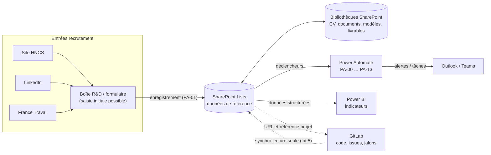
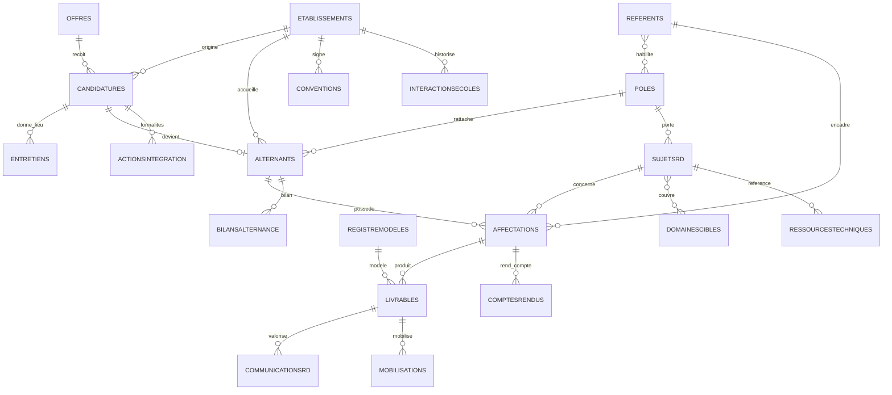

# Spécification du système de suivi R&D — HNCS Groupe

| Propriété | Valeur |
| --- | --- |
| Version de la spec | 1.0.0 |
| Date | 2026-10-14 |
| Statut | Lot 0 — à valider en atelier (voir § 13) |
| Sources fonctionnelles | `Processus.md` ; `Cadrage_Fonctionnel_Automatisation_R&D_HNCS.docx` (v0.1) ; schéma « Architecture cible — Système de suivi R&D HNCS » |
| Portée | Recrutement, intégration, suivi des alternants, livrables, comptes rendus, écoles et partenariats, capitalisation, reporting |

> **Règle d'or.** Ce fichier est la **source de vérité unique** du projet. Toute modification d'un comportement commence ici,
> puis se répercute dans le code. Les tableaux balisés (`### LST:`, `### LIB:`, `### ENUM`, `### TRANSITIONS:`, etc.) sont
> **lus par machine** (`tools/spec_extract.py`) pour générer `provisioning/model/model.generated.json`, que consomment les scripts,
> les flux, Power BI, le jeu de test et les tests de cohérence. Ne pas changer leur format sans mettre à jour l'extracteur.

## Sommaire

1. Principes directeurs non négociables
2. Architecture et conventions de nommage
3. Énumérations (valeurs contrôlées)
4. Modèle de données — listes SharePoint
5. Bibliothèques documentaires
6. Statuts et transitions autorisées
7. Sécurité : groupes, niveaux d'autorisation, matrice d'accès
8. Flux Power Automate — contrats
9. Modèle Power BI et mesures DAX
10. Intégration GitLab et infrastructure
11. Découpage en lots (0 à 5)
12. Stratégie de test et critères d'acceptation
13. Hypothèses et décisions à confirmer
14. Sous-spécifications et journal des modifications

---

## 1. Principes directeurs non négociables

| Code | Principe | Mise en œuvre |
| --- | --- | --- |
| P-01 | **Les décisions humaines ne sont jamais automatisées** : pertinence d'un CV (présélection), résultat d'entretien, décision finale de sélection, validation d'un livrable, validation d'un compte rendu, validation d'une communication externe, décision de partenariat ou de sponsoring. | Ces statuts ne figurent dans les transitions qu'avec des acteurs humains (§ 6). Le rôle `FLUX` n'y apparaît jamais. Les flux notifient, tracent et ne font avancer un statut **qu'en conséquence** d'une action humaine enregistrée (ex. « Présélectionnée » saisi par la R&D → le flux passe à « Transmise à l'administration » après l'envoi effectif de la notification). |
| P-02 | **Une candidature ne passe à « Intégrée » que si les formalités sont au bon stade.** | Double barrière : règle de validation de liste (dates obligatoires) + contrôle `G_INTEGRATION` (§ 6.6) exécuté par PA-04, qui annule la transition si une action bloquante n'est pas terminée avec preuve. |
| P-03 | **Un changement de sujet ou de référent crée une nouvelle affectation et n'écrase jamais l'ancienne.** | Les champs `Alternant`, `Sujet`, `Referent`, `DateDebut` d'une affectation sont verrouillés dès qu'elle est « Active » (empreinte `EmpreinteVerrou`, PA-05 annule toute modification). Le remplacement passe par une nouvelle affectation portant `AffectationRemplacee` ; l'ancienne est seulement terminée (date de fin + motif). |
| P-04 | **Les CV et les données personnelles restent cloisonnés** et n'apparaissent pas dans les vues de la Direction. | Groupe Direction sans accès aux listes et bibliothèques de recrutement (§ 7) ; Power BI n'importe **aucune** colonne marquée `perso` ou `confidentiel` (§ 9.2) ; rôle Power BI `Direction` avec sécurité au niveau objet (OLS) sur les noms d'alternants ; notifications sans CV en pièce jointe (lien contrôlé uniquement). |
| P-05 | SharePoint est le **référentiel central** ; GitLab reste la référence du code, des issues et des jalons. | SharePoint ne stocke que des liens et métadonnées GitLab (§ 10). |
| P-06 | Aucune API LinkedIn ou France Travail n'est présumée. | V1 : saisie manuelle, formulaire du site HNCS acheminé vers la boîte R&D, ou traitement contrôlé de la boîte mail R&D (PA-01b). Toute intégration directe = étude de faisabilité séparée (H-04). |
| P-07 | Historique jamais écrasé. | Versioning activé sur toutes les listes et bibliothèques ; liste `HistoriqueStatuts` alimentée à chaque transition ; niveau d'autorisation « Contribution sans suppression » pour les utilisateurs métier. |
| P-08 | Connecteurs **standard** uniquement en V1. | SharePoint, Office 365 Outlook, Office 365 Users, Microsoft Teams. Aucun connecteur premium (HTTP, Dataverse premium, API tierces) sans validation budgétaire (H-15). |

---

## 2. Architecture et conventions de nommage

### 2.1 Vue d'ensemble



### 2.2 Conventions de nommage

| Objet | Convention | Exemple |
| --- | --- | --- |
| Site | Site d'équipe **sans** groupe Microsoft 365 (modèle `STS#3`), langue française (1036), fuseau Paris | `https://<tenant>.sharepoint.com/sites/HNCS-RD`, titre « HNCS-R&D » |
| Liste / bibliothèque (nom interne = URL) | PascalCase ASCII, sans accent ni espace | `Candidatures`, `LivrablesRD` |
| Titre affiché | Français accentué | « Candidatures », « 04 — Livrables R&D » |
| Colonne (nom interne) | PascalCase ASCII, sans accent, ≤ 32 caractères, jamais renommée après création | `DateTransmissionAdmin` |
| Identifiant métier | Colonne `IdHNCS`, format `{PREFIXE}-{AAAA}-{NNNN}` (AAAA = année de création, NNNN = ID SharePoint sur 4 chiffres minimum) ; exception `Poles` : `POL-{CodePole}` | `CAND-2026-0042`, `POL-P1` |
| Colonnes de recherche (lookup) | Affichent toujours `IdHNCS` de la cible (jamais un nom de personne) | `Candidature` → `CAND-2026-0042` |
| Groupes SharePoint | `HNCS-RD-<Rôle>` sans accent ni `&` | `HNCS-RD-Administration` |
| Flux | `HNCS-RD PA-xx[lettre] — <Libellé>` | `HNCS-RD PA-01b — Candidature reçue par la boîte R&D` |
| Références de connexion (solution) | `hncs_<connecteur>` | `hncs_sharepoint`, `hncs_outlook`, `hncs_teams`, `hncs_o365users` |
| Variables d'environnement (solution) | `hncs_<Nom>` | `hncs_SiteUrl`, `hncs_ServiceAccountEmail` |
| Paramètres métier modifiables | Liste `Parametres`, clé `Categorie.Nom` | `Delai.RelanceAnalyseJours` |
| Objet des courriels | Préfixe `[HNCS-R&D]` + code notification | `[HNCS-R&D][N-05] Candidature CAND-2026-0042 transmise` |
| Dossiers documentaires | Nommés par `IdHNCS` (jamais par nom de personne) | `/Recrutement/2026/CAND-2026-0042/` |
| Power BI | Tables = noms internes des listes ; mesures en français | `[Livrables en retard]` |
| GitLab | Groupe `hncs-rd`, projet `suj-aaaa-nnnn-<slug>`, labels `rd::…` | `suj-2026-0003-sauvegarde-pra` |
| Branches Git (ce dépôt) | `feature/<sujet>`, commits impératifs en français | `feature/systeme-suivi-rd` |

### 2.3 Colonnes implicites (ajoutées par l'extracteur)

| Condition | Colonne | Type | Paramètres | Rôle |
| --- | --- | --- | --- | --- |
| La liste a un « Préfixe ID » différent de `—` | `IdHNCS` | Text | indexed; unique; flux | Identifiant métier stable |
| La liste a une « Énumération de statut » | `Statut` | Choice | enum=<énumération>; default=<statut initial>; indexed | Statut courant |
| idem | `StatutPrecedent` | Text | hidden; flux | Dernier statut **validé** (sert à détecter et, si besoin, annuler une transition) |
| idem | `DateStatut` | DateTime | flux | Date du dernier changement validé |

Les colonnes système SharePoint (`ID`, `Created`, `Modified`, `Author`, `Editor`) sont utilisées telles quelles.

### 2.4 Conventions de lecture des tableaux de colonnes

- **Type** ∈ `Text`, `Note` (texte multiligne brut), `Choice`, `MultiChoice`, `Number`, `Boolean`, `Date` (date seule), `DateTime`, `User`, `UserMulti`, `Lookup`, `LookupMulti`, `URL`.
- **Paramètres** (séparés par `;`) : `enum=<CODE>`, `lookup=<Liste>`, `default=<valeur>`, `indexed`, `unique`, `hidden`, `min=`, `max=`, `decimals=`, `lot=<n>` (colonne ajoutée à un lot ultérieur), et les marqueurs :
  - `flux` : renseignée uniquement par les flux (lecture seule par convention, affichée en lecture dans les vues) ;
  - `perso` : donnée personnelle — **jamais** importée dans Power BI ni affichée hors des groupes habilités ;
  - `confidentiel` : contenu d'évaluation ou commentaire restreint — même règle que `perso`.
- La ligne `Title` d'un tableau redéfinit le libellé (et l'obligation) de la colonne Titre native.
- Les **règles de validation de liste** (propriété `Validation`) utilisent la syntaxe invariante SharePoint (noms de fonctions anglais, séparateur `,`). Elles ne peuvent référencer ni colonnes `Note`, ni `URL`, ni `Lookup` : ces contrôles sont faits par les flux (§ 6.6).
- Dans les filtres OData des flux, une apostrophe dans une valeur est doublée (`'En cours d''analyse'`).

---

## 3. Énumérations (valeurs contrôlées)

Les valeurs sont séparées par ` ; `. L'ordre est l'ordre d'affichage. Toute modification de valeur impose une mise à jour de la spec, du provisioning, des flux, du jeu de test et des mesures Power BI (règle « spec d'abord »).

### ENUM

| Code | Valeurs |
| --- | --- |
| TYPE_OFFRE | Alternance ; Stage ; Autre |
| CANAL | Site HNCS ; LinkedIn ; France Travail ; Candidature spontanée ; École / établissement ; Cooptation ; Autre ; À qualifier |
| MODE_RECEPTION | Saisie manuelle ; Boîte mail R&D ; Formulaire |
| MOTIF_CLOTURE | Profil hors cible ; Prérequis non satisfaits ; Poste pourvu ; Avis défavorable après entretien ; Désistement du candidat ; Candidature incomplète ; Doublon ; Offre annulée ; Formalités non abouties ; Autre |
| TYPE_ENTRETIEN | Premier entretien ; Entretien technique ; Entretien final ; Autre |
| MODALITE_ENTRETIEN | Présentiel ; Teams ; Téléphone |
| RESULTAT_ENTRETIEN | Favorable ; Défavorable ; Réservé — entretien complémentaire |
| TYPE_ETABLISSEMENT | École d'ingénieurs ; Université ; École spécialisée ; CFA ; Autre |
| TYPE_CONVENTION | Convention de stage ; Contrat d'alternance — volet école ; Convention de partenariat ; Sponsoring ; Autre |
| RENOUVELLEMENT | Tacite ; À renouveler explicitement ; Non renouvelable |
| DECISION_PARTENARIAT | À examiner ; Partenariat retenu ; Sponsoring retenu ; Pas de partenariat ; Décision reportée |
| TYPE_INTERACTION | Réunion ; E-mail ; Téléphone ; Événement / forum ; Visite ; Autre |
| DISPONIBILITE | Disponible ; Partiellement disponible ; Indisponible |
| TYPE_SUJET | POC / démonstrateur ; Plan de stratégie ; Communication ; Partenariat / talents ; Autre |
| PRIORITE | P1 — Haute ; P2 — Moyenne ; P3 — Basse |
| CADENCE_CR | Selon paramètre global ; Hebdomadaire ; Quinzaine ; Mensuelle ; Par jalon |
| TYPE_LIVRABLE | POC / démonstrateur ; Plan de stratégie ; Fiche de cadrage ; Fiche méthodologie ; Fiche de démonstration ; Document technique ; Restitution ; Support de communication ; Retour d'expérience ; Autre |
| DECISION_REVUE | Validé ; Corrections demandées |
| ETAT_GENERAL | Conforme au plan ; Vigilance ; En difficulté |
| TYPE_MODELE | Cadrage de sujet ; Rapport d'avancement ; Fiche POC ; Plan de stratégie ; Fiche méthodologie ; Compte rendu ; Restitution ; Revue de livrable ; Clôture d'alternance ; Autre |
| CONTEXTE_ACTION | Formalités d'intégration ; Accueil ; Correction livrable ; Clôture d'alternance ; Évaluation partenariat ; Suivi école |
| CATEGORIE_ACTION | Administratif ; Convention / école ; Accès et matériel ; Accueil R&D ; Documentation ; Capitalisation ; Retour d'expérience ; Partenariat ; Autre |
| QUALITE_COLLAB | Très satisfaisante ; Satisfaisante ; À améliorer ; Insatisfaisante |
| RECOMMANDATION_PARTENARIAT | Recommandé ; À étudier ; Non recommandé |
| CANAL_COM | Publication LinkedIn HNCS ; Article site HNCS ; Article technique ; Synthèse interne ; Événement ; Autre |
| AUTORISATION | Non requise ; Demandée ; Obtenue ; Refusée |
| TYPE_RESSOURCE | Projet GitLab ; Issue / jalon GitLab ; VM Proxmox ; Serveur OVH ; Environnement de démonstration ; Autre |
| TYPE_MOBILISATION | Rendez-vous client ; Réponse à appel d'offres ; Avant-vente ; Démonstration ; Autre |
| CATEGORIE_PARAMETRE | Destinataires ; Délais ; Fonctionnalités ; Conservation ; Liens ; Gouvernance ; Canaux |
| OBJET_TRANSITION | Candidature ; Livrable ; CompteRendu ; Affectation ; Alternant ; Communication ; Convention |
| ROLE | PROPRIETAIRE ; DIRECTION_RD ; RD ; ADMIN ; REFERENT ; ALTERNANT ; DIRECTION ; ECOLES ; ITEM_AUTEUR ; ITEM_VALIDEUR ; FLUX |
| ORIGINE | Humain ; Flux |
| RESULTAT_TRANSITION | Acceptée ; Refusée — annulée |
| NIVEAU_LOG | Info ; Avertissement ; Erreur |
| STATUT_REPRISE | Sans objet ; À reprendre ; Reprise effectuée ; Abandonnée |
| TYPE_DOC_RECRUTEMENT | CV ; Lettre de motivation ; Portfolio ; Pièce de candidature ; Autre |
| TYPE_DOC_ADMIN | Contrat ; Convention ; Pièce administrative ; Grille d'évaluation d'entretien ; Autre |
| TYPE_DOC_SUIVI | Plan de travail ; Compte rendu ; Bilan de mission ; Évaluation (confidentielle) ; Consigne ; Autre |
| TYPE_DOC_ECOLE | Fiche école ; Compte rendu de réunion ; Convention ; Bilan école ; Autre |
| STATUT_DOCUMENT | Brouillon ; Soumis ; Validé ; Référence ; Obsolète |
| STATUT_OFFRE | Brouillon ; Publiée ; Pourvue ; Close |
| STATUT_CANDIDATURE | Reçue ; À analyser ; En cours d'analyse ; Présélectionnée ; Transmise à l'administration ; Entretien planifié ; Entretien réalisé ; En attente de décision ; Retenue ; Formalités en cours ; Intégrée ; Non retenue ; Clôturée |
| STATUT_ENTRETIEN | Planifié ; Réalisé ; Reporté ; Annulé |
| STATUT_ECOLE | Prospect ; Contact établi ; Établissement d'accueil ; Partenariat à évaluer ; Partenaire actif ; Relation suspendue |
| STATUT_CONVENTION | À préparer ; En discussion ; En validation ; À signer ; Signée / active ; À renouveler ; Expirée ; Clôturée |
| STATUT_ALTERNANT | À intégrer ; Actif ; Suspendu ; Fin planifiée ; Terminé ; Clôturé |
| STATUT_REFERENTIEL | Actif ; Inactif |
| STATUT_SUJET | Proposé ; À arbitrer ; Priorisé ; En cours ; Bloqué ; Suspendu ; Terminé ; Abandonné |
| STATUT_AFFECTATION | À préparer ; Active ; À risque ; Bloquée ; Terminée ; Clôturée |
| STATUT_LIVRABLE | À produire ; En cours ; Soumis à revue ; En revue ; Corrections demandées ; Validé ; Archivé / clôturé ; Suspendu / abandonné |
| STATUT_CR | Attendu ; En rédaction ; Remis ; À compléter ; Validé ; Non remis |
| STATUT_MODELE | Brouillon ; En validation ; Approuvé ; Obsolète |
| STATUT_ACTION | À faire ; En cours ; Terminée ; Non applicable ; Bloquée |
| STATUT_BILAN | À réaliser ; En cours ; Réalisé |
| STATUT_COMMUNICATION | Idée ; À préparer ; En rédaction ; En revue ; Validée ; Programmée ; Publiée ; Suspendue / refusée |

**Correspondance avec les documents sources** (détail en H-02, H-03) :

| Source | Libellé source | Valeur retenue |
| --- | --- | --- |
| Processus.md | « Présélectionnée par la R&D » | Présélectionnée |
| Cadrage, annexe A | « Retenue — formalités en cours » | scindé : Retenue (décision) puis Formalités en cours (autorisation de lancer les formalités, cf. PA-04 du Processus) |
| Cadrage, annexe A | « Intégrée comme alternant » | Intégrée |
| Cadrage, annexe A | « Clôturée / retirée / annulée » | Clôturée + `MotifCode` (Désistement du candidat, Offre annulée, Doublon…) |
| Processus.md (livrables) | « Livrable prévu au cadrage » / « Soumis » / « Archivé » | À produire / Soumis à revue / Archivé / clôturé |
| Cadrage, annexe A (alternant) | « Formalités en cours » ; « Suspension éventuelle » | non retenu (la fiche n'existe qu'après intégration, cf. § 3.1 du cadrage) ; Suspendu |

---

## 4. Modèle de données — listes SharePoint

### 4.1 Vue des relations



### 4.2 Domaines et lots

| Domaine | Listes | Lot |
| --- | --- | --- |
| A. Recrutement | Offres, Candidatures, Entretiens | 1 |
| B. Gestion des alternants | Alternants, Poles, Referents, Affectations, ActionsIntegration | 1 |
| B. Gestion des alternants | BilansAlternance | 3 |
| C. Production R&D | SujetsRD, Livrables, RegistreModeles, DomainesCibles | 1 |
| C. Production R&D | ComptesRendus, CommunicationsRD, RessourcesTechniques | 3 |
| C. Production R&D | Mobilisations | 4 |
| D. Écoles et partenariats | Etablissements | 1 |
| D. Écoles et partenariats | Conventions, InteractionsEcoles | 3 |
| T. Technique | Parametres, TransitionsStatuts, HistoriqueStatuts, JournalFlux, ModelesActions | 1 |
| T. Technique | GitlabSync | 5 |

Règle : une colonne `Lookup` ne peut cibler qu'une liste d'un lot inférieur ou égal (sinon la colonne porte `lot=<n>`). Vérifié par `tests/offline`.

### 4.3 Listes

### LST: Offres

| Propriété | Valeur |
| --- | --- |
| Titre affiché | Offres |
| Préfixe ID | OFF |
| Lot | 1 |
| Domaine | A. Recrutement |
| Énumération de statut | STATUT_OFFRE |
| Statut initial | Brouillon |
| Données personnelles | Non |
| Libellé Title | Intitulé de l'offre |
| Title obligatoire | Oui |
| Validation | `=OR(ISBLANK([DateFinPeriode]),[DateFinPeriode]>=[DateDebutPeriode])` |
| Message de validation | La fin de période doit être postérieure au début. |

| Nom interne | Libellé | Type | Oblig. | Paramètres | Description |
| --- | --- | --- | --- | --- | --- |
| TypeOffre | Type d'offre | Choice | Oui | enum=TYPE_OFFRE | Alternance, stage… |
| Pole | Pôle | Lookup | Non | lookup=Poles | Pôle demandeur |
| Competences | Compétences recherchées | Note | Non |  |  |
| DateDebutPeriode | Début de période | Date | Non |  |  |
| DateFinPeriode | Fin de période | Date | Non |  |  |
| CanauxPublication | Canaux de publication | MultiChoice | Non | enum=CANAL |  |
| LienAnnonce | Lien de l'annonce | URL | Non |  | Annonce publiée (site, LinkedIn, France Travail) |

### LST: Candidatures

| Propriété | Valeur |
| --- | --- |
| Titre affiché | Candidatures |
| Préfixe ID | CAND |
| Lot | 1 |
| Domaine | A. Recrutement |
| Énumération de statut | STATUT_CANDIDATURE |
| Statut initial | Reçue |
| Données personnelles | Oui |
| Libellé Title | Nom et prénom du candidat |
| Title obligatoire | Oui |
| Validation | `=AND(IF(OR([Statut]="Non retenue",[Statut]="Clôturée"),NOT(ISBLANK([MotifCode])),TRUE),IF([Statut]="Intégrée",AND(NOT(ISBLANK([DateDemarrageConfirmee])),NOT(ISBLANK([DateFinPrevue]))),TRUE),OR(ISBLANK([DateFinPrevue]),ISBLANK([DateDemarrageConfirmee]),[DateFinPrevue]>[DateDemarrageConfirmee]))` |
| Message de validation | Motif obligatoire pour « Non retenue » ou « Clôturée » ; dates de démarrage et de fin (cohérentes) obligatoires pour « Intégrée ». |

| Nom interne | Libellé | Type | Oblig. | Paramètres | Description |
| --- | --- | --- | --- | --- | --- |
| Title | Nom et prénom du candidat | Text | Oui | perso |  |
| Email | E-mail de contact | Text | Oui | perso; indexed | Clé du contrôle anti-doublon (comparée en minuscules) |
| Telephone | Téléphone | Text | Non | perso |  |
| Canal | Canal d'origine | Choice | Oui | enum=CANAL; indexed | « À qualifier » si non déterminable (PA-01b) |
| ModeReception | Mode de réception | Choice | Oui | enum=MODE_RECEPTION; default=Saisie manuelle |  |
| DateReception | Date de réception | DateTime | Oui | indexed | Par défaut : date de saisie |
| Offre | Offre | Lookup | Non | lookup=Offres |  |
| PosteVise | Poste ou sujet visé | Text | Non |  | Libre si aucune offre |
| TypeContratVise | Type de contrat visé | Choice | Non | enum=TYPE_OFFRE |  |
| Etablissement | École / établissement | Lookup | Non | lookup=Etablissements | École d'origine (entité, pas un texte libre) |
| Formation | Formation suivie | Text | Non |  |  |
| LienCV | CV (lien sécurisé) | URL | Non | perso | Lien vers le dossier de la candidature dans `Recrutement` |
| ResponsableAnalyse | Responsable d'analyse | User | Non | indexed |  |
| DateAnalyse | Début d'analyse | DateTime | Non | flux |  |
| AvisAnalyse | Avis de la R&D | Note | Non | confidentiel | Obligatoire pour présélectionner ou écarter (contrôle `G_AVIS_ANALYSE`) |
| CriteresEvaluation | Critères d'évaluation | Note | Non | confidentiel |  |
| DateDecisionPreselection | Date de décision de présélection | DateTime | Non | flux | Fin du délai de présélection |
| MotifCode | Motif codifié | Choice | Non | enum=MOTIF_CLOTURE |  |
| MotifCommentaire | Commentaire de motif | Note | Non | confidentiel |  |
| DestinataireAdmin | Destinataire administration | User | Non | flux | Issu de `Destinataires.Administration` |
| DateTransmissionAdmin | Date de transmission à l'administration | DateTime | Non | flux |  |
| DecideurFinal | Décideur final | User | Non |  | Personne ayant pris la décision finale (H-06) |
| DateDecisionFinale | Date de décision finale | DateTime | Non | flux |  |
| PolePressenti | Pôle pressenti | Lookup | Non | lookup=Poles | Requis pour l'intégration |
| ReferentPressenti | Référent pressenti | Lookup | Non | lookup=Referents |  |
| SujetPressenti | Sujet pressenti | Lookup | Non | lookup=SujetsRD |  |
| DateDemarrageConfirmee | Date de démarrage confirmée | Date | Non |  | Requise pour « Intégrée » |
| DateFinPrevue | Date de fin prévue | Date | Non |  | Requise pour « Intégrée » |
| DateIntegration | Date d'intégration | DateTime | Non | flux |  |
| IdAlternant | Identifiant alternant | Text | Non | flux | Renseigné par PA-04 |
| DoublonPotentiel | Doublon potentiel | Boolean | Non | flux; default=Non | Signalement, jamais de fusion automatique |
| DoublonDe | Doublon de | Text | Non | flux | `IdHNCS` de la candidature similaire |
| AccuseReceptionEnvoye | Accusé de réception envoyé | Boolean | Non | flux; default=Non |  |
| InformationCandidat | Candidat informé de l'issue | Boolean | Non | default=Non | Saisi par la personne qui informe (H-09) |
| DateInformationCandidat | Date d'information du candidat | Date | Non |  |  |
| DateCloture | Date de clôture | DateTime | Non | flux |  |
| DateFinConservation | Fin de conservation prévue | Date | Non | flux | Vide tant que la durée n'est pas validée (H-10) |
| RefMessage | Référence du message source | Text | Non | hidden; flux; indexed | `Internet-Message-Id` (idempotence PA-01b) |

### LST: Entretiens

| Propriété | Valeur |
| --- | --- |
| Titre affiché | Entretiens |
| Préfixe ID | ENT |
| Lot | 1 |
| Domaine | A. Recrutement |
| Énumération de statut | STATUT_ENTRETIEN |
| Statut initial | Planifié |
| Données personnelles | Oui |
| Libellé Title | Objet de l'entretien |
| Title obligatoire | Oui |
| Validation | `=IF([Statut]="Réalisé",NOT(ISBLANK([Resultat])),TRUE)` |
| Message de validation | Le résultat est obligatoire lorsque l'entretien est réalisé. |

| Nom interne | Libellé | Type | Oblig. | Paramètres | Description |
| --- | --- | --- | --- | --- | --- |
| Candidature | Candidature | Lookup | Oui | lookup=Candidatures; indexed |  |
| DateHeure | Date et heure | DateTime | Oui | indexed |  |
| TypeEntretien | Type d'entretien | Choice | Oui | enum=TYPE_ENTRETIEN |  |
| Modalite | Modalité | Choice | Oui | enum=MODALITE_ENTRETIEN |  |
| Participants | Participants HNCS | UserMulti | Non |  |  |
| LienReunion | Lien de réunion | URL | Non |  | Invitation Teams/Outlook créée par l'administration |
| Resultat | Résultat | Choice | Non | enum=RESULTAT_ENTRETIEN | Décision humaine |
| ProchaineAction | Prochaine action | Text | Non |  |  |
| CommentaireRestreint | Commentaire (restreint) | Note | Non | confidentiel |  |
| LienGrilleEvaluation | Grille d'évaluation | URL | Non | confidentiel | Document dans `Administration` |
| SaisiPar | Résultat saisi par | User | Non | flux |  |
| DateSaisieResultat | Date de saisie du résultat | DateTime | Non | flux |  |
| RappelEnvoye | Rappel envoyé | Boolean | Non | flux; default=Non |  |
| DemandeResultatEnvoyee | Demande de saisie du résultat envoyée | Boolean | Non | flux; default=Non |  |

### LST: Etablissements

| Propriété | Valeur |
| --- | --- |
| Titre affiché | Écoles et établissements |
| Préfixe ID | ECO |
| Lot | 1 |
| Domaine | D. Écoles et partenariats |
| Énumération de statut | STATUT_ECOLE |
| Statut initial | Prospect |
| Données personnelles | Oui |
| Libellé Title | Nom officiel |
| Title obligatoire | Oui |

| Nom interne | Libellé | Type | Oblig. | Paramètres | Description |
| --- | --- | --- | --- | --- | --- |
| Ville | Ville | Text | Non |  |  |
| TypeEtablissement | Type d'établissement | Choice | Non | enum=TYPE_ETABLISSEMENT |  |
| Formations | Domaines et formations | Note | Non |  |  |
| ContactPrincipal | Contact principal | Text | Non | perso |  |
| EmailContact | E-mail du contact | Text | Non | perso |  |
| TelephoneContact | Téléphone du contact | Text | Non | perso |  |
| ResponsableHNCS | Responsable HNCS de la relation | User | Non |  |  |
| DateDerniereInteraction | Dernière interaction | Date | Non | flux | Mise à jour par PA-10 |
| ProchaineAction | Prochaine action | Text | Non |  |  |
| DateProchaineAction | Échéance de la prochaine action | Date | Non |  |  |
| SiteWeb | Site web | URL | Non |  |  |

### LST: Conventions

| Propriété | Valeur |
| --- | --- |
| Titre affiché | Conventions et partenariats |
| Préfixe ID | CONV |
| Lot | 3 |
| Domaine | D. Écoles et partenariats |
| Énumération de statut | STATUT_CONVENTION |
| Statut initial | À préparer |
| Données personnelles | Non |
| Libellé Title | Objet de la convention |
| Title obligatoire | Oui |
| Validation | `=AND(IF([Statut]="Signée / active",NOT(ISBLANK([DateSignature])),TRUE),OR(ISBLANK([DateFin]),ISBLANK([DateDebut]),[DateFin]>=[DateDebut]))` |
| Message de validation | Date de signature obligatoire pour « Signée / active » ; la fin doit suivre le début. |

| Nom interne | Libellé | Type | Oblig. | Paramètres | Description |
| --- | --- | --- | --- | --- | --- |
| Etablissement | Établissement | Lookup | Oui | lookup=Etablissements; indexed |  |
| TypeConvention | Type | Choice | Oui | enum=TYPE_CONVENTION |  |
| Alternant | Alternant concerné | Lookup | Non | lookup=Alternants |  |
| DateDebut | Début | Date | Non |  |  |
| DateFin | Fin | Date | Non | indexed |  |
| Responsable | Responsable HNCS | User | Non |  |  |
| DateTransmission | Date de transmission | Date | Non |  |  |
| DateSignature | Date de signature | Date | Non |  |  |
| PreuveSignature | Preuve de signature | URL | Non |  | Obligatoire pour « Signée / active » (`G_PREUVE_SIGNATURE`) |
| Renouvellement | Renouvellement | Choice | Non | enum=RENOUVELLEMENT |  |
| DecisionPartenariat | Décision de partenariat | Choice | Non | enum=DECISION_PARTENARIAT | Décision humaine réservée à DIRECTION_RD / DIRECTION |
| DecideurPartenariat | Décideur | User | Non | flux | Auteur de la décision, tracé par PA-10 |
| DateDecisionPartenariat | Date de décision | Date | Non | flux |  |
| Commentaire | Commentaire | Note | Non |  |  |
| EmpreinteDecision | Empreinte de décision | Text | Non | hidden; flux | Dernière décision validée (détection des modifications non autorisées) |

### LST: InteractionsEcoles

| Propriété | Valeur |
| --- | --- |
| Titre affiché | Échanges avec les écoles |
| Préfixe ID | INT |
| Lot | 3 |
| Domaine | D. Écoles et partenariats |
| Énumération de statut | — |
| Données personnelles | Oui |
| Libellé Title | Objet de l'échange |
| Title obligatoire | Oui |

| Nom interne | Libellé | Type | Oblig. | Paramètres | Description |
| --- | --- | --- | --- | --- | --- |
| Etablissement | Établissement | Lookup | Oui | lookup=Etablissements; indexed |  |
| DateInteraction | Date | Date | Oui | indexed |  |
| Interlocuteur | Interlocuteur | Text | Non | perso |  |
| TypeInteraction | Type d'échange | Choice | Non | enum=TYPE_INTERACTION |  |
| ResponsableHNCS | Responsable HNCS | User | Non |  |  |
| Resume | Résumé | Note | Non |  |  |
| ProchaineAction | Prochaine action | Text | Non |  |  |
| DateProchaineAction | Échéance de la prochaine action | Date | Non |  |  |
| LienDocument | Document associé | URL | Non |  | Dans `EcolesPartenariats` |

### LST: Alternants

| Propriété | Valeur |
| --- | --- |
| Titre affiché | Alternants |
| Préfixe ID | ALT |
| Lot | 1 |
| Domaine | B. Gestion des alternants |
| Énumération de statut | STATUT_ALTERNANT |
| Statut initial | À intégrer |
| Données personnelles | Oui |
| Libellé Title | Nom et prénom |
| Title obligatoire | Oui |
| Validation | `=AND([DateFin]>[DateDebut],IF(OR([Statut]="Terminé",[Statut]="Clôturé"),NOT(ISBLANK([DateFinReelle])),TRUE))` |
| Message de validation | La date de fin doit suivre la date de début ; la date de fin réelle est obligatoire pour « Terminé » / « Clôturé ». |

| Nom interne | Libellé | Type | Oblig. | Paramètres | Description |
| --- | --- | --- | --- | --- | --- |
| Title | Nom et prénom | Text | Oui | perso |  |
| CandidatureSource | Candidature d'origine | Lookup | Non | lookup=Candidatures | Vide uniquement pour la reprise de l'existant (H-12) |
| CompteM365 | Compte Microsoft 365 | User | Non | perso | Sert aux permissions ciblées |
| EmailProfessionnel | E-mail professionnel | Text | Non | perso |  |
| DateDebut | Date de début | Date | Oui | indexed |  |
| DateFin | Date de fin prévue | Date | Oui | indexed |  |
| DateFinReelle | Date de fin réelle | Date | Non |  |  |
| Formation | Formation | Text | Non |  |  |
| Etablissement | Établissement | Lookup | Oui | lookup=Etablissements; indexed |  |
| RythmeAlternance | Rythme d'alternance | Text | Non |  |  |
| Pole | Pôle | Lookup | Oui | lookup=Poles; indexed |  |
| ReferentPrincipal | Référent principal | Lookup | Non | lookup=Referents | Valeur courante ; l'historique des responsabilités est porté par `Affectations` |
| LienDossierAdministratif | Dossier administratif (restreint) | URL | Non | flux; confidentiel |  |
| LienDossierSuivi | Dossier de suivi | URL | Non | flux |  |
| MotifFin | Motif de fin | Text | Non |  |  |

### LST: Poles

| Propriété | Valeur |
| --- | --- |
| Titre affiché | Pôles R&D |
| Préfixe ID | POL |
| Lot | 1 |
| Domaine | B. Gestion des alternants |
| Énumération de statut | STATUT_REFERENTIEL |
| Statut initial | Actif |
| Données personnelles | Non |
| Libellé Title | Nom du pôle |
| Title obligatoire | Oui |

| Nom interne | Libellé | Type | Oblig. | Paramètres | Description |
| --- | --- | --- | --- | --- | --- |
| CodePole | Code pôle | Text | Oui | unique; indexed | P1 à P4 ; `IdHNCS` = `POL-` + code |
| Mission | Mission | Note | Non |  |  |
| Responsable | Responsable | User | Non |  |  |
| Objectifs | Objectifs | Note | Non |  |  |
| DomainesCouverts | Domaines couverts | Note | Non |  |  |

### LST: Referents

| Propriété | Valeur |
| --- | --- |
| Titre affiché | Référents |
| Préfixe ID | REF |
| Lot | 1 |
| Domaine | B. Gestion des alternants |
| Énumération de statut | STATUT_REFERENTIEL |
| Statut initial | Actif |
| Données personnelles | Non |
| Libellé Title | Nom du référent |
| Title obligatoire | Oui |

| Nom interne | Libellé | Type | Oblig. | Paramètres | Description |
| --- | --- | --- | --- | --- | --- |
| Compte | Compte Microsoft 365 | User | Oui | indexed | Clé de la sécurité Power BI (RLS) et des contrôles `ITEM_VALIDEUR` |
| EmailPro | E-mail professionnel | Text | Oui |  |  |
| Poles | Pôles | LookupMulti | Non | lookup=Poles |  |
| Expertise | Expertise | Note | Non |  |  |
| CapaciteIndicative | Capacité indicative (alternants) | Number | Non | min=0; max=20; decimals=0 |  |
| Disponibilite | Disponibilité | Choice | Non | enum=DISPONIBILITE |  |

### LST: SujetsRD

| Propriété | Valeur |
| --- | --- |
| Titre affiché | Sujets R&D |
| Préfixe ID | SUJ |
| Lot | 1 |
| Domaine | C. Production R&D |
| Énumération de statut | STATUT_SUJET |
| Statut initial | Proposé |
| Données personnelles | Non |
| Libellé Title | Titre du sujet |
| Title obligatoire | Oui |
| Validation | `=OR(ISBLANK([DateFinPrevue]),ISBLANK([DateDebutPrevue]),[DateFinPrevue]>=[DateDebutPrevue])` |
| Message de validation | La fin prévue doit suivre le début prévu. |

| Nom interne | Libellé | Type | Oblig. | Paramètres | Description |
| --- | --- | --- | --- | --- | --- |
| TypeSujet | Type de sujet | Choice | Oui | enum=TYPE_SUJET |  |
| Pole | Pôle | Lookup | Oui | lookup=Poles; indexed |  |
| Description | Description et périmètre | Note | Non |  |  |
| ValeurAttendue | Valeur attendue | Note | Non |  |  |
| Priorite | Priorité | Choice | Non | enum=PRIORITE |  |
| Referent | Référent du sujet | Lookup | Non | lookup=Referents |  |
| Validateur | Validateur | User | Non |  |  |
| Jalons | Jalons | Note | Non |  |  |
| CriteresAcceptation | Critères d'acceptation | Note | Non |  |  |
| RisquesDependances | Risques et dépendances | Note | Non |  |  |
| DateDebutPrevue | Début prévu | Date | Non |  |  |
| DateFinPrevue | Fin prévue | Date | Non |  |  |
| Domaines | Domaines cibles couverts | LookupMulti | Non | lookup=DomainesCibles | Base de l'indicateur de couverture |
| GitlabProjetUrl | Projet GitLab | URL | Non |  |  |
| GitlabProjetId | ID projet GitLab | Number | Non | decimals=0 | Clé de la synchro GitLab (lot 5) |
| GitlabIssueUrl | Issue GitLab principale | URL | Non |  |  |
| GitlabMilestone | Jalon GitLab principal | Text | Non |  |  |
| MotifDecision | Motif de décision (GO/NO-GO, suspension, abandon) | Note | Non |  |  |

### LST: Affectations

| Propriété | Valeur |
| --- | --- |
| Titre affiché | Affectations |
| Préfixe ID | AFF |
| Lot | 1 |
| Domaine | B. Gestion des alternants |
| Énumération de statut | STATUT_AFFECTATION |
| Statut initial | À préparer |
| Données personnelles | Non |
| Libellé Title | Libellé de l'affectation |
| Title obligatoire | Non |
| Validation | `=OR(ISBLANK([DateFin]),[DateFin]>=[DateDebut])` |
| Message de validation | La date de fin doit suivre la date de début. |

| Nom interne | Libellé | Type | Oblig. | Paramètres | Description |
| --- | --- | --- | --- | --- | --- |
| Alternant | Alternant | Lookup | Oui | lookup=Alternants; indexed | Verrouillé dès « Active » |
| Sujet | Sujet | Lookup | Oui | lookup=SujetsRD; indexed | Verrouillé dès « Active » |
| Referent | Référent | Lookup | Non | lookup=Referents; indexed | Requis pour activer ; verrouillé dès « Active » |
| DateDebut | Date de début | Date | Oui | indexed | Verrouillée dès « Active » |
| DateFin | Date de fin | Date | Non |  |  |
| Objectifs | Objectifs | Note | Non |  |  |
| ChargeCadence | Charge et cadence | Text | Non |  | Ex. « 3 j/semaine » |
| CadenceCR | Cadence des comptes rendus | Choice | Oui | enum=CADENCE_CR; default=Selon paramètre global |  |
| LienPlanTravail | Plan de travail | URL | Non |  |  |
| AffectationRemplacee | Affectation remplacée | Lookup | Non | lookup=Affectations | Lien explicite de succession (changement de sujet ou de référent) |
| MotifFin | Motif de fin | Text | Non |  |  |
| EmpreinteVerrou | Empreinte de verrouillage | Text | Non | hidden; flux | JSON `{"AlternantId","SujetId","ReferentId","DateDebut"}` figé à l'activation |
| ProchaineEcheanceCR | Prochaine échéance de compte rendu | Date | Non | flux |  |

### LST: Livrables

| Propriété | Valeur |
| --- | --- |
| Titre affiché | Livrables |
| Préfixe ID | LIV |
| Lot | 1 |
| Domaine | C. Production R&D |
| Énumération de statut | STATUT_LIVRABLE |
| Statut initial | À produire |
| Données personnelles | Non |
| Libellé Title | Titre du livrable |
| Title obligatoire | Oui |
| Validation | `=AND(IF(AND([Statut]="Archivé / clôturé",OR([TypeLivrable]="POC / démonstrateur",[TypeLivrable]="Plan de stratégie")),AND([DoD1Fonctionnel],[DoD2FicheMethodo],[DoD3Restitution],[DoD4SupportCom],[DoD5Enseignements]),TRUE),IF([Statut]="Suspendu / abandonné",NOT(ISBLANK([MotifSuspension])),TRUE))` |
| Message de validation | Un POC ou un plan de stratégie ne peut être clôturé qu'avec les 5 critères de la Definition of Done ; motif obligatoire pour une suspension. |

| Nom interne | Libellé | Type | Oblig. | Paramètres | Description |
| --- | --- | --- | --- | --- | --- |
| Affectation | Affectation | Lookup | Oui | lookup=Affectations; indexed |  |
| Sujet | Sujet | Lookup | Non | lookup=SujetsRD; flux; indexed | Copié de l'affectation par PA-07 |
| TypeLivrable | Type de livrable | Choice | Oui | enum=TYPE_LIVRABLE |  |
| Modele | Modèle utilisé | Lookup | Non | lookup=RegistreModeles |  |
| VersionModele | Version du modèle | Text | Non | flux | Figée à la création (gouvernance des modèles, cadrage § 9.4) |
| Proprietaire | Propriétaire (auteur) | User | Oui | indexed | `ITEM_AUTEUR` |
| Reviseur | Réviseur (référent) | User | Non | indexed | `ITEM_VALIDEUR` ; par défaut le référent de l'affectation |
| Echeance | Échéance | Date | Oui | indexed |  |
| EcheanceInitiale | Échéance initiale | Date | Non | flux | Permet de mesurer les échéances déplacées |
| DatePremierDepot | Date du premier dépôt | DateTime | Non | flux | Base du taux de remise à l'heure |
| DateDepot | Date du dernier dépôt | DateTime | Non | flux |  |
| DateRevue | Date de la dernière revue | DateTime | Non | flux |  |
| DecisionRevue | Décision de revue | Choice | Non | enum=DECISION_REVUE; flux | Reflet de la décision humaine |
| CommentaireRevue | Commentaires de revue | Note | Non |  | Obligatoire pour demander des corrections |
| NbCorrections | Nombre de demandes de corrections | Number | Non | flux; default=0; decimals=0 | Base du taux de validation au premier passage |
| Valideur | Validé par | User | Non | flux |  |
| DateValidation | Date de validation | DateTime | Non | flux |  |
| VersionValidee | Version validée du document | Text | Non | flux | Libellé de version SharePoint au moment de la validation |
| LienDocument | Document (SharePoint) | URL | Non |  | Requis pour soumettre (`G_DOCUMENT`) |
| LienGitlab | Lien GitLab | URL | Non |  | Dépôt, MR, issue ou jalon |
| CriteresValidation | Critères de validation | Note | Non |  |  |
| DoD1Fonctionnel | DoD 1 — Fonctionnel et démontrable | Boolean | Non | default=Non |  |
| DoD2FicheMethodo | DoD 2 — Fiche méthodologie rangée | Boolean | Non | default=Non |  |
| DoD3Restitution | DoD 3 — Restitution présentée | Boolean | Non | default=Non |  |
| DoD4SupportCom | DoD 4 — Support de communication prêt | Boolean | Non | default=Non |  |
| DoD5Enseignements | DoD 5 — Enseignements et limites documentés | Boolean | Non | default=Non |  |
| DateArchivage | Date d'archivage | DateTime | Non | flux |  |
| MotifSuspension | Motif de suspension / abandon | Text | Non |  |  |
| EnRetard | En retard | Boolean | Non | flux; default=Non | Recalculé chaque jour par PA-06 |
| DernierRappel | Dernier rappel envoyé | Text | Non | hidden; flux | Ex. `J-7:2026-10-14` (évite les doublons de rappel) |

### LST: ComptesRendus

| Propriété | Valeur |
| --- | --- |
| Titre affiché | Comptes rendus de suivi |
| Préfixe ID | CR |
| Lot | 3 |
| Domaine | C. Production R&D |
| Énumération de statut | STATUT_CR |
| Statut initial | Attendu |
| Données personnelles | Non |
| Libellé Title | Libellé du compte rendu |
| Title obligatoire | Non |
| Validation | `=[PeriodeFin]>=[PeriodeDebut]` |
| Message de validation | La fin de période doit suivre le début. |

| Nom interne | Libellé | Type | Oblig. | Paramètres | Description |
| --- | --- | --- | --- | --- | --- |
| Affectation | Affectation | Lookup | Oui | lookup=Affectations; indexed |  |
| Alternant | Alternant | Lookup | Non | lookup=Alternants; flux; indexed | Copié de l'affectation |
| PeriodeDebut | Début de période | Date | Oui |  |  |
| PeriodeFin | Fin de période | Date | Oui |  |  |
| Echeance | Échéance de remise | Date | Oui | indexed |  |
| DateRemise | Date de remise | DateTime | Non | flux |  |
| EtatGeneral | État général | Choice | Non | enum=ETAT_GENERAL |  |
| Avancement | Avancement estimé (%) | Number | Non | min=0; max=100; decimals=0 |  |
| Realisations | Réalisations de la période | Note | Non |  |  |
| ProchainesEtapes | Prochaines étapes | Note | Non |  |  |
| LivrablesAttendus | Livrables attendus | Note | Non |  |  |
| Risques | Risques | Note | Non |  |  |
| Blocages | Blocages | Note | Non |  |  |
| BlocageSignale | Blocage signalé | Boolean | Non | default=Non | Remonté au Comité R&D |
| DecisionsRequises | Décisions requises | Note | Non |  |  |
| SoutienRequis | Soutien attendu du référent | Note | Non |  |  |
| Valideur | Valideur (référent) | User | Non | flux | `ITEM_VALIDEUR` |
| DateValidation | Date de validation | DateTime | Non | flux |  |
| CommentaireReferent | Commentaire du référent | Note | Non |  | Obligatoire pour « À compléter » |
| DernierRappel | Dernier rappel envoyé | Text | Non | hidden; flux |  |

### LST: RegistreModeles

| Propriété | Valeur |
| --- | --- |
| Titre affiché | Registre des modèles R&D |
| Préfixe ID | MOD |
| Lot | 1 |
| Domaine | C. Production R&D |
| Énumération de statut | STATUT_MODELE |
| Statut initial | Brouillon |
| Données personnelles | Non |
| Libellé Title | Nom du modèle |
| Title obligatoire | Oui |
| Validation | `=IF([Statut]="Approuvé",AND(NOT(ISBLANK([DateApprobation])),NOT(ISBLANK([DateEntreeVigueur]))),TRUE)` |
| Message de validation | Un modèle approuvé doit avoir une date d'approbation et une date d'entrée en vigueur. |

| Nom interne | Libellé | Type | Oblig. | Paramètres | Description |
| --- | --- | --- | --- | --- | --- |
| TypeModele | Type de modèle | Choice | Oui | enum=TYPE_MODELE |  |
| TypeLivrableCible | Type de livrable produit | Choice | Non | enum=TYPE_LIVRABLE |  |
| Version | Version | Text | Oui |  | Ex. `1.0` |
| Proprietaire | Propriétaire du modèle | User | Oui |  |  |
| DateApprobation | Date d'approbation | Date | Non |  |  |
| DateEntreeVigueur | Date d'entrée en vigueur | Date | Non |  |  |
| LienFichier | Fichier du modèle | URL | Non |  | Dans la bibliothèque `ModelesRD` |
| HistoriqueVersions | Historique des versions | Note | Non |  |  |
| ApplicableA | Applicable aux sujets | MultiChoice | Non | enum=TYPE_SUJET |  |
| CreationAuto | Livrable proposé automatiquement | Boolean | Non | default=Non | Si Oui, PA-05 propose un livrable « À produire » à l'activation d'une affectation |
| DelaiStandardJours | Délai standard (jours) | Number | Non | decimals=0 | Échéance proposée = début d'affectation + délai |

### LST: ActionsIntegration

| Propriété | Valeur |
| --- | --- |
| Titre affiché | Actions d'intégration et checklists |
| Préfixe ID | ACT |
| Lot | 1 |
| Domaine | B. Gestion des alternants |
| Énumération de statut | STATUT_ACTION |
| Statut initial | À faire |
| Données personnelles | Non |
| Libellé Title | Action |
| Title obligatoire | Oui |

| Nom interne | Libellé | Type | Oblig. | Paramètres | Description |
| --- | --- | --- | --- | --- | --- |
| Contexte | Contexte | Choice | Oui | enum=CONTEXTE_ACTION; indexed |  |
| Categorie | Catégorie | Choice | Non | enum=CATEGORIE_ACTION |  |
| Candidature | Candidature | Lookup | Non | lookup=Candidatures; indexed |  |
| Alternant | Alternant | Lookup | Non | lookup=Alternants; indexed |  |
| Livrable | Livrable | Lookup | Non | lookup=Livrables |  |
| Etablissement | Établissement | Lookup | Non | lookup=Etablissements |  |
| Description | Description | Note | Non |  | Sans donnée sensible : les pièces restent dans `Administration` |
| Responsable | Responsable | User | Non | indexed |  |
| RoleResponsable | Rôle responsable | Choice | Non | enum=ROLE |  |
| Echeance | Échéance | Date | Non | indexed |  |
| Bloquante | Bloquante pour l'étape | Boolean | Non | default=Non | Bloque l'intégration ou la clôture tant qu'elle n'est pas terminée |
| PreuveAttendue | Preuve attendue | Text | Non |  |  |
| Preuve | Preuve / lien | URL | Non |  | Obligatoire pour terminer une action bloquante |
| Commentaire | Commentaire | Note | Non |  | Obligatoire pour « Non applicable » sur une action bloquante |
| CodeModeleAction | Code du modèle d'action | Text | Non | flux; indexed | Idempotence de génération des checklists |
| DernierRappel | Dernier rappel envoyé | Text | Non | hidden; flux |  |

### LST: ModelesActions

| Propriété | Valeur |
| --- | --- |
| Titre affiché | Modèles de checklists |
| Préfixe ID | — |
| Lot | 1 |
| Domaine | T. Technique |
| Énumération de statut | — |
| Données personnelles | Non |
| Libellé Title | Libellé de l'action |
| Title obligatoire | Oui |

| Nom interne | Libellé | Type | Oblig. | Paramètres | Description |
| --- | --- | --- | --- | --- | --- |
| Code | Code | Text | Oui | unique; indexed | Ex. `FORM-01` |
| Contexte | Contexte | Choice | Oui | enum=CONTEXTE_ACTION |  |
| Categorie | Catégorie | Choice | Non | enum=CATEGORIE_ACTION |  |
| Description | Description | Note | Non |  |  |
| RoleResponsable | Rôle responsable | Choice | Oui | enum=ROLE |  |
| DelaiJours | Délai (jours après déclenchement) | Number | Non | decimals=0 |  |
| Bloquante | Bloquante | Boolean | Non | default=Non |  |
| PreuveAttendue | Preuve attendue | Text | Non |  |  |
| Ordre | Ordre | Number | Non | decimals=0 |  |
| Actif | Actif | Boolean | Non | default=Oui |  |

### LST: BilansAlternance

| Propriété | Valeur |
| --- | --- |
| Titre affiché | Bilans d'alternance |
| Préfixe ID | BIL |
| Lot | 3 |
| Domaine | B. Gestion des alternants |
| Énumération de statut | STATUT_BILAN |
| Statut initial | À réaliser |
| Données personnelles | Oui |
| Libellé Title | Libellé du bilan |
| Title obligatoire | Non |
| Validation | `=IF([Statut]="Réalisé",AND(NOT(ISBLANK([DateBilan])),NOT(ISBLANK([RecommandationPartenariat]))),TRUE)` |
| Message de validation | Un bilan réalisé doit être daté et comporter une recommandation. |

| Nom interne | Libellé | Type | Oblig. | Paramètres | Description |
| --- | --- | --- | --- | --- | --- |
| Alternant | Alternant | Lookup | Oui | lookup=Alternants; indexed |  |
| Etablissement | Établissement | Lookup | Non | lookup=Etablissements | Copié de l'alternant |
| Referent | Référent | Lookup | Non | lookup=Referents |  |
| DateBilan | Date du bilan | Date | Non |  |  |
| SyntheseParcours | Synthèse du parcours | Note | Non | confidentiel |  |
| LivrablesClotures | Livrables clôturés | Boolean | Non | default=Non |  |
| DocumentationCapitalisee | Documentation capitalisée | Boolean | Non | default=Non |  |
| RetourExperience | Retour d'expérience | Note | Non |  |  |
| QualiteCollaborationEcole | Qualité de la collaboration avec l'école | Choice | Non | enum=QUALITE_COLLAB |  |
| RecommandationPartenariat | Recommandation de partenariat | Choice | Non | enum=RECOMMANDATION_PARTENARIAT | **Recommandation**, jamais une décision |
| JustificationRecommandation | Justification | Note | Non |  |  |
| Contributeurs | Contributeurs | UserMulti | Non |  |  |

### LST: CommunicationsRD

| Propriété | Valeur |
| --- | --- |
| Titre affiché | Communications R&D |
| Préfixe ID | COM |
| Lot | 3 |
| Domaine | C. Production R&D |
| Énumération de statut | STATUT_COMMUNICATION |
| Statut initial | Idée |
| Données personnelles | Non |
| Libellé Title | Titre de la communication |
| Title obligatoire | Oui |
| Validation | `=AND(IF([Statut]="Publiée",NOT(ISBLANK([DateEffective])),TRUE),IF(OR([Statut]="Validée",[Statut]="Programmée",[Statut]="Publiée"),OR([AutorisationsTiers]="Non requise",[AutorisationsTiers]="Obtenue"),TRUE),IF([Statut]="Programmée",NOT(ISBLANK([DatePrevue])),TRUE))` |
| Message de validation | Publication datée obligatoire ; aucune validation sans autorisations des tiers obtenues ou non requises ; date prévue obligatoire pour programmer. |

| Nom interne | Libellé | Type | Oblig. | Paramètres | Description |
| --- | --- | --- | --- | --- | --- |
| LivrableSource | Livrable source | Lookup | Non | lookup=Livrables |  |
| Sujet | Sujet | Lookup | Non | lookup=SujetsRD |  |
| Canal | Canal | Choice | Oui | enum=CANAL_COM |  |
| Externe | Communication externe | Boolean | Non | default=Oui |  |
| Auteur | Auteur | User | Oui |  | `ITEM_AUTEUR` |
| DatePrevue | Date prévue | Date | Non |  |  |
| DateEffective | Date de publication | Date | Non |  |  |
| ValidationInterne | Approbateur | User | Non |  | `ITEM_VALIDEUR` |
| DateValidation | Date de validation | DateTime | Non | flux |  |
| AutorisationsTiers | Autorisations des tiers | Choice | Non | enum=AUTORISATION; default=Non requise |  |
| PreuveAutorisation | Preuve d'autorisation | URL | Non |  |  |
| UrlPublication | URL de publication | URL | Non |  | Obligatoire pour une communication externe publiée (`G_PUBLICATION`) |
| Commentaire | Commentaire | Note | Non |  |  |

### LST: DomainesCibles

| Propriété | Valeur |
| --- | --- |
| Titre affiché | Domaines cibles |
| Préfixe ID | DOM |
| Lot | 1 |
| Domaine | C. Production R&D |
| Énumération de statut | STATUT_REFERENTIEL |
| Statut initial | Actif |
| Données personnelles | Non |
| Libellé Title | Domaine |
| Title obligatoire | Oui |

| Nom interne | Libellé | Type | Oblig. | Paramètres | Description |
| --- | --- | --- | --- | --- | --- |
| Pole | Pôle | Lookup | Non | lookup=Poles |  |
| Description | Description | Note | Non |  |  |
| Cible | Domaine cible stratégique | Boolean | Non | default=Oui | Dénominateur de la couverture |

### LST: RessourcesTechniques

| Propriété | Valeur |
| --- | --- |
| Titre affiché | Ressources techniques |
| Préfixe ID | RES |
| Lot | 3 |
| Domaine | C. Production R&D |
| Énumération de statut | STATUT_REFERENTIEL |
| Statut initial | Actif |
| Données personnelles | Non |
| Libellé Title | Nom de la ressource |
| Title obligatoire | Oui |

| Nom interne | Libellé | Type | Oblig. | Paramètres | Description |
| --- | --- | --- | --- | --- | --- |
| TypeRessource | Type de ressource | Choice | Oui | enum=TYPE_RESSOURCE |  |
| Url | URL | URL | Non |  | Jamais d'identifiant ni de secret |
| Sujet | Sujet | Lookup | Non | lookup=SujetsRD; indexed |  |
| Responsable | Responsable | User | Non |  |  |
| Commentaire | Commentaire | Note | Non |  |  |

### LST: Mobilisations

| Propriété | Valeur |
| --- | --- |
| Titre affiché | Mobilisations commerciales |
| Préfixe ID | MOB |
| Lot | 4 |
| Domaine | C. Production R&D |
| Énumération de statut | — |
| Données personnelles | Non |
| Libellé Title | Contexte de la mobilisation |
| Title obligatoire | Oui |

| Nom interne | Libellé | Type | Oblig. | Paramètres | Description |
| --- | --- | --- | --- | --- | --- |
| Livrable | Livrable mobilisé | Lookup | Oui | lookup=Livrables; indexed |  |
| DateMobilisation | Date | Date | Oui | indexed |  |
| TypeMobilisation | Type | Choice | Non | enum=TYPE_MOBILISATION |  |
| Responsable | Responsable | User | Non |  |  |
| Commentaire | Commentaire | Note | Non |  |  |

### LST: Parametres

| Propriété | Valeur |
| --- | --- |
| Titre affiché | Paramètres |
| Préfixe ID | — |
| Lot | 1 |
| Domaine | T. Technique |
| Énumération de statut | — |
| Données personnelles | Non |
| Libellé Title | Clé |
| Title obligatoire | Oui |

| Nom interne | Libellé | Type | Oblig. | Paramètres | Description |
| --- | --- | --- | --- | --- | --- |
| Title | Clé | Text | Oui | unique; indexed |  |
| Valeur | Valeur | Text | Non |  | Texte ; les listes de valeurs sont séparées par `;` |
| Categorie | Catégorie | Choice | Oui | enum=CATEGORIE_PARAMETRE |  |
| Description | Description | Note | Non |  |  |

### LST: TransitionsStatuts

| Propriété | Valeur |
| --- | --- |
| Titre affiché | Transitions de statuts |
| Préfixe ID | — |
| Lot | 1 |
| Domaine | T. Technique |
| Énumération de statut | — |
| Données personnelles | Non |
| Libellé Title | Code de transition |
| Title obligatoire | Oui |

| Nom interne | Libellé | Type | Oblig. | Paramètres | Description |
| --- | --- | --- | --- | --- | --- |
| Title | Code de transition | Text | Oui | unique; indexed | Ex. `CAND-T04` (une ligne par couple De/Vers après expansion) |
| Objet | Objet | Choice | Oui | enum=OBJET_TRANSITION; indexed |  |
| StatutDe | Statut de départ | Text | Oui | indexed | `∅` = création |
| StatutVers | Statut d'arrivée | Text | Oui | indexed |  |
| Acteurs | Rôles autorisés | MultiChoice | Oui | enum=ROLE |  |
| Controle | Contrôle à appliquer | Text | Non |  | Codes `G_*` séparés par `;` |
| FluxResponsable | Flux responsable | Text | Non |  |  |
| Actif | Actif | Boolean | Non | default=Oui |  |

### LST: HistoriqueStatuts

| Propriété | Valeur |
| --- | --- |
| Titre affiché | Historique des statuts |
| Préfixe ID | — |
| Lot | 1 |
| Domaine | T. Technique |
| Énumération de statut | — |
| Données personnelles | Non |
| Libellé Title | Identifiant de l'objet |
| Title obligatoire | Oui |

| Nom interne | Libellé | Type | Oblig. | Paramètres | Description |
| --- | --- | --- | --- | --- | --- |
| Title | Identifiant de l'objet | Text | Oui | indexed | `IdHNCS` (jamais de nom) |
| Objet | Objet | Choice | Oui | enum=OBJET_TRANSITION; indexed |  |
| Liste | Liste | Text | Oui |  | Nom interne de la liste |
| ItemId | ID SharePoint | Number | Oui | decimals=0; indexed |  |
| StatutAvant | Statut avant | Text | Non |  |  |
| StatutApres | Statut demandé | Text | Oui |  |  |
| CodeTransition | Code de transition | Text | Non |  |  |
| Acteur | Acteur | User | Non |  |  |
| ActeurEmail | E-mail de l'acteur | Text | Non |  |  |
| DateChangement | Date | DateTime | Oui | indexed |  |
| Origine | Origine | Choice | Oui | enum=ORIGINE |  |
| Resultat | Résultat | Choice | Oui | enum=RESULTAT_TRANSITION |  |
| Motif | Motif (refus ou commentaire) | Note | Non |  |  |
| FluxRunId | Exécution de flux | Text | Non |  |  |

### LST: JournalFlux

| Propriété | Valeur |
| --- | --- |
| Titre affiché | Journal des flux |
| Préfixe ID | — |
| Lot | 1 |
| Domaine | T. Technique |
| Énumération de statut | — |
| Données personnelles | Non |
| Libellé Title | Code du flux |
| Title obligatoire | Oui |

| Nom interne | Libellé | Type | Oblig. | Paramètres | Description |
| --- | --- | --- | --- | --- | --- |
| Niveau | Niveau | Choice | Oui | enum=NIVEAU_LOG; indexed |  |
| Liste | Liste concernée | Text | Non |  |  |
| ItemId | ID SharePoint | Number | Non | decimals=0 |  |
| IdObjet | Identifiant de l'objet | Text | Non | indexed |  |
| Message | Message | Note | Oui |  | Sans donnée personnelle |
| DetailErreur | Détail technique | Note | Non |  |  |
| RunUrl | Exécution | URL | Non |  | Lien vers l'exécution (reprise par « Resoumettre ») |
| DateEvenement | Date | DateTime | Oui | indexed |  |
| StatutReprise | Statut de reprise | Choice | Oui | enum=STATUT_REPRISE; default=Sans objet |  |
| CommentaireReprise | Commentaire de reprise | Note | Non |  |  |

### LST: GitlabSync

| Propriété | Valeur |
| --- | --- |
| Titre affiché | Synchronisation GitLab |
| Préfixe ID | — |
| Lot | 5 |
| Domaine | T. Technique |
| Énumération de statut | — |
| Données personnelles | Non |
| Libellé Title | Chemin du projet GitLab |
| Title obligatoire | Oui |

| Nom interne | Libellé | Type | Oblig. | Paramètres | Description |
| --- | --- | --- | --- | --- | --- |
| CleSynchro | Clé de synchronisation | Text | Oui | unique; indexed | `<projetId>:<milestoneId ou 0>` |
| Sujet | Sujet | Lookup | Non | lookup=SujetsRD; indexed |  |
| GitlabProjetId | ID projet | Number | Oui | decimals=0 |  |
| Milestone | Jalon | Text | Non |  |  |
| MilestoneEcheance | Échéance du jalon | Date | Non |  |  |
| MilestoneEtat | État du jalon | Text | Non |  | `active` / `closed` |
| IssuesOuvertes | Issues ouvertes | Number | Non | decimals=0 |  |
| IssuesFermees | Issues fermées | Number | Non | decimals=0 |  |
| MRsOuvertes | Merge requests ouvertes | Number | Non | decimals=0 |  |
| DerniereActivite | Dernière activité | DateTime | Non |  |  |
| IdLivrable | Livrable rattaché | Text | Non |  | `LIV-…` trouvé dans le titre du jalon |
| EcartEcheance | Écart d'échéance avec le livrable | Boolean | Non | default=Non |  |
| DateSynchro | Date de synchronisation | DateTime | Oui |  |  |

---

## 5. Bibliothèques documentaires

Toutes les bibliothèques ont le versioning activé. Les dossiers sont nommés par `IdHNCS`. Les permissions uniques sont posées **au niveau dossier** par les flux (jamais au niveau fichier), afin de limiter les permissions uniques (cadrage § 5.2).

### LIB: Recrutement

| Propriété | Valeur |
| --- | --- |
| Titre affiché | 01 — Recrutement |
| Lot | 1 |
| Versioning | Majeures (50) |
| Données personnelles | Oui |
| Dossiers | `/{AAAA}/{IdCandidature}/` créé par PA-01 ; héritage rompu ; G_ADM ajouté par PA-02 à la transmission |

| Nom interne | Libellé | Type | Oblig. | Paramètres | Description |
| --- | --- | --- | --- | --- | --- |
| TypeDocument | Type de document | Choice | Oui | enum=TYPE_DOC_RECRUTEMENT |  |
| Candidature | Candidature | Lookup | Non | lookup=Candidatures; indexed |  |
| IdObjet | Identifiant de l'objet | Text | Non | flux; indexed |  |

### LIB: Administration

| Propriété | Valeur |
| --- | --- |
| Titre affiché | 02 — Administration |
| Lot | 1 |
| Versioning | Majeures (50) |
| Données personnelles | Oui |
| Dossiers | `/Candidatures/{IdCandidature}/` créé par PA-04 ; `/Alternants/{IdAlternant}/` créé par PA-04 |

| Nom interne | Libellé | Type | Oblig. | Paramètres | Description |
| --- | --- | --- | --- | --- | --- |
| TypeDocument | Type de document | Choice | Oui | enum=TYPE_DOC_ADMIN |  |
| Candidature | Candidature | Lookup | Non | lookup=Candidatures |  |
| Alternant | Alternant | Lookup | Non | lookup=Alternants |  |
| StatutDocument | Statut du document | Choice | Non | enum=STATUT_DOCUMENT; default=Brouillon |  |
| IdObjet | Identifiant de l'objet | Text | Non | flux; indexed |  |

### LIB: ModelesRD

| Propriété | Valeur |
| --- | --- |
| Titre affiché | 03 — Modèles R&D |
| Lot | 1 |
| Versioning | Majeures et mineures (50/10) |
| Données personnelles | Non |
| Dossiers | Aucun (classement par métadonnées) |

| Nom interne | Libellé | Type | Oblig. | Paramètres | Description |
| --- | --- | --- | --- | --- | --- |
| Modele | Entrée du registre | Lookup | Non | lookup=RegistreModeles |  |
| TypeModele | Type de modèle | Choice | Oui | enum=TYPE_MODELE |  |
| VersionModele | Version | Text | Oui |  |  |
| StatutDocument | Statut du document | Choice | Non | enum=STATUT_DOCUMENT; default=Brouillon |  |

### LIB: LivrablesRD

| Propriété | Valeur |
| --- | --- |
| Titre affiché | 04 — Livrables R&D |
| Lot | 1 |
| Versioning | Majeures et mineures (100/20) |
| Données personnelles | Non |
| Dossiers | `/{IdSujet}/` créé par PA-05 ; héritage rompu si un alternant y contribue (G_ALT n'a aucun droit au niveau bibliothèque) |

| Nom interne | Libellé | Type | Oblig. | Paramètres | Description |
| --- | --- | --- | --- | --- | --- |
| Livrable | Livrable | Lookup | Non | lookup=Livrables; indexed | Rattachement document → livrable (PA-07b) |
| Sujet | Sujet | Lookup | Non | lookup=SujetsRD |  |
| Alternant | Alternant | Lookup | Non | lookup=Alternants |  |
| TypeDocument | Type de document | Choice | Non | enum=TYPE_LIVRABLE |  |
| StatutDocument | Statut du document | Choice | Non | enum=STATUT_DOCUMENT; default=Brouillon | « Référence » = version capitalisée |
| ResponsableValidation | Responsable de validation | User | Non |  |  |
| DateDocument | Date du document | Date | Non |  |  |
| IdObjet | Identifiant de l'objet | Text | Non | flux; indexed |  |

### LIB: SuiviAlternants

| Propriété | Valeur |
| --- | --- |
| Titre affiché | 05 — Suivi des alternants |
| Lot | 1 |
| Versioning | Majeures (50) |
| Données personnelles | Oui |
| Dossiers | `/{IdAlternant}/` (alternant + référents concernés) et `/{IdAlternant}/_Evaluations/` (sans l'alternant), créés par PA-04 |

| Nom interne | Libellé | Type | Oblig. | Paramètres | Description |
| --- | --- | --- | --- | --- | --- |
| Alternant | Alternant | Lookup | Non | lookup=Alternants; indexed |  |
| Affectation | Affectation | Lookup | Non | lookup=Affectations |  |
| TypeDocument | Type de document | Choice | Non | enum=TYPE_DOC_SUIVI |  |
| Periode | Période | Text | Non |  | Ex. `2026-S42` |
| StatutDocument | Statut du document | Choice | Non | enum=STATUT_DOCUMENT; default=Brouillon |  |
| DateDocument | Date du document | Date | Non |  |  |

### LIB: EcolesPartenariats

| Propriété | Valeur |
| --- | --- |
| Titre affiché | 06 — Écoles et partenariats |
| Lot | 1 |
| Versioning | Majeures (50) |
| Données personnelles | Oui |
| Dossiers | `/{IdEcole}/` créé à la demande (PA-10) |

| Nom interne | Libellé | Type | Oblig. | Paramètres | Description |
| --- | --- | --- | --- | --- | --- |
| Etablissement | Établissement | Lookup | Non | lookup=Etablissements; indexed |  |
| Convention | Convention | Lookup | Non | lookup=Conventions; lot=3 |  |
| TypeDocument | Type de document | Choice | Non | enum=TYPE_DOC_ECOLE |  |
| DateDocument | Date du document | Date | Non |  |  |

---

## 6. Statuts et transitions autorisées

### 6.1 Règles générales

1. **Toute** transition d'un objet listé ci-dessous est contrôlée après coup par le flux responsable du statut cible (§ 8.2) : il vérifie que le couple (De, Vers) existe, que l'acteur (`Editor`) a l'un des rôles autorisés et que les contrôles `G_*` sont satisfaits.
2. Si la transition est **acceptée** : écriture dans `HistoriqueStatuts` (`Acceptée`), mise à jour de `StatutPrecedent` et `DateStatut`, puis exécution des effets.
3. Si la transition est **refusée** : le statut est **rétabli** à `StatutPrecedent` par le compte de service, l'événement est historisé (`Refusée — annulée`, motif), et l'acteur est notifié (N-90). Aucun effet métier n'est exécuté. Limite connue : le statut refusé reste visible quelques secondes (H-17).
4. `∅` désigne la création. `*` dans « De » désigne tout statut de l'énumération autre que le statut d'arrivée.
5. Plusieurs valeurs séparées par ` ; ` dans « De » ou « Vers » sont développées en autant de lignes dans la liste `TransitionsStatuts` (codes suffixés `-01`, `-02`…).
6. Le rôle `FLUX` n'apparaît **jamais** sur une transition dont le statut d'arrivée matérialise une décision humaine (P-01), listée ci-dessous. Vérifié par `tools/spec_extract.py` et `tests/offline`.
7. Les objets sans tableau de transitions (Offres, Entretiens, Établissements, Sujets, Modèles, Actions, Bilans, référentiels) ont des statuts libres pour les groupes habilités en écriture (§ 7).

### DECISIONS_HUMAINES

| Objet | Statut d'arrivée | Décision humaine | Décideur |
| --- | --- | --- | --- |
| Candidature | Présélectionnée | Pertinence du CV (présélection) | RD |
| Candidature | Non retenue | Refus après analyse ou après entretien | RD ; ADMIN |
| Candidature | Retenue | Décision finale de sélection | ADMIN |
| Candidature | Formalités en cours | Autorisation de lancer les formalités | ADMIN |
| Candidature | Intégrée | Confirmation de l'intégration | ADMIN |
| Candidature | Clôturée | Clôture pour un autre motif | RD ; ADMIN |
| Candidature | À analyser | Réouverture (depuis Non retenue ou Clôturée) — le passage initial Reçue → À analyser par FLUX est un constat d'attribution | DIRECTION_RD |
| Livrable | Validé | Validation du livrable | ITEM_VALIDEUR |
| Livrable | Corrections demandées | Demande de corrections | ITEM_VALIDEUR |
| Livrable | Suspendu / abandonné | Suspension ou abandon | RD ; ITEM_VALIDEUR |
| CompteRendu | Validé | Validation du compte rendu | ITEM_VALIDEUR |
| CompteRendu | À compléter | Demande de complément | ITEM_VALIDEUR |
| Affectation | Active | Affectation d'un alternant à un sujet et un référent | RD |
| Alternant | Terminé | Fin effective de l'alternance | RD ; ADMIN |
| Communication | Validée | Validation d'une communication externe | DIRECTION_RD ; DIRECTION |
| Convention | Signée / active | Constat de signature avec preuve | ADMIN ; ECOLES |

Exception documentée : pour « À analyser », seule la transition `Reçue → À analyser` (CAND-T02) admet `FLUX`, car elle ne fait que constater l'attribution d'un responsable d'analyse par un humain. L'extracteur vérifie la règle transition par transition, en tenant compte de cette exception explicite (`EXCEPTIONS_FLUX` : `CAND-T02`).

### 6.2 Rôles et résolution

### ROLES

| Rôle | Résolution | Remarque |
| --- | --- | --- |
| PROPRIETAIRE | Membre de `HNCS-RD-Proprietaires` | IT / administrateurs de la plateforme et compte de service |
| DIRECTION_RD | Membre de `HNCS-RD-DirectionRD` | Arbitrages métier R&D |
| RD | Membre de `HNCS-RD-EquipeRD` |  |
| ADMIN | Membre de `HNCS-RD-Administration` | Karine et l'équipe administrative (H-05) |
| REFERENT | Membre de `HNCS-RD-Referents` |  |
| ALTERNANT | Membre de `HNCS-RD-Alternants` |  |
| DIRECTION | Membre de `HNCS-RD-Direction` | Direction Générale |
| ECOLES | Membre de `HNCS-RD-RelationEcoles` |  |
| ITEM_AUTEUR | Personne désignée sur l'élément (voir tableau suivant) |  |
| ITEM_VALIDEUR | Personne désignée sur l'élément (voir tableau suivant) |  |
| FLUX | Compte de service `hncs_ServiceAccountEmail` |  |

| Objet | ITEM_AUTEUR | ITEM_VALIDEUR |
| --- | --- | --- |
| Livrable | `Proprietaire` | `Reviseur` |
| CompteRendu | `Alternant` → `CompteM365` | `Valideur` (à défaut : `Affectation` → `Referent` → `Compte`) |
| Affectation | `Alternant` → `CompteM365` | `Referent` → `Compte` |
| Communication | `Auteur` | `ValidationInterne` |

La vérification d'appartenance utilise l'API REST SharePoint (`/_api/web/sitegroups/getbyname('<groupe>')/users`), d'où l'exigence H-14 (membres ajoutés directement dans les groupes SharePoint).

### TRANSITIONS: Candidature

| Code | De | Vers | Acteurs | Contrôle | Flux responsable |
| --- | --- | --- | --- | --- | --- |
| CAND-T01 | ∅ | Reçue | RD ; ADMIN ; FLUX |  | PA-01 |
| CAND-T02 | Reçue | À analyser | RD ; FLUX | G_RESP_ANALYSE | PA-02 |
| CAND-T03 | Reçue ; À analyser | En cours d'analyse | RD | G_RESP_ANALYSE | PA-02 |
| CAND-T04 | En cours d'analyse | Présélectionnée | RD | G_AVIS_ANALYSE | PA-02 |
| CAND-T05 | Présélectionnée | Transmise à l'administration | FLUX |  | PA-02 |
| CAND-T06 | En cours d'analyse | Non retenue | RD | G_AVIS_ANALYSE | PA-02 |
| CAND-T07 | Transmise à l'administration ; Entretien réalisé | Entretien planifié | ADMIN ; FLUX | G_ENTRETIEN_PLANIFIE | PA-03 |
| CAND-T08 | Entretien planifié | Transmise à l'administration | ADMIN ; FLUX | G_AUCUN_ENTRETIEN_ACTIF | PA-02 |
| CAND-T09 | Entretien planifié | Entretien réalisé | ADMIN ; FLUX | G_ENTRETIEN_REALISE | PA-03 |
| CAND-T10 | Entretien réalisé | En attente de décision | ADMIN |  | PA-03 |
| CAND-T11 | Entretien réalisé ; En attente de décision | Retenue | ADMIN | G_DECISION_FINALE | PA-03 |
| CAND-T12 | Entretien réalisé ; En attente de décision | Non retenue | ADMIN | G_DECISION_FINALE | PA-02 |
| CAND-T13 | Retenue | Formalités en cours | ADMIN |  | PA-04 |
| CAND-T14 | Formalités en cours | Intégrée | ADMIN | G_INTEGRATION | PA-04 |
| CAND-T15 | Reçue ; À analyser ; En cours d'analyse ; Présélectionnée ; Transmise à l'administration ; Entretien planifié ; Entretien réalisé ; En attente de décision ; Retenue ; Formalités en cours | Clôturée | RD ; ADMIN |  | PA-02 |
| CAND-T16 | Non retenue ; Clôturée | À analyser | DIRECTION_RD |  | PA-02 |

Notes : le motif (`MotifCode`) de « Non retenue » et « Clôturée » est imposé par la règle de validation de la liste. La réouverture (CAND-T16) est réservée à la Direction R&D (H-07). Aucune transition directe de « Reçue » vers « Intégrée » n'existe ; aucune exception n'est implémentée (cadrage § 3.3 : « sauf exception formellement définie » — aucune n'est définie à ce jour).

### TRANSITIONS: Livrable

| Code | De | Vers | Acteurs | Contrôle | Flux responsable |
| --- | --- | --- | --- | --- | --- |
| LIV-T01 | ∅ | À produire | RD ; REFERENT ; FLUX |  | PA-07 |
| LIV-T02 | À produire | En cours | ITEM_AUTEUR ; ITEM_VALIDEUR ; RD |  | PA-07 |
| LIV-T03 | En cours ; Corrections demandées | Soumis à revue | ITEM_AUTEUR | G_DOCUMENT | PA-07 |
| LIV-T04 | Corrections demandées | En cours | ITEM_AUTEUR |  | PA-07 |
| LIV-T05 | Soumis à revue | En revue | ITEM_VALIDEUR |  | PA-07 |
| LIV-T06 | Soumis à revue ; En revue | Corrections demandées | ITEM_VALIDEUR | G_COMMENTAIRE_REVUE | PA-07 |
| LIV-T07 | Soumis à revue ; En revue | Validé | ITEM_VALIDEUR |  | PA-07 |
| LIV-T08 | Validé | Archivé / clôturé | FLUX ; ITEM_VALIDEUR ; RD | G_CAPITALISATION | PA-07 |
| LIV-T09 | À produire ; En cours ; Soumis à revue ; En revue ; Corrections demandées | Suspendu / abandonné | RD ; ITEM_VALIDEUR |  | PA-07 |
| LIV-T10 | Suspendu / abandonné | À produire ; En cours | RD ; ITEM_VALIDEUR |  | PA-07 |

Note : LIV-T08 avec `FLUX` n'est pas une décision humaine : c'est la capitalisation (« Archivé — Système ou responsable désigné », Processus.md), exécutée uniquement **après** la validation humaine LIV-T07 et si `G_CAPITALISATION` est satisfait.

### TRANSITIONS: CompteRendu

| Code | De | Vers | Acteurs | Contrôle | Flux responsable |
| --- | --- | --- | --- | --- | --- |
| CR-T01 | ∅ | Attendu | FLUX ; RD ; REFERENT |  | PA-08 |
| CR-T02 | Attendu ; Non remis ; À compléter | En rédaction | ITEM_AUTEUR |  | PA-08 |
| CR-T03 | Attendu ; En rédaction ; Non remis ; À compléter | Remis | ITEM_AUTEUR | G_CR_COMPLET | PA-08 |
| CR-T04 | Attendu ; En rédaction | Non remis | FLUX | G_CR_ECHU | PA-08 |
| CR-T05 | Remis | Validé | ITEM_VALIDEUR |  | PA-08 |
| CR-T06 | Remis | À compléter | ITEM_VALIDEUR | G_COMMENTAIRE_REFERENT | PA-08 |

### TRANSITIONS: Affectation

| Code | De | Vers | Acteurs | Contrôle | Flux responsable |
| --- | --- | --- | --- | --- | --- |
| AFF-T01 | ∅ | À préparer | RD ; FLUX |  | PA-05 |
| AFF-T02 | À préparer | Active | RD | G_AFFECTATION_COMPLETE | PA-05 |
| AFF-T03 | Active | À risque ; Bloquée | RD ; ITEM_VALIDEUR |  | PA-05 |
| AFF-T04 | À risque ; Bloquée | Active | RD ; ITEM_VALIDEUR |  | PA-05 |
| AFF-T05 | Active ; À risque ; Bloquée | Terminée | RD ; FLUX | G_DATE_FIN | PA-05 |
| AFF-T06 | Terminée | Clôturée | RD ; FLUX | G_LIVRABLES_CLOS | PA-05 |
| AFF-T07 | À préparer | Clôturée | RD |  | PA-05 |

Note : AFF-T05 avec `FLUX` n'intervient qu'en conséquence d'une décision humaine : création d'une affectation de remplacement (PA-05) ou fin d'alternance enregistrée (PA-09).

### TRANSITIONS: Alternant

| Code | De | Vers | Acteurs | Contrôle | Flux responsable |
| --- | --- | --- | --- | --- | --- |
| ALT-T01 | ∅ | À intégrer | FLUX ; DIRECTION_RD |  | PA-04 |
| ALT-T02 | À intégrer ; Suspendu | Actif | FLUX ; RD ; ADMIN | G_DATE_DEBUT_ATTEINTE | PA-04 |
| ALT-T03 | Actif | Suspendu | RD ; ADMIN |  | PA-09 |
| ALT-T04 | Actif | Fin planifiée | FLUX ; RD |  | PA-09 |
| ALT-T05 | Actif ; Suspendu ; Fin planifiée | Terminé | RD ; ADMIN |  | PA-09 |
| ALT-T06 | Terminé | Clôturé | RD ; FLUX | G_CLOTURE_ALTERNANCE | PA-09 |
| ALT-T07 | À intégrer | Clôturé | RD ; ADMIN |  | PA-09 |

Note : ALT-T02 et ALT-T04 par `FLUX` sont des constats de date (date de début atteinte, fin dans moins de `Fin.AnticipationJours`), pas des décisions. « Terminé » (fin effective) reste une action humaine.

### TRANSITIONS: Communication

| Code | De | Vers | Acteurs | Contrôle | Flux responsable |
| --- | --- | --- | --- | --- | --- |
| COM-T01 | ∅ | Idée ; À préparer | RD ; REFERENT ; ALTERNANT ; DIRECTION_RD |  | PA-12 |
| COM-T02 | Idée ; Suspendue / refusée | À préparer | RD ; REFERENT ; ITEM_AUTEUR ; DIRECTION_RD |  | PA-12 |
| COM-T03 | À préparer ; En revue | En rédaction | RD ; ITEM_AUTEUR ; ITEM_VALIDEUR ; DIRECTION_RD |  | PA-12 |
| COM-T04 | En rédaction | En revue | RD ; ITEM_AUTEUR |  | PA-12 |
| COM-T05 | En revue | Validée | DIRECTION_RD ; DIRECTION | G_AUTORISATIONS | PA-12 |
| COM-T06 | Validée | Programmée | RD ; ITEM_AUTEUR |  | PA-12 |
| COM-T07 | Validée ; Programmée | Publiée | RD ; ITEM_AUTEUR | G_PUBLICATION | PA-12 |
| COM-T08 | Idée ; À préparer ; En rédaction ; En revue ; Validée ; Programmée | Suspendue / refusée | RD ; DIRECTION_RD ; DIRECTION |  | PA-12 |

### TRANSITIONS: Convention

| Code | De | Vers | Acteurs | Contrôle | Flux responsable |
| --- | --- | --- | --- | --- | --- |
| CONV-T01 | ∅ | À préparer ; En discussion | ADMIN ; ECOLES ; RD |  | PA-10 |
| CONV-T02 | * | À préparer ; En discussion ; En validation ; À signer ; Clôturée | ADMIN ; ECOLES |  | PA-10 |
| CONV-T03 | * | Signée / active | ADMIN ; ECOLES | G_PREUVE_SIGNATURE | PA-10 |
| CONV-T04 | Signée / active | À renouveler | FLUX ; ADMIN ; ECOLES |  | PA-10 |
| CONV-T05 | Signée / active ; À renouveler | Expirée | FLUX ; ADMIN ; ECOLES | G_DATE_FIN_DEPASSEE | PA-10 |

Note : la **décision de partenariat** (`DecisionPartenariat`) n'est pas un statut : PA-10 rétablit sa valeur précédente (`EmpreinteDecision`) si elle est modifiée par une personne n'ayant ni le rôle DIRECTION_RD ni le rôle DIRECTION.

### 6.6 Catalogue des contrôles

### CONTROLES

| Code | Objet | Règle | Évalué par |
| --- | --- | --- | --- |
| G_RESP_ANALYSE | Candidature | `ResponsableAnalyse` renseigné | PA-02 |
| G_AVIS_ANALYSE | Candidature | `AvisAnalyse` non vide | PA-02 |
| G_ENTRETIEN_PLANIFIE | Candidature | Au moins un élément `Entretiens` lié au statut « Planifié » | PA-03 |
| G_AUCUN_ENTRETIEN_ACTIF | Candidature | Aucun entretien lié au statut « Planifié » | PA-02 |
| G_ENTRETIEN_REALISE | Candidature | Au moins un entretien lié « Réalisé » avec `Resultat` renseigné | PA-03 |
| G_DECISION_FINALE | Candidature | `DecideurFinal` renseigné **et** au moins un entretien « Réalisé » | PA-03 / PA-02 |
| G_INTEGRATION | Candidature | (a) `DateDecisionFinale` renseignée ; (b) `DateDemarrageConfirmee` et `DateFinPrevue` renseignées ; (c) `Etablissement` et `PolePressenti` renseignés ; (d) au moins une action `ActionsIntegration` de contexte « Formalités d'intégration » existe pour la candidature ; (e) **toutes** les actions bloquantes de ce contexte sont « Terminée » avec `Preuve` renseignée, ou « Non applicable » avec `Commentaire` renseigné | PA-04 |
| G_DOCUMENT | Livrable | `LienDocument` renseigné, ou au moins un document de `LivrablesRD` rattaché (`Livrable` = l'élément) | PA-07 |
| G_COMMENTAIRE_REVUE | Livrable | `CommentaireRevue` non vide **et** différent de la valeur au moment de la décision précédente | PA-07 |
| G_CAPITALISATION | Livrable | `LienDocument` renseigné ; si le document est dans `LivrablesRD` : `Sujet` et `TypeDocument` renseignés sur le document ; Definition of Done complète pour POC / plan (règle de validation de liste) | PA-07 |
| G_CR_COMPLET | CompteRendu | `Realisations`, `ProchainesEtapes` non vides et `Avancement` renseigné | PA-08 |
| G_CR_ECHU | CompteRendu | Aujourd'hui > `Echeance` + `CR.DelaiNonRemisJours` | PA-08 |
| G_COMMENTAIRE_REFERENT | CompteRendu | `CommentaireReferent` non vide | PA-08 |
| G_AFFECTATION_COMPLETE | Affectation | `Alternant`, `Sujet`, `Referent`, `DateDebut` renseignés ; alternant « À intégrer » ou « Actif » ; référent « Actif » | PA-05 |
| G_DATE_FIN | Affectation | `DateFin` renseignée | PA-05 |
| G_LIVRABLES_CLOS | Affectation | Aucun livrable lié dans « À produire », « En cours », « Soumis à revue », « En revue », « Corrections demandées » | PA-05 |
| G_DATE_DEBUT_ATTEINTE | Alternant | `DateDebut` ≤ aujourd'hui (non exigé pour la reprise depuis « Suspendu ») | PA-04 |
| G_CLOTURE_ALTERNANCE | Alternant | Toutes les actions bloquantes de contexte « Clôture d'alternance » terminées (ou non applicables justifiées) ; un `BilansAlternance` « Réalisé » existe | PA-09 |
| G_AUTORISATIONS | Communication | `AutorisationsTiers` ∈ {Non requise, Obtenue} (aussi en règle de validation) | PA-12 |
| G_PUBLICATION | Communication | `DateEffective` renseignée ; `UrlPublication` renseignée si `Externe` = Oui | PA-12 |
| G_PREUVE_SIGNATURE | Convention | `DateSignature` et `PreuveSignature` renseignées (« aucun document n'est considéré signé sans preuve ») | PA-10 |
| G_DATE_FIN_DEPASSEE | Convention | `DateFin` < aujourd'hui (non exigé pour une action humaine) | PA-10 |

---

## 7. Sécurité : groupes, niveaux d'autorisation, matrice d'accès

### 7.1 Groupes SharePoint

### GROUPES

| Code | Nom du groupe | Membres cibles | Description |
| --- | --- | --- | --- |
| G_PROP | HNCS-RD-Proprietaires | Administrateur M365 / IT, compte de service des flux | Administration technique de la plateforme |
| G_DRD | HNCS-RD-DirectionRD | Direction R&D | Pilotage et arbitrages R&D |
| G_RD | HNCS-RD-EquipeRD | Équipe R&D (analyse des candidatures, suivi) | Recrutement côté R&D, affectations, portefeuille |
| G_ADM | HNCS-RD-Administration | Karine et équipe administrative habilitée | Entretiens, formalités, conventions |
| G_REF | HNCS-RD-Referents | Experts référents de pôle | Encadrement et validation |
| G_ALT | HNCS-RD-Alternants | Alternants et stagiaires actifs | Accès ciblé à leur propre périmètre |
| G_DIR | HNCS-RD-Direction | Direction Générale | Lecture de pilotage, validations de son niveau |
| G_ECO | HNCS-RD-RelationEcoles | Responsables de la relation école (pôle 4) | Écoles, conventions, bilans |

Une même personne peut appartenir à plusieurs groupes (ex. Direction R&D dans G_DRD et G_RD). Les membres sont ajoutés **directement** (H-14). Revue des membres à chaque départ, changement de rôle et fin d'alternance (checklist de clôture, cadrage § 9.3).

### 7.2 Niveaux d'autorisation

Les niveaux natifs sont référencés par leur **type** (`RoleTypeKind`) et non par leur nom, qui dépend de la langue du site.

| Code | Niveau | Définition |
| --- | --- | --- |
| FC | Contrôle total | `RoleTypeKind = Administrator` |
| CSS | HNCS - Contribution sans suppression | Niveau personnalisé : permissions de `Contributor` **moins** `DeleteListItems` et `DeleteVersions` |
| R | Lecture | `RoleTypeKind = Reader` |
| — | Aucun accès | Aucune attribution au niveau de l'objet |
| IL(x) | Accès au niveau élément ou dossier | Héritage rompu par un flux sur l'élément ou le dossier concerné, niveau `x` accordé à la personne ou au groupe concerné uniquement |

L'héritage est rompu **sur toutes les listes et bibliothèques** (sans copie des attributions) ; seules les attributions ci-dessous existent. Au niveau du site, tous les groupes ont `R` (accès à la page d'accueil) sauf G_PROP (`FC`) ; aucune liste n'hérite du site.

### 7.3 Matrice d'accès

### MATRICE

| Objet | G_PROP | G_DRD | G_RD | G_ADM | G_REF | G_ALT | G_DIR | G_ECO |
| --- | --- | --- | --- | --- | --- | --- | --- | --- |
| Offres | FC | CSS | CSS | R | R | R | R | R |
| Candidatures | FC | CSS | CSS | IL(CSS) | — | — | — | — |
| Entretiens | FC | — | — | CSS | — | — | — | — |
| Etablissements | FC | CSS | CSS | CSS | R | — | R | CSS |
| Conventions | FC | CSS | R | CSS | — | — | R | CSS |
| InteractionsEcoles | FC | R | R | CSS | — | — | — | CSS |
| Alternants | FC | CSS | CSS | CSS | R | — | — | R |
| Poles | FC | CSS | R | R | R | R | R | R |
| Referents | FC | CSS | CSS | R | R | R | R | R |
| SujetsRD | FC | CSS | CSS | R | CSS | R | R | R |
| Affectations | FC | CSS | CSS | R | CSS | IL(R) | — | — |
| Livrables | FC | CSS | CSS | — | CSS | IL(CSS) | R | — |
| ComptesRendus | FC | CSS | CSS | — | IL(CSS) | IL(CSS) | — | — |
| RegistreModeles | FC | CSS | CSS | R | CSS | R | R | R |
| ActionsIntegration | FC | CSS | CSS | CSS | R | — | — | R |
| ModelesActions | FC | CSS | R | R | R | — | — | R |
| BilansAlternance | FC | CSS | CSS | R | CSS | — | — | CSS |
| CommunicationsRD | FC | CSS | CSS | R | CSS | R | CSS | R |
| DomainesCibles | FC | CSS | R | R | R | R | R | R |
| RessourcesTechniques | FC | CSS | CSS | — | CSS | R | — | — |
| Mobilisations | FC | CSS | CSS | — | R | — | R | — |
| Parametres | FC | CSS | R | R | — | — | — | — |
| TransitionsStatuts | FC | R | R | R | R | R | R | R |
| HistoriqueStatuts | FC | R | R | R | — | — | — | — |
| JournalFlux | FC | R | — | — | — | — | — | — |
| GitlabSync | FC | R | R | — | R | — | R | — |
| Recrutement | FC | CSS | CSS | IL(CSS) | — | — | — | — |
| Administration | FC | — | — | CSS | — | — | — | — |
| ModelesRD | FC | CSS | CSS | R | CSS | R | R | R |
| LivrablesRD | FC | CSS | CSS | — | CSS | IL(CSS) | R | — |
| SuiviAlternants | FC | R | R | — | IL(CSS) | IL(CSS) | — | — |
| EcolesPartenariats | FC | CSS | R | CSS | — | — | — | CSS |

### 7.4 Permissions au niveau élément ou dossier (posées par les flux)

| Objet | Moment | Attributions ajoutées (héritage copié puis complété) | Flux |
| --- | --- | --- | --- |
| Élément `Candidatures` + dossier `Recrutement/{AAAA}/{CAND}` | Transmission à l'administration | G_ADM : CSS | PA-02 |
| Dossier `Administration/Candidatures/{CAND}` | Lancement des formalités | Héritage de la bibliothèque (G_PROP, G_ADM) — aucun ajout | PA-04 |
| Dossier `SuiviAlternants/{ALT}` | Création de l'alternant, puis à chaque activation d'affectation | Alternant (`CompteM365`) : CSS ; référent principal et référents des affectations : CSS | PA-04, PA-05 |
| Dossier `SuiviAlternants/{ALT}/_Evaluations` | Création de l'alternant | Héritage **non copié** : G_PROP FC, G_DRD R, référents concernés CSS (alternant exclu) | PA-04 |
| Dossier `LivrablesRD/{SUJ}` | Activation d'une affectation | Alternant de l'affectation : CSS | PA-05 |
| Élément `Affectations` | Activation | Alternant : R | PA-05 |
| Élément `Livrables` | Création | Propriétaire (alternant) : CSS | PA-07 |
| Élément `ComptesRendus` | Création | Alternant : CSS ; référent (`Valideur`) : CSS | PA-08 |
| Élément `CommunicationsRD` | Création ou changement d'auteur | Auteur membre de G_ALT : CSS | PA-12 |

À la fin d'une alternance, le retrait des accès est une **action humaine** de la checklist de clôture (catégorie « Accès et matériel ») : aucun flux ne retire automatiquement des droits (H-18).

### 7.5 Sécurité des données personnelles

- Les CV ne sont **jamais** envoyés en pièce jointe : les notifications contiennent un lien vers l'élément ou le dossier, dont l'accès est contrôlé par les permissions ci-dessus.
- Les notifications vers des listes de diffusion larges (Comité, Direction) ne contiennent que des identifiants `IdHNCS`, des statuts et des agrégats, jamais de nom de candidat ni de commentaire d'évaluation.
- Power BI n'importe aucune colonne `perso` ou `confidentiel` (§ 9.2).
- `HistoriqueStatuts` et `JournalFlux` ne contiennent que des identifiants.
- Conservation : non définie par les documents sources ; aucun effacement automatique en V1 (H-10, flux PA-13 en mode signalement).

---

## 8. Flux Power Automate — contrats

### 8.1 Socle commun (s'applique à tous les flux)

| Thème | Règle |
| --- | --- |
| Conditionnement | Une **solution** Power Platform `HNCSRDSuivi` (non gérée en recette, gérée en production) contenant les flux, les références de connexion `hncs_sharepoint`, `hncs_outlook`, `hncs_teams`, `hncs_o365users` et les variables d'environnement `hncs_SiteUrl`, `hncs_ServiceAccountEmail`, `hncs_SupportEmail`. |
| Identité d'exécution | Toutes les connexions utilisent le **compte de service** (H-13), membre de G_PROP. |
| Anti-boucle | Toute écriture du compte de service ne redéclenche aucun flux : condition de déclenchement `@not(equals(toLower(triggerOutputs()?['body/Editor/Email']), toLower(parameters('hncs_ServiceAccountEmail (hncs_ServiceAccountEmail)'))))`. Le flux qui écrit est donc responsable de journaliser ce qu'il fait. |
| Détection d'une transition | Condition de déclenchement : `Statut` ≠ `StatutPrecedent` **et** statut cible dans l'ensemble traité par le flux (§ 8.2). |
| Structure | Portées `Principal` → `Erreur` (exécutée si `Principal` est en échec ou expiré) → `Terminer`. La portée `Erreur` appelle **PA-00C**, puis termine l'exécution en échec (pour permettre la reprise par « Resoumettre »). |
| Nouvelle tentative | Stratégie exponentielle par défaut (4 tentatives) sur les actions SharePoint, Outlook et Teams. |
| Idempotence | Chaque effet vérifie d'abord s'il a déjà été produit (date déjà renseignée, élément existant avec le même `CodeModeleAction`, dossier existant, `DernierRappel` identique, `RefMessage` connu). Une exécution resoumise ne produit donc jamais de doublon. |
| Journalisation | Transitions → `HistoriqueStatuts` (via PA-00B). Erreurs et avertissements → `JournalFlux` (via PA-00C). Événements métier majeurs (création d'alternant, génération de checklist, archivage) → `JournalFlux` niveau Info. Aucune donnée personnelle dans `Message`. |
| Gestion d'erreur | En cas d'échec : élément `JournalFlux` (Niveau Erreur, `StatutReprise` = À reprendre, `RunUrl`), courriel N-99 au support (`hncs_SupportEmail`), exécution marquée en échec. |
| Reprise | (1) Corriger la cause ; (2) « Resoumettre » l'exécution depuis `RunUrl` ; (3) passer `StatutReprise` à « Reprise effectuée ». Les flux planifiés se rattrapent seuls au passage suivant. PA-00E rappelle chaque jour les erreurs non reprises. |
| Notifications | Catalogue `specs/notifications.md` (codes N-xx). Courriel depuis la boîte partagée R&D (`Destinataires.BoiteRD`) et, si `Fonction.NotificationsTeams` = Oui, message Teams du bot Flow aux personnes nommées. Toujours un lien vers l'élément SharePoint source. |
| Paramètres | Lus dans la liste `Parametres` au début de chaque exécution (action « Obtenir des éléments » filtrée par catégorie). |
| Fuseau horaire | Les dates « aujourd'hui » sont calculées en heure de Paris (`convertTimeZone(utcNow(),'UTC','Romance Standard Time')`). |
| Licences | Connecteurs standard uniquement (P-08). |

### 8.2 Partition des statuts cibles

Chaque liste à statut contrôlé a un ensemble de flux dont les statuts cibles sont **disjoints** : un changement de statut ne déclenche qu'un seul flux métier.

### PARTITION

| Objet | Liste | Statuts cibles | Flux |
| --- | --- | --- | --- |
| Candidature | Candidatures | Reçue | PA-01 |
| Candidature | Candidatures | À analyser ; En cours d'analyse ; Présélectionnée ; Transmise à l'administration ; Non retenue ; Clôturée | PA-02 |
| Candidature | Candidatures | Entretien planifié ; Entretien réalisé ; En attente de décision ; Retenue | PA-03 |
| Candidature | Candidatures | Formalités en cours ; Intégrée | PA-04 |
| Alternant | Alternants | À intégrer ; Actif | PA-04 |
| Alternant | Alternants | Suspendu ; Fin planifiée ; Terminé ; Clôturé | PA-09 |
| Affectation | Affectations | À préparer ; Active ; À risque ; Bloquée ; Terminée ; Clôturée | PA-05 |
| Livrable | Livrables | À produire ; En cours ; Soumis à revue ; En revue ; Corrections demandées ; Validé ; Archivé / clôturé ; Suspendu / abandonné | PA-07 |
| CompteRendu | ComptesRendus | Attendu ; En rédaction ; Remis ; À compléter ; Validé ; Non remis | PA-08 |
| Convention | Conventions | À préparer ; En discussion ; En validation ; À signer ; Signée / active ; À renouveler ; Expirée ; Clôturée | PA-10 |
| Communication | CommunicationsRD | Idée ; À préparer ; En rédaction ; En revue ; Validée ; Programmée ; Publiée ; Suspendue / refusée | PA-12 |

### 8.3 Catalogue des flux

Numérotation : PA-01 à PA-09 reprennent **exactement** les flux de `Processus.md`. PA-10 à PA-12 couvrent les flux supplémentaires du cadrage ; PA-00 est le socle technique ; PA-13 la conservation (lot 5). Correspondance avec le cadrage : voir H-01.

### FLUX

| ID | Nom | Type | Lot | Déclencheur technique |
| --- | --- | --- | --- | --- |
| PA-00A | Vérifier une transition | Flux enfant | 2 | Appel par un flux parent |
| PA-00B | Appliquer ou annuler une transition | Flux enfant | 2 | Appel par un flux parent |
| PA-00C | Journaliser une erreur | Flux enfant | 2 | Appel par un flux parent |
| PA-00D | Attribuer les identifiants manquants | Planifié (toutes les heures) + manuel | 2 | Récurrence |
| PA-00E | Supervision quotidienne des flux | Planifié (quotidien 07:30) | 2 | Récurrence |
| PA-01a | Nouvelle candidature — saisie ou formulaire | Automatisé | 2 | SharePoint « Quand un élément est créé » (Candidatures) |
| PA-01b | Nouvelle candidature — boîte mail R&D | Automatisé | 2 | Outlook « Quand un nouveau courriel arrive dans une boîte partagée (V2) », dossier `Candidatures` |
| PA-02 | Présélection et suivi de l'analyse | Automatisé | 2 | SharePoint « Quand un élément est créé ou modifié » (Candidatures) |
| PA-02b | Relance des candidatures sans traitement | Planifié (quotidien 08:00) | 2 | Récurrence |
| PA-03 | Entretien | Automatisé | 2 | SharePoint « créé ou modifié » (Entretiens) **et** (Candidatures, statuts PA-03) |
| PA-03b | Rappels d'entretien et demande de résultat | Planifié (toutes les heures, 07:00–20:00) | 2 | Récurrence |
| PA-04 | Intégration | Automatisé | 2 | SharePoint « créé ou modifié » (Candidatures, statuts PA-04 ; Alternants, statuts PA-04 ou changement de `CompteM365` ; ActionsIntegration) |
| PA-04b | Activation des alternants et rappels d'actions | Planifié (quotidien 06:30) | 2 | Récurrence |
| PA-05 | Affectation | Automatisé | 2 | SharePoint « créé ou modifié » (Affectations) |
| PA-06 | Échéance de livrable | Planifié (quotidien 07:00) | 2 | Récurrence |
| PA-07 | Revue d'un livrable | Automatisé | 2 | SharePoint « créé ou modifié » (Livrables) |
| PA-07b | Dépôt d'une nouvelle version | Automatisé | 2 | SharePoint « Quand un fichier est créé ou modifié (propriétés uniquement) » (LivrablesRD) |
| PA-08 | Compte rendu périodique | Automatisé | 3 | SharePoint « créé ou modifié » (ComptesRendus) |
| PA-08b | Création et relance des comptes rendus | Planifié (quotidien 06:45) | 3 | Récurrence |
| PA-09 | Fin d'alternance | Automatisé | 3 | SharePoint « créé ou modifié » (Alternants, statuts PA-09 ; BilansAlternance) |
| PA-09b | Détection des fins d'alternance | Planifié (quotidien 06:50) | 3 | Récurrence |
| PA-10 | École et convention | Automatisé | 3 | SharePoint « créé ou modifié » (Conventions, InteractionsEcoles) |
| PA-10b | Échéances des conventions et des écoles | Planifié (quotidien 07:10) | 3 | Récurrence |
| PA-11 | Préparation de la gouvernance | Planifié | 3 | Hebdomadaire (Comité R&D), mensuel (Point Direction), trimestriel (Revue de gouvernance) |
| PA-12 | Validation des communications | Automatisé | 3 | SharePoint « créé ou modifié » (CommunicationsRD) |
| PA-13 | Conservation des candidatures | Planifié (mensuel), **désactivé par défaut** | 5 | Récurrence |

Un flux SharePoint ne peut écouter qu'une liste : les flux marqués « et » ci-dessus sont livrés sous forme de plusieurs définitions techniques (suffixes `-cand`, `-alt`, `-act`, etc.), qui partagent le même code PA et le même contrat.

### 8.4 Contrats détaillés

#### PA-00A — Vérifier une transition (flux enfant)

| Élément | Contrat |
| --- | --- |
| Entrées | `Objet` (texte, OBJET_TRANSITION), `StatutAvant` (texte, `∅` si vide), `StatutApres`, `ActeurEmail`, `ItemAuteurEmail` (facultatif), `ItemValideurEmail` (facultatif) |
| Traitement | 1. Lire dans `TransitionsStatuts` les lignes actives `Objet`/`StatutDe`/`StatutVers`. 2. Aucune ligne → refus « Transition non autorisée ». 3. Si `ActeurEmail` = compte de service → rôle `FLUX`. Sinon, pour chaque rôle de groupe autorisé, tester l'appartenance via REST ; pour `ITEM_AUTEUR`/`ITEM_VALIDEUR`, comparer en minuscules aux e-mails fournis. 4. Aucun rôle satisfait → refus « Rôle non autorisé ». |
| Sorties | `Autorise` (booléen), `CodeTransition`, `Controles` (codes `G_*` séparés par `;`), `Motif` |
| Erreurs | Toute erreur technique → `Autorise` = false, `Motif` = « Erreur technique de contrôle », et l'appelant journalise via PA-00C (fail-safe : une transition n'est jamais acceptée sur erreur) |
| Journalisation | Aucune (l'appelant historise via PA-00B) |

#### PA-00B — Appliquer ou annuler une transition (flux enfant)

| Élément | Contrat |
| --- | --- |
| Entrées | `Liste`, `ItemId`, `IdObjet`, `Objet`, `StatutAvant`, `StatutApres`, `Accepte` (booléen), `CodeTransition`, `ActeurEmail`, `Origine` (Humain/Flux), `Motif`, `RunId` |
| Traitement | Si `Accepte` : mettre à jour l'élément `StatutPrecedent` = `StatutApres`, `DateStatut` = maintenant. Sinon : remettre `Statut` = `StatutAvant` (et `StatutPrecedent` inchangé), puis envoyer N-90 à l'acteur. Dans les deux cas : créer un élément `HistoriqueStatuts`. |
| Sorties | `Ok` (booléen) |
| Erreurs | Échec d'écriture → remonté à l'appelant (qui passe en portée `Erreur`) |
| Journalisation | `HistoriqueStatuts` (toujours) |

#### PA-00C — Journaliser une erreur (flux enfant)

| Élément | Contrat |
| --- | --- |
| Entrées | `CodeFlux`, `Niveau`, `Liste`, `ItemId`, `IdObjet`, `Message`, `DetailErreur`, `RunUrl` |
| Traitement | Créer un élément `JournalFlux` (`StatutReprise` = À reprendre si Niveau = Erreur) ; si Niveau = Erreur, envoyer N-99 à `hncs_SupportEmail`. |
| Sorties | `IdJournal` |
| Erreurs | Si l'écriture du journal échoue, le courriel N-99 est quand même tenté (le support est toujours prévenu) |

#### PA-00D — Attribuer les identifiants manquants

| Élément | Contrat |
| --- | --- |
| Déclencheur | Récurrence horaire + déclenchement manuel |
| Entrées | Toutes les listes ayant un préfixe ID (§ 4.3) |
| Traitement | Pour chaque liste, éléments où `IdHNCS` est vide → `IdHNCS` = `{PREFIXE}-{année de Created}-{ID sur 4 chiffres}` (Pôles : `POL-{CodePole}`). |
| Sorties | `IdHNCS` renseigné ; filet de sécurité pour les listes sans flux de création |
| Erreurs / journalisation | PA-00C par liste en échec ; nombre d'identifiants attribués → `JournalFlux` Info |

#### PA-00E — Supervision quotidienne

| Élément | Contrat |
| --- | --- |
| Déclencheur | Quotidien 07:30 |
| Traitement | Lister `JournalFlux` Niveau Erreur avec `StatutReprise` = À reprendre ; si non vide, envoyer N-98 (synthèse) au support et à G_PROP. |
| Sorties | Courriel de synthèse |

#### PA-01 — Nouvelle candidature

| Élément | Contrat |
| --- | --- |
| Déclencheur fonctionnel | Réception d'une candidature (site HNCS, LinkedIn, France Travail, spontanée) |
| PA-01a — déclencheur | Élément créé dans `Candidatures` (saisie manuelle par la R&D ou l'administration) |
| PA-01b — déclencheur | Courriel dans le dossier `Candidatures` de la boîte partagée `Destinataires.BoiteRD` (les règles Outlook qui y déposent les courriels sont définies par la R&D) |
| Entrées | 01a : élément créé. 01b : expéditeur, objet, corps, `Internet-Message-Id`, pièces jointes |
| Traitement 01b | 1. Si `RefMessage` existe déjà → fin (idempotence). 2. Canal déduit par les règles `Canal.Regles` (domaine de l'expéditeur ou balise d'objet, ex. `[CANDIDATURE-SITE]` → Site HNCS) ; sinon « À qualifier ». 3. Créer l'élément (`ModeReception` = Boîte mail R&D, `Title` = nom affiché de l'expéditeur, `Email` = expéditeur, `Statut` = Reçue). 4. Continuer comme 01a. |
| Traitement commun | 1. `IdHNCS`. 2. Contrôle doublon : autre candidature non terminale (≠ Intégrée, Non retenue, Clôturée) avec le même `Email` → `DoublonPotentiel` = Oui, `DoublonDe`. 3. Créer `Recrutement/{AAAA}/{IdHNCS}/` (héritage rompu, attributions G_PROP, G_DRD, G_RD) ; 01b : y enregistrer les pièces jointes autorisées (`.pdf`, `.doc`, `.docx`, `.odt`), métadonnées `TypeDocument` = CV par défaut, `Candidature`, `IdObjet` ; `LienCV` = lien du dossier. 4. PA-00B : historiser CAND-T01. 5. Si `ResponsableAnalyse` renseigné → passer à « À analyser » (CAND-T02, `FLUX`). 6. Notifier N-01 (responsable d'analyse ou G_RD). 7. Si `Fonction.AccuseReceptionActif` = Oui et modèle validé → N-02 au candidat, `AccuseReceptionEnvoye` = Oui. |
| Sorties | Élément complété, dossier CV, notifications, historique |
| Transitions | CAND-T01, CAND-T02 |
| Décision humaine préservée | Aucune décision : le doublon est **signalé**, jamais fusionné ni clôturé |
| Erreurs | Pièce jointe refusée (type) → `JournalFlux` Avertissement, la candidature est créée quand même ; autres erreurs → PA-00C |

#### PA-02 — Présélection et suivi de l'analyse

| Élément | Contrat |
| --- | --- |
| Déclencheur fonctionnel | La R&D attribue, analyse, présélectionne ou écarte une candidature ; clôture ou réouverture |
| Déclencheur technique | `Candidatures` modifié, statut cible ∈ partition PA-02, `Editor` ≠ compte de service |
| Entrées | Élément, `StatutPrecedent`, `Editor` |
| Traitement | 1. PA-00A puis contrôles `G_*` ; refus → PA-00B (annulation) et fin. 2. Effets par statut cible : **À analyser** : N-03 au responsable d'analyse. **En cours d'analyse** : `DateAnalyse` si vide. **Présélectionnée** : `DateDecisionPreselection` ; rompre l'héritage de l'élément et du dossier CV, y ajouter G_ADM (CSS) ; `DestinataireAdmin` = `Destinataires.Administration` ; envoyer N-05 (lien vers l'élément et le dossier, **jamais** de pièce jointe) ; `DateTransmissionAdmin` ; puis transition CAND-T05 → « Transmise à l'administration » (`FLUX`). **Non retenue** : `DateDecisionPreselection` (si depuis l'analyse) ou `DateDecisionFinale` (si après entretien), `DateCloture` ; N-06 à G_RD (et à l'administration si après entretien) ; si `Fonction.InformationCandidatAuto` = Oui → N-07 au candidat et `InformationCandidat` = Oui, sinon tâche N-08 « informer le candidat ». **Clôturée** : `DateCloture` ; N-06. **Transmise à l'administration** (retour CAND-T08) : N-04 à l'administration. **À analyser (réouverture)** : `DateCloture` vidée, N-03. 3. PA-00B (acceptée). |
| Sorties | Champs datés, permissions, notifications, historique |
| Transitions | CAND-T02, T03, T04, T05, T06, T08, T12, T15, T16 |
| Décision humaine préservée | La présélection et le refus sont saisis par la R&D (ou l'administration après entretien) ; le flux exécute uniquement la transmission |
| Erreurs | Échec de partage → la candidature reste « Présélectionnée », erreur journalisée, reprise par resoumission (idempotente : permissions et dates déjà posées ne sont pas dupliquées) |

#### PA-02b — Relance des candidatures sans traitement

| Élément | Contrat |
| --- | --- |
| Déclencheur | Quotidien 08:00 |
| Traitement | Candidatures en « Reçue », « À analyser » ou « En cours d'analyse » dont `DateStatut` (ou `DateReception`) est plus ancienne que `Delai.RelanceAnalyseJours` → N-09 au responsable d'analyse (ou à G_RD s'il n'y en a pas). Une relance par jour au plus. |
| Sorties | Relances ; aucune modification de statut |

#### PA-03 — Entretien

| Élément | Contrat |
| --- | --- |
| Déclencheur fonctionnel | Entretien planifié, modifié ou résultat enregistré par l'administration ; décision finale saisie |
| Déclencheurs techniques | (a) `Entretiens` créé ou modifié ; (b) `Candidatures` modifié, statut cible ∈ partition PA-03 |
| Traitement (a) | 1. `IdHNCS` si vide. 2. **Planifié** (création ou nouvelle date) : si la candidature est « Transmise à l'administration » ou « Entretien réalisé » → CAND-T07 (`FLUX`) ; si `Fonction.CreationReunionTeams` = Oui et `LienReunion` vide → créer la réunion Teams et renseigner `LienReunion` ; réinitialiser `RappelEnvoye`. 3. **Réalisé** avec `Resultat` : `SaisiPar`, `DateSaisieResultat` ; si la candidature est « Entretien planifié » → CAND-T09 (`FLUX`) ; N-11 (statut uniquement, **sans** commentaire) à G_RD et au responsable d'analyse. 4. **Reporté / Annulé** : s'il ne reste aucun entretien « Planifié » et que la candidature est « Entretien planifié » → CAND-T08 (`FLUX`). |
| Traitement (b) | PA-00A + contrôles. **Entretien planifié / réalisé** saisis à la main : contrôles `G_ENTRETIEN_*`. **En attente de décision** : N-12 au décideur pressenti. **Retenue** : `DateDecisionFinale` ; N-13 à G_ADM et au responsable d'analyse (« lancer les formalités »). |
| Transitions | CAND-T07, T09, T10, T11 (et T08 via PA-02 pour l'effet) |
| Décision humaine préservée | Le résultat d'entretien et la décision finale sont saisis par l'administration ; le flux ne fait que refléter l'existence d'un entretien planifié ou réalisé |
| Erreurs | PA-00C ; le résultat saisi n'est jamais modifié par le flux |

#### PA-03b — Rappels d'entretien

| Élément | Contrat |
| --- | --- |
| Déclencheur | Toutes les heures de 07:00 à 20:00 |
| Traitement | Entretiens « Planifié » dans les `Delai.RappelEntretienHeures` à venir et `RappelEnvoye` = Non → N-10 aux participants, `RappelEnvoye` = Oui. Entretiens « Planifié » dont la date est passée de plus de 2 h et `DemandeResultatEnvoyee` = Non → N-14 à l'administration (« saisir le résultat »), `DemandeResultatEnvoyee` = Oui. |

#### PA-04 — Intégration

| Élément | Contrat |
| --- | --- |
| Déclencheur fonctionnel | Décision favorable **et** autorisation de lancer les formalités ; confirmation de l'intégration ; avancement de la checklist |
| Déclencheurs techniques | (a) `Candidatures` modifié, statut cible ∈ {Formalités en cours, Intégrée} ; (b) `Alternants` créé ou modifié, statut cible ∈ {À intégrer, Actif} ou `CompteM365` modifié ; (c) `ActionsIntegration` modifié, contexte « Formalités d'intégration » |
| Traitement (a) — Formalités en cours | 1. PA-00A. 2. Générer les actions depuis `ModelesActions` (contexte « Formalités d'intégration », `Actif` = Oui) : une action par `Code`, liée à la candidature, échéance = aujourd'hui + `DelaiJours`, responsable résolu depuis `RoleResponsable` (ADMIN → `Destinataires.Administration`, RD → responsable d'analyse) ; **idempotent** par (`Candidature`, `CodeModeleAction`). 3. Créer `Administration/Candidatures/{CAND}/`. 4. N-15 à l'administration (liste des actions et échéances). 5. PA-00B. |
| Traitement (a) — Intégrée | 1. PA-00A puis **`G_INTEGRATION`** ; échec → annulation (retour à « Formalités en cours ») et N-90 détaillant les éléments manquants. 2. Si une fiche `Alternants` liée existe déjà → ne rien recréer (idempotence). 3. Créer l'alternant : `Title`, `CandidatureSource`, `Etablissement`, `Formation`, `Pole` = `PolePressenti`, `ReferentPrincipal` = `ReferentPressenti`, `DateDebut` = `DateDemarrageConfirmee`, `DateFin` = `DateFinPrevue`, `Statut` = À intégrer (ALT-T01, historisé). 4. Candidature : `IdAlternant`, `DateIntegration`. 5. Créer `SuiviAlternants/{ALT}/` et `/_Evaluations/` (§ 7.4), `Administration/Alternants/{ALT}/` ; renseigner les liens. 6. Générer les actions de contexte « Accueil » (liées à l'alternant). 7. Si l'établissement est « Prospect » ou « Contact établi » → « Établissement d'accueil » (constat factuel, **pas** un partenariat). 8. N-16 à G_RD, au référent pressenti et à l'administration. |
| Traitement (b) | Statut **Actif** saisi à la main : contrôle `G_DATE_DEBUT_ATTEINTE`. Changement de `CompteM365` : ajouter l'alternant (CSS) sur `SuiviAlternants/{ALT}` (hors `_Evaluations`). |
| Traitement (c) | Si toutes les actions bloquantes de la candidature sont terminées ou non applicables justifiées → N-17 à l'administration (« les formalités sont complètes ; vous pouvez confirmer l'intégration »). **Aucun changement de statut automatique.** |
| Transitions | CAND-T13, CAND-T14, ALT-T01, ALT-T02 |
| Décision humaine préservée | Le lancement des formalités et la confirmation d'intégration sont des actions de l'administration ; le flux vérifie et crée la fiche |
| Erreurs | Création partielle → la resoumission reprend sans doublon (recherche préalable par `CandidatureSource`, dossiers existants, `CodeModeleAction`) |

#### PA-04b — Activation des alternants et rappels d'actions

| Élément | Contrat |
| --- | --- |
| Déclencheur | Quotidien 06:30 |
| Traitement | 1. Alternants « À intégrer » avec `DateDebut` ≤ aujourd'hui → « Actif » (ALT-T02, `FLUX`), N-18 au référent principal. 2. Actions (tous contextes) non terminées dont l'échéance est dans `Delai.RappelActionJours` jours ou dépassée → N-19 au responsable (une fois par jour au plus, `DernierRappel`). |

#### PA-05 — Affectation

| Élément | Contrat |
| --- | --- |
| Déclencheur fonctionnel | Affectation d'un sujet à un alternant ; changement de sujet ou de référent ; changement d'état |
| Déclencheur technique | `Affectations` créé ou modifié (changement de statut **ou** empreinte de verrouillage différente des valeurs courantes) |
| Traitement | 1. `IdHNCS` ; `Title` = `{IdAlternant} – {IdSujet}` si vide. 2. **Contrôle de verrouillage** (P-03) : si l'affectation a une `EmpreinteVerrou` et que `Alternant`, `Sujet`, `Referent` ou `DateDebut` diffèrent → rétablir les valeurs de l'empreinte, `JournalFlux` Avertissement, N-91 à l'auteur de la modification (« pour changer de sujet ou de référent, créez une nouvelle affectation ») ; fin. 3. Transition : PA-00A + contrôles. 4. **Active** : figer `EmpreinteVerrou` ; créer `LivrablesRD/{SUJ}/` et y ajouter l'alternant (CSS) ; donner à l'alternant la lecture sur l'affectation ; ajouter le référent (CSS) sur `SuiviAlternants/{ALT}` ; proposer les livrables « À produire » à partir de `RegistreModeles` (`CreationAuto` = Oui, statut « Approuvé », `ApplicableA` contient le type du sujet) — idempotent par (affectation, modèle) ; créer le premier compte rendu « Attendu » si le lot 3 est déployé et la cadence ≠ « Par jalon » ; calculer `ProchaineEcheanceCR` ; N-20 à l'alternant et au référent (liens : sujet, GitLab, modèles, dossier de suivi). Si `AffectationRemplacee` est renseignée et active → la terminer : `DateFin` = `DateDebut` de la nouvelle − 1 jour, `MotifFin` = « Remplacée par {IdHNCS} », AFF-T05 (`FLUX`) ; **aucun autre champ de l'ancienne affectation n'est modifié**. 5. **À risque / Bloquée** : N-21 à G_DRD. 6. **Terminée** : N-22. 7. **Clôturée** : contrôle `G_LIVRABLES_CLOS`. 8. PA-00B. |
| Transitions | AFF-T01 à AFF-T07 |
| Décision humaine préservée | Le choix du sujet, du référent et le remplacement sont faits par la R&D ; le flux ne fait qu'exécuter la conséquence (terminer l'ancienne affectation) et proposer des livrables modifiables |
| Erreurs | PA-00C ; idempotence sur dossiers, permissions, livrables proposés et compte rendu |

#### PA-06 — Échéance de livrable

| Élément | Contrat |
| --- | --- |
| Déclencheur | Quotidien 07:00 |
| Entrées | Livrables non terminaux (statut ∈ {À produire, En cours, Corrections demandées}) ; paramètres `Delai.RappelLivrableJours` (ex. `7;2`), `Delai.EscaladeComiteJours` |
| Traitement | Pour chaque livrable : J−n (n ∈ rappels) → N-23 au propriétaire ; J+1 et au-delà → `EnRetard` = Oui, N-24 au propriétaire et au réviseur (une fois par palier, `DernierRappel`) ; au-delà de `Delai.EscaladeComiteJours` → inclus dans la synthèse PA-11. Livrables redevenus dans les temps (échéance déplacée) ou passés en « Soumis à revue », « En revue », « Validé », « Archivé / clôturé », « Suspendu / abandonné » → `EnRetard` = Non, aucun rappel. |
| Sorties | `EnRetard`, `DernierRappel`, rappels ciblés (propriétaire et réviseur uniquement) |

#### PA-07 — Revue d'un livrable

| Élément | Contrat |
| --- | --- |
| Déclencheur fonctionnel | Création d'un livrable, soumission d'une version, décision de revue, archivage, suspension |
| Déclencheur technique | `Livrables` créé ou modifié, statut cible ∈ partition PA-07 |
| Traitement | 1. **Création (∅ → À produire)** : `IdHNCS` ; `Sujet` copié de l'affectation ; `Reviseur` = compte du référent de l'affectation si vide ; `VersionModele` = version du modèle ; `EcheanceInitiale` = `Echeance` ; héritage rompu, propriétaire (CSS) ajouté. 2. Transitions : PA-00A (avec `ItemAuteurEmail` = `Proprietaire`, `ItemValideurEmail` = `Reviseur`) puis contrôles. 3. **Soumis à revue** : `DateDepot` = maintenant, `DatePremierDepot` si vide ; document lié → `StatutDocument` = Soumis ; N-25 au réviseur (lien vers l'élément et le document). 4. **En revue** : aucune action. 5. **Corrections demandées** : `DateRevue`, `DecisionRevue` = Corrections demandées, `NbCorrections` + 1 ; créer une action « Correction livrable » (responsable = propriétaire, échéance = `Echeance` ou aujourd'hui + 5 j si dépassée) ; N-26 au propriétaire avec les commentaires ; la version précédente du document est conservée par le versioning. 6. **Validé** : `DateRevue`, `DecisionRevue` = Validé, `Valideur` = `Editor`, `DateValidation`, `VersionValidee` = libellé de version du document ; document → `StatutDocument` = Validé ; actions de correction ouvertes → « Terminée » ; N-27 au propriétaire ; puis tentative de capitalisation : si `G_CAPITALISATION` → LIV-T08 (`FLUX`), `DateArchivage`, document → « Référence », `JournalFlux` Info ; sinon N-28 au réviseur listant les éléments manquants (le livrable reste « Validé »). 7. **Archivé / clôturé** saisi à la main : contrôle `G_CAPITALISATION`, mêmes effets. 8. **Suspendu / abandonné** : N-29 au propriétaire et au réviseur. 9. PA-00B. |
| Transitions | LIV-T01 à LIV-T10 |
| Décision humaine préservée | Validation et demande de corrections réservées au réviseur désigné (`ITEM_VALIDEUR`) ; le flux enregistre la décision, ne la prend jamais |
| Erreurs | PA-00C ; la décision saisie n'est jamais modifiée par le flux |

#### PA-07b — Dépôt d'une nouvelle version

| Élément | Contrat |
| --- | --- |
| Déclencheur | Fichier créé ou modifié dans `LivrablesRD` avec la colonne `Livrable` renseignée |
| Traitement | `IdObjet` = `IdHNCS` du livrable ; `Sujet` du document = sujet du livrable si vide ; si `LienDocument` du livrable est vide → le renseigner. **Aucun changement de statut** : la soumission reste une action explicite de l'alternant (LIV-T03). |

#### PA-08 — Compte rendu périodique

| Élément | Contrat |
| --- | --- |
| Déclencheur fonctionnel | Arrivée de la date de remise définie ; remise ou validation d'un compte rendu |
| PA-08b — planifié (06:45) | Pour chaque affectation « Active », « À risque » ou « Bloquée » dont la cadence effective (`CadenceCR`, sinon `CR.CadenceGlobale`) n'est pas « Par jalon » : si aucun compte rendu ne couvre la période courante → en créer un « Attendu » (`PeriodeDebut`, `PeriodeFin` selon la cadence : Hebdomadaire = 7 j, Quinzaine = 14 j, Mensuelle = mois calendaire ; `Echeance` = `PeriodeFin` + `CR.DelaiRemiseJours`) ; mettre à jour `ProchaineEcheanceCR`. Rappel N-30 à l'alternant la veille de l'échéance. Si `G_CR_ECHU` → « Non remis » (CR-T04, `FLUX`) et N-31 au référent. |
| PA-08 — déclencheur | `ComptesRendus` créé ou modifié, statut cible ∈ partition PA-08 |
| Traitement | **Création** : `IdHNCS`, `Title`, `Alternant` (copié), `Valideur` = compte du référent de l'affectation ; permissions élément (§ 7.4). **Remis** : `G_CR_COMPLET`, `DateRemise`, N-32 au valideur ; si `BlocageSignale` = Oui → N-33 à G_DRD. **Validé** : `DateValidation`. **À compléter** : `G_COMMENTAIRE_REFERENT`, N-34 à l'alternant. PA-00B dans tous les cas. |
| Transitions | CR-T01 à CR-T06 |
| Décision humaine préservée | Validation du compte rendu par le référent ; « Non remis » est un constat de date |

#### PA-09 — Fin d'alternance

| Élément | Contrat |
| --- | --- |
| Déclencheur fonctionnel | Date de fin approchante ou clôture décidée |
| PA-09b — planifié (06:50) | Alternants « Actif » dont `DateFin` − aujourd'hui ≤ `Fin.AnticipationJours` → « Fin planifiée » (ALT-T04, `FLUX`) ; générer la checklist « Clôture d'alternance » depuis `ModelesActions` (idempotent) ; créer un `BilansAlternance` « À réaliser » (alternant, établissement, référent) s'il n'existe pas ; N-35 au référent, à G_RD et au responsable HNCS de l'école. |
| PA-09 — déclencheurs | `Alternants` modifié, statut cible ∈ partition PA-09 ; `BilansAlternance` modifié |
| Traitement | **Suspendu** : N-36 au référent et à G_RD. **Fin planifiée** (manuel) : mêmes effets que PA-09b. **Terminé** : affectations encore actives → « Terminée » avec `DateFin` = `DateFinReelle` (AFF-T05, `FLUX`) ; garantir la checklist de clôture et le bilan ; N-37. **Clôturé** : `G_CLOTURE_ALTERNANCE`. **Bilan « Réalisé »** : si `RecommandationPartenariat` ∈ {Recommandé, À étudier} → établissement en « Partenariat à évaluer » (signal de revue, pas une décision), action « Évaluation partenariat » assignée au responsable HNCS de l'école, N-38 à G_DRD et G_ECO. |
| Transitions | ALT-T03 à ALT-T07, AFF-T05 |
| Décision humaine préservée | La fin effective, le bilan et la recommandation sont humains ; la **décision** de partenariat ou de sponsoring est prise ensuite dans `Conventions` par DIRECTION_RD / DIRECTION (PA-10) |
| Accès | Le retrait des accès est une action de la checklist (H-18), jamais automatique |

#### PA-10 — École et convention

| Élément | Contrat |
| --- | --- |
| Déclencheurs | `Conventions` créé ou modifié ; `InteractionsEcoles` créé ; PA-10b quotidien 07:10 |
| Traitement Conventions | 1. `IdHNCS`. 2. Transition : PA-00A + contrôles (`G_PREUVE_SIGNATURE` : aucune convention n'est « Signée / active » sans preuve). 3. **Signée / active** d'une convention de type « Convention de partenariat » ou « Sponsoring » → établissement « Partenaire actif » (constat de signature). 4. **Décision de partenariat** : si `DecisionPartenariat` ≠ `EmpreinteDecision` → acteur DIRECTION_RD ou DIRECTION ? oui : `DecideurPartenariat`, `DateDecisionPartenariat`, empreinte mise à jour, N-39 ; non : valeur rétablie, N-90. 5. PA-00B. |
| Traitement Interactions | `IdHNCS` ; établissement : `DateDerniereInteraction` = date de l'échange si plus récente ; `ProchaineAction`/`DateProchaineAction` reportées si renseignées. |
| PA-10b | Conventions « Signée / active » dont `DateFin` est dans `Convention.AlerteExpirationJours` → « À renouveler » (CONV-T04, `FLUX`) + N-40 ; `DateFin` dépassée → « Expirée » (CONV-T05) + N-40 ; établissements dont `DateProchaineAction` est atteinte → N-41 au responsable HNCS. |
| Décision humaine préservée | Aucun établissement n'est converti automatiquement en partenaire ou sponsor : seule une convention signée avec preuve, ou une décision tracée de DIRECTION_RD / DIRECTION, le permet |

#### PA-11 — Préparation de la gouvernance

| Élément | Contrat |
| --- | --- |
| Déclencheurs | Hebdomadaire (`Gouvernance.ComiteJourHeure`, défaut lundi 08:00) ; mensuel (1er lundi, 08:00) ; trimestriel (1er lundi du trimestre) |
| Traitement | Synthèse HTML : livrables en retard (escaladés), échéances des 14 prochains jours, comptes rendus « Non remis », blocages signalés, affectations « À risque » / « Bloquée », sujets « Bloqué » / « À arbitrer », conventions « À renouveler », établissements « Partenariat à évaluer », communications « En revue », candidatures en attente **en nombre par statut** ; lien `Lien.RapportPowerBI`. Destinataires : Comité → G_DRD + canal Teams `Lien.CanalComite` ; Point Direction et Revue trimestrielle → G_DIR + G_DRD (version agrégée sans nom de personne). |
| Sorties | N-42 (comité), N-43 (direction) |

#### PA-12 — Validation des communications

| Élément | Contrat |
| --- | --- |
| Déclencheur | `CommunicationsRD` créé ou modifié, statut cible ∈ partition PA-12 |
| Traitement | `IdHNCS` ; permissions de l'auteur s'il est alternant (§ 7.4) ; PA-00A (`ItemAuteurEmail` = `Auteur`, `ItemValideurEmail` = `ValidationInterne`) + contrôles. **En revue** : N-44 à l'approbateur (ou G_DRD). **Validée** : `DateValidation`, `ValidationInterne` = `Editor` si vide, N-45 à l'auteur. **Suspendue / refusée** : N-45. PA-00B. |
| Décision humaine préservée | La validation d'une communication externe est réservée à DIRECTION_RD / DIRECTION (H-11) |

#### PA-13 — Conservation des candidatures (lot 5, désactivé par défaut)

| Élément | Contrat |
| --- | --- |
| Déclencheur | Mensuel, **activé uniquement** lorsque `Conservation.CandidatureNonRetenueMois` est renseigné après validation (H-10) |
| Traitement | Candidatures « Non retenue » ou « Clôturée » : `DateFinConservation` = `DateCloture` + durée. Celles dont la date est dépassée sont **listées** dans N-46 envoyé à G_DRD et G_PROP. `Conservation.ModePurge` = Signalement (seule valeur implémentée) : aucune suppression automatique. |

### 8.5 Paramètres métier (liste `Parametres`)

Les valeurs initiales sont des **propositions** à valider (§ 13) ; le jeu complet est dans `specs/referentiels-initiaux.md` (tableau `PARAMETRES`).

---

## 9. Modèle Power BI et mesures DAX

### 9.1 Projet

- Format **PBIP** (`powerbi/HNCS-RD.pbip`) : modèle sémantique en **TMDL** (`HNCS-RD.SemanticModel/definition/`) et rapport au format **PBIR** (`HNCS-RD.Report/definition/`).
- Source : **API REST SharePoint** (`Web.Contents(SiteUrl, [RelativePath = "_api/web/lists/getbytitle('…')/items", Query = [#"$select" = …, #"$top" = "5000"]])` avec pagination `odata.nextLink`) afin de ne sélectionner **que** les colonnes autorisées. Paramètre M `SiteUrl`.
- Actualisation planifiée quotidienne (06:00, après les flux de nuit) dans l'espace de travail « HNCS-R&D Pilotage » ; identifiants OAuth du compte de service (H-16).
- Reporting **en lecture seule** : aucune réécriture vers SharePoint.

### 9.2 Tables importées

Règle : aucune colonne `perso` ou `confidentiel` n'est importée, **sauf** `Alternants.Title` importée sous le nom `NomAffichage` et masquée par OLS au rôle `Direction`. Colonnes de recherche importées sous la forme `<Nom>Id` (ID SharePoint), colonnes personne sous la forme `<Nom>Email` uniquement lorsque c'est nécessaire à la RLS.

### PBI_TABLES

| Table | Source | Colonnes |
| --- | --- | --- |
| Poles | Poles | Id ; IdHNCS ; Title ; CodePole ; Statut |
| Referents | Referents | Id ; IdHNCS ; Title ; CompteEmail ; CapaciteIndicative ; Disponibilite ; Statut |
| Etablissements | Etablissements | Id ; IdHNCS ; Title ; Ville ; TypeEtablissement ; Statut |
| Offres | Offres | Id ; IdHNCS ; Title ; TypeOffre ; PoleId ; Statut |
| DomainesCibles | DomainesCibles | Id ; IdHNCS ; Title ; PoleId ; Cible ; Statut |
| SujetsRD | SujetsRD | Id ; IdHNCS ; Title ; TypeSujet ; PoleId ; Priorite ; ReferentId ; DateDebutPrevue ; DateFinPrevue ; GitlabProjetId ; Statut |
| SujetDomaine | SujetsRD (colonne `Domaines` développée) | SujetId ; DomaineId |
| RegistreModeles | RegistreModeles | Id ; IdHNCS ; Title ; TypeModele ; Version ; Statut |
| Candidatures | Candidatures | Id ; IdHNCS ; Canal ; ModeReception ; DateReception ; OffreId ; TypeContratVise ; EtablissementId ; PolePressentiId ; DateDecisionPreselection ; DateTransmissionAdmin ; DateDecisionFinale ; DateIntegration ; DateCloture ; MotifCode ; DoublonPotentiel ; Statut ; DateStatut |
| Entretiens | Entretiens | Id ; IdHNCS ; CandidatureId ; DateHeure ; TypeEntretien ; Modalite ; Resultat ; Statut |
| Alternants | Alternants | Id ; IdHNCS ; Title (→ NomAffichage) ; CandidatureSourceId ; DateDebut ; DateFin ; DateFinReelle ; EtablissementId ; PoleId ; ReferentPrincipalId ; Statut |
| Affectations | Affectations | Id ; IdHNCS ; AlternantId ; SujetId ; ReferentId ; DateDebut ; DateFin ; CadenceCR ; AffectationRemplaceeId ; Statut |
| Livrables | Livrables | Id ; IdHNCS ; Title ; AffectationId ; SujetId ; TypeLivrable ; ModeleId ; Echeance ; EcheanceInitiale ; DatePremierDepot ; DateDepot ; DateRevue ; DecisionRevue ; NbCorrections ; DateValidation ; DateArchivage ; LienDocument (→ booléen ADocument) ; LienGitlab (→ booléen AGitlab) ; DoD1Fonctionnel ; DoD2FicheMethodo ; DoD3Restitution ; DoD4SupportCom ; DoD5Enseignements ; EnRetard ; Statut |
| ComptesRendus | ComptesRendus | Id ; IdHNCS ; AffectationId ; AlternantId ; PeriodeDebut ; PeriodeFin ; Echeance ; DateRemise ; EtatGeneral ; Avancement ; BlocageSignale ; DateValidation ; Statut |
| ActionsIntegration | ActionsIntegration | Id ; IdHNCS ; Contexte ; Categorie ; CandidatureId ; AlternantId ; Echeance ; Bloquante ; Statut |
| Conventions | Conventions | Id ; IdHNCS ; EtablissementId ; TypeConvention ; DateDebut ; DateFin ; DateSignature ; DecisionPartenariat ; DateDecisionPartenariat ; Statut |
| BilansAlternance | BilansAlternance | Id ; IdHNCS ; AlternantId ; EtablissementId ; DateBilan ; QualiteCollaborationEcole ; RecommandationPartenariat ; Statut |
| CommunicationsRD | CommunicationsRD | Id ; IdHNCS ; LivrableSourceId ; SujetId ; Canal ; Externe ; DatePrevue ; DateEffective ; AutorisationsTiers ; Statut |
| Mobilisations | Mobilisations | Id ; IdHNCS ; LivrableId ; DateMobilisation ; TypeMobilisation |
| HistoriqueStatuts | HistoriqueStatuts | Id ; Title ; Objet ; StatutAvant ; StatutApres ; DateChangement ; Origine ; Resultat |
| GitlabSync | GitlabSync | Id ; SujetId ; GitlabProjetId ; Milestone ; MilestoneEcheance ; MilestoneEtat ; IssuesOuvertes ; IssuesFermees ; MRsOuvertes ; EcartEcheance ; DateSynchro |
| Parametres | Parametres | Title (→ Cle) ; Valeur |
| Calendrier | DAX | Date ; Annee ; Mois ; NumMois ; Trimestre ; Semaine ; AnneeMois |
| Objectifs | DAX (DATATABLE) | Indicateur ; Cible — cibles indicatives à un an du cadrage § 2.4 |

### 9.3 Relations

Toutes les relations sont **plusieurs-à-un, filtrage simple** (de la dimension vers le fait). Les relations « inactives » sont activées au besoin par `USERELATIONSHIP`. Le pôle d'un sujet, d'une offre ou d'une candidature est exposé par une colonne dénormalisée (`PoleNom`), afin d'éviter les chemins ambigus.

### PBI_RELATIONS

| De (plusieurs) | Vers (un) | Active |
| --- | --- | --- |
| Candidatures[OffreId] | Offres[Id] | Oui |
| Candidatures[EtablissementId] | Etablissements[Id] | Oui |
| Candidatures[DateReceptionJour] | Calendrier[Date] | Oui |
| Entretiens[CandidatureId] | Candidatures[Id] | Oui |
| Alternants[EtablissementId] | Etablissements[Id] | Oui |
| Alternants[PoleId] | Poles[Id] | Oui |
| Alternants[ReferentPrincipalId] | Referents[Id] | Non |
| Alternants[CandidatureSourceId] | Candidatures[Id] | Non |
| Affectations[AlternantId] | Alternants[Id] | Oui |
| Affectations[SujetId] | SujetsRD[Id] | Oui |
| Affectations[ReferentId] | Referents[Id] | Oui |
| Livrables[AffectationId] | Affectations[Id] | Oui |
| Livrables[ModeleId] | RegistreModeles[Id] | Oui |
| Livrables[Echeance] | Calendrier[Date] | Oui |
| ComptesRendus[AffectationId] | Affectations[Id] | Oui |
| ComptesRendus[Echeance] | Calendrier[Date] | Oui |
| SujetDomaine[SujetId] | SujetsRD[Id] | Oui |
| SujetDomaine[DomaineId] | DomainesCibles[Id] | Oui |
| Conventions[EtablissementId] | Etablissements[Id] | Oui |
| BilansAlternance[AlternantId] | Alternants[Id] | Oui |
| CommunicationsRD[LivrableSourceId] | Livrables[Id] | Oui |
| CommunicationsRD[DateEffective] | Calendrier[Date] | Non |
| Mobilisations[LivrableId] | Livrables[Id] | Oui |
| ActionsIntegration[AlternantId] | Alternants[Id] | Non |
| GitlabSync[SujetId] | SujetsRD[Id] | Oui |

### 9.4 Colonnes calculées

```dax
// Candidatures
DateReceptionJour = DATEVALUE ( Candidatures[DateReception] )
EstPreselectionnee = NOT ISBLANK ( Candidatures[DateTransmissionAdmin] )
EstActive = NOT ( Candidatures[Statut] IN { "Intégrée", "Non retenue", "Clôturée" } )
DelaiPreselectionJours = IF ( NOT ISBLANK ( Candidatures[DateDecisionPreselection] ), DATEDIFF ( Candidatures[DateReception], Candidatures[DateDecisionPreselection], DAY ) )
DelaiTraitementJours =
    VAR Fin = COALESCE ( Candidatures[DateIntegration], Candidatures[DateCloture] )
    RETURN IF ( NOT ISBLANK ( Fin ), DATEDIFF ( Candidatures[DateReception], Fin, DAY ) )
// Livrables
EstPOCouPlan = Livrables[TypeLivrable] IN { "POC / démonstrateur", "Plan de stratégie" }
DoDComplete = Livrables[DoD1Fonctionnel] && Livrables[DoD2FicheMethodo] && Livrables[DoD3Restitution] && Livrables[DoD4SupportCom] && Livrables[DoD5Enseignements]
CapitalisationComplete = Livrables[ADocument] && ( NOT Livrables[EstPOCouPlan] || Livrables[DoDComplete] )
DatePremierDepotJour = DATEVALUE ( Livrables[DatePremierDepot] )
// SujetsRD, Offres, Candidatures : PoleNom = LOOKUPVALUE ( Poles[Title], Poles[Id], <table>[PoleId ou PolePressentiId] )
```

### 9.5 Mesures

### MESURES

```dax
// ---------- Recrutement ----------
Candidatures reçues = COUNTROWS ( Candidatures )
Candidatures actives = CALCULATE ( COUNTROWS ( Candidatures ), Candidatures[EstActive] = TRUE () )
Seuil attente (j) =
    VAR v = LOOKUPVALUE ( Parametres[Valeur], Parametres[Cle], "Delai.SeuilAttenteCandidatureJours" )
    RETURN IFERROR ( VALUE ( v ), 10 )
Candidatures en attente =
    VAR Seuil = [Seuil attente (j)]
    RETURN COUNTROWS ( FILTER ( Candidatures, Candidatures[EstActive] && DATEDIFF ( COALESCE ( Candidatures[DateStatut], Candidatures[DateReception] ), NOW (), DAY ) > Seuil ) )
Délai moyen de présélection (j) = AVERAGE ( Candidatures[DelaiPreselectionJours] )
Délai moyen de traitement (j) = AVERAGE ( Candidatures[DelaiTraitementJours] )
Candidatures analysées = CALCULATE ( COUNTROWS ( Candidatures ), NOT ISBLANK ( Candidatures[DateDecisionPreselection] ) )
Candidatures présélectionnées = CALCULATE ( COUNTROWS ( Candidatures ), Candidatures[EstPreselectionnee] = TRUE () )
Taux de présélection = DIVIDE ( [Candidatures présélectionnées], [Candidatures analysées] )
Entretiens réalisés = CALCULATE ( COUNTROWS ( Entretiens ), Entretiens[Statut] = "Réalisé" )
Entretiens à venir = CALCULATE ( COUNTROWS ( Entretiens ), Entretiens[Statut] = "Planifié", Entretiens[DateHeure] >= NOW () )
Candidatures retenues = CALCULATE ( COUNTROWS ( Candidatures ), Candidatures[Statut] IN { "Retenue", "Formalités en cours", "Intégrée" } )
Candidatures intégrées = CALCULATE ( COUNTROWS ( Candidatures ), Candidatures[Statut] = "Intégrée" )
Taux de transformation = DIVIDE ( [Candidatures intégrées], [Candidatures reçues] )
Doublons signalés = CALCULATE ( COUNTROWS ( Candidatures ), Candidatures[DoublonPotentiel] = TRUE () )

// ---------- Effectifs et encadrement ----------
Alternants actifs = CALCULATE ( COUNTROWS ( Alternants ), Alternants[Statut] IN { "Actif", "Fin planifiée" } )
Alternants accueillis = CALCULATE ( COUNTROWS ( Alternants ), Alternants[Statut] IN { "Actif", "Suspendu", "Fin planifiée", "Terminé", "Clôturé" } )
Alternants présents sur la période =
    VAR DebutP = MIN ( Calendrier[Date] )
    VAR FinP = MAX ( Calendrier[Date] )
    RETURN COUNTROWS ( FILTER ( Alternants, Alternants[Statut] <> "À intégrer" && Alternants[DateDebut] <= FinP && COALESCE ( Alternants[DateFinReelle], Alternants[DateFin] ) >= DebutP ) )
Affectations actives = CALCULATE ( COUNTROWS ( Affectations ), Affectations[Statut] IN { "Active", "À risque", "Bloquée" } )
Affectations sans référent = CALCULATE ( COUNTROWS ( Affectations ), Affectations[Statut] IN { "À préparer", "Active", "À risque", "Bloquée" }, ISBLANK ( Affectations[ReferentId] ) )
Affectations incomplètes =
    COUNTROWS (
        FILTER (
            Affectations,
            Affectations[Statut] IN { "À préparer", "Active", "À risque", "Bloquée" }
                && ( ISBLANK ( Affectations[ReferentId] ) || ISBLANK ( Affectations[DateFin] ) || COUNTROWS ( RELATEDTABLE ( Livrables ) ) = 0 )
        )
    )
Alternants sans affectation active =
    COUNTROWS ( FILTER ( Alternants, Alternants[Statut] IN { "Actif", "Fin planifiée" } && CALCULATE ( COUNTROWS ( Affectations ), Affectations[Statut] IN { "Active", "À risque", "Bloquée" } ) = 0 ) )
Taux de charge référent = DIVIDE ( [Affectations actives], SUM ( Referents[CapaciteIndicative] ) )

// ---------- Projets et livrables ----------
Livrables = COUNTROWS ( Livrables )
Livrables validés = CALCULATE ( COUNTROWS ( Livrables ), Livrables[Statut] IN { "Validé", "Archivé / clôturé" } )
Livrables soumis à revue = CALCULATE ( COUNTROWS ( Livrables ), NOT ISBLANK ( Livrables[DatePremierDepot] ) )
Taux de validation = DIVIDE ( [Livrables validés], [Livrables soumis à revue] )
Livrables en retard = COUNTROWS ( FILTER ( Livrables, Livrables[Statut] IN { "À produire", "En cours", "Corrections demandées" } && Livrables[Echeance] < TODAY () ) )
Livrables arrivés à échéance = COUNTROWS ( FILTER ( Livrables, Livrables[Echeance] <= TODAY () && Livrables[Statut] <> "Suspendu / abandonné" ) )
Taux de remise à l'heure =
    DIVIDE (
        COUNTROWS ( FILTER ( Livrables, Livrables[Echeance] <= TODAY () && Livrables[Statut] <> "Suspendu / abandonné" && NOT ISBLANK ( Livrables[DatePremierDepot] ) && Livrables[DatePremierDepotJour] <= Livrables[Echeance] ) ),
        [Livrables arrivés à échéance]
    )
Taux de validation au premier passage =
    DIVIDE (
        CALCULATE ( COUNTROWS ( Livrables ), Livrables[Statut] IN { "Validé", "Archivé / clôturé" }, Livrables[NbCorrections] = 0 ),
        CALCULATE ( COUNTROWS ( Livrables ), NOT ISBLANK ( Livrables[DateRevue] ) )
    )
Taux de capitalisation =
    DIVIDE (
        CALCULATE ( COUNTROWS ( Livrables ), Livrables[Statut] = "Archivé / clôturé", Livrables[CapitalisationComplete] = TRUE () ),
        CALCULATE ( COUNTROWS ( Livrables ), Livrables[Statut] = "Archivé / clôturé" )
    )
Corrections en cours = CALCULATE ( COUNTROWS ( Livrables ), Livrables[Statut] = "Corrections demandées" )
Échéances à 14 jours = COUNTROWS ( FILTER ( Livrables, Livrables[Statut] IN { "À produire", "En cours", "Corrections demandées" } && Livrables[Echeance] >= TODAY () && Livrables[Echeance] <= TODAY () + 14 ) )
Livrables sans modèle = CALCULATE ( COUNTROWS ( Livrables ), ISBLANK ( Livrables[ModeleId] ), Livrables[Statut] <> "Suspendu / abandonné" )
POC réalisés = CALCULATE ( COUNTROWS ( Livrables ), Livrables[Statut] = "Archivé / clôturé", Livrables[TypeLivrable] = "POC / démonstrateur", Livrables[DoDComplete] = TRUE () )
Plans de stratégie formalisés = CALCULATE ( COUNTROWS ( Livrables ), Livrables[Statut] = "Archivé / clôturé", Livrables[TypeLivrable] = "Plan de stratégie", Livrables[DoDComplete] = TRUE () )
Couverture des domaines cibles =
    VAR DomCibles = FILTER ( ALL ( DomainesCibles ), DomainesCibles[Cible] = TRUE () && DomainesCibles[Statut] = "Actif" )
    VAR SujetsValides = SELECTCOLUMNS ( FILTER ( ALL ( Livrables ), Livrables[Statut] IN { "Validé", "Archivé / clôturé" } ), "SujetId", RELATED ( Affectations[SujetId] ) )
    VAR Couverts = FILTER ( DomCibles, NOT ISEMPTY ( FILTER ( ALL ( SujetDomaine ), SujetDomaine[DomaineId] = DomainesCibles[Id] && SujetDomaine[SujetId] IN SujetsValides ) ) )
    RETURN DIVIDE ( COUNTROWS ( Couverts ), COUNTROWS ( DomCibles ) )
Sujets bloqués = CALCULATE ( COUNTROWS ( SujetsRD ), SujetsRD[Statut] IN { "Bloqué", "À arbitrer" } )
Mobilisations commerciales = COUNTROWS ( Mobilisations )

// ---------- Comptes rendus ----------
Comptes rendus attendus = CALCULATE ( COUNTROWS ( ComptesRendus ), ComptesRendus[Echeance] <= TODAY () )
Comptes rendus manquants = COUNTROWS ( FILTER ( ComptesRendus, ComptesRendus[Statut] = "Non remis" || ( ComptesRendus[Statut] IN { "Attendu", "En rédaction" } && ComptesRendus[Echeance] < TODAY () ) ) )
Taux de remise des comptes rendus =
    DIVIDE (
        COUNTROWS ( FILTER ( ComptesRendus, ComptesRendus[Echeance] <= TODAY () && NOT ISBLANK ( ComptesRendus[DateRemise] ) && DATEVALUE ( ComptesRendus[DateRemise] ) <= ComptesRendus[Echeance] ) ),
        [Comptes rendus attendus]
    )
Blocages signalés = CALCULATE ( COUNTROWS ( ComptesRendus ), ComptesRendus[BlocageSignale] = TRUE () )
Avancement moyen (dernier CR) =
    AVERAGEX (
        VALUES ( Affectations[Id] ),
        VAR DernierePeriode = CALCULATE ( MAX ( ComptesRendus[PeriodeFin] ), ComptesRendus[Statut] IN { "Remis", "Validé", "À compléter" } )
        RETURN CALCULATE ( MAX ( ComptesRendus[Avancement] ), ComptesRendus[PeriodeFin] = DernierePeriode )
    )

// ---------- Établissements et partenariats ----------
Partenariats académiques actifs = CALCULATE ( COUNTROWS ( Conventions ), Conventions[Statut] = "Signée / active", Conventions[TypeConvention] IN { "Convention de partenariat", "Sponsoring" } )
Conventions à renouveler = CALCULATE ( COUNTROWS ( Conventions ), Conventions[Statut] = "À renouveler" )
Établissements collaborants = CALCULATE ( COUNTROWS ( Etablissements ), Etablissements[Statut] IN { "Établissement d'accueil", "Partenariat à évaluer", "Partenaire actif" } )
Partenariats à évaluer = CALCULATE ( COUNTROWS ( Etablissements ), Etablissements[Statut] = "Partenariat à évaluer" )
Bilans réalisés = CALCULATE ( COUNTROWS ( BilansAlternance ), BilansAlternance[Statut] = "Réalisé" )

// ---------- Communications et valorisation ----------
Communications publiées = CALCULATE ( COUNTROWS ( CommunicationsRD ), CommunicationsRD[Statut] = "Publiée" )
Communications en préparation = CALCULATE ( COUNTROWS ( CommunicationsRD ), CommunicationsRD[Statut] IN { "Idée", "À préparer", "En rédaction", "En revue", "Validée", "Programmée" } )
Livrables valorisés = CALCULATE ( DISTINCTCOUNT ( CommunicationsRD[LivrableSourceId] ), CommunicationsRD[Statut] = "Publiée" )

// ---------- Actions et qualité des données ----------
Actions en retard = COUNTROWS ( FILTER ( ActionsIntegration, ActionsIntegration[Statut] IN { "À faire", "En cours", "Bloquée" } && ActionsIntegration[Echeance] < TODAY () ) )
Transitions refusées = CALCULATE ( COUNTROWS ( HistoriqueStatuts ), HistoriqueStatuts[Resultat] = "Refusée — annulée" )
Écarts d'échéance GitLab = CALCULATE ( COUNTROWS ( GitlabSync ), GitlabSync[EcartEcheance] = TRUE () )

// ---------- Objectifs indicatifs (cadrage § 2.4) ----------
Cible = SELECTEDVALUE ( Objectifs[Cible] )
```

La table `Objectifs` contient : POC réalisés = 5 ; Plans de stratégie formalisés = 4 ; Mobilisations commerciales = 8 ; Communications publiées = 30 ; Partenariats académiques actifs = 3 ; Alternants accueillis = 3 ; Couverture des domaines cibles = 1 (valeurs indicatives, H-20).

### 9.6 Sécurité du modèle (RLS / OLS)

### PBI_ROLES

| Rôle | Membres (groupes Entra / personnes) | Filtres (DAX) | OLS |
| --- | --- | --- | --- |
| Direction | Direction Générale | aucun | `Alternants[NomAffichage]` : aucun accès |
| PilotageRD | Direction R&D, équipe R&D | aucun | aucune |
| Administration | Équipe administrative | `Livrables` : `FALSE ()` ; `ComptesRendus` : `FALSE ()` ; `Mobilisations` : `FALSE ()` ; `GitlabSync` : `FALSE ()` | aucune |
| Referent | Référents | `Referents` : `Referents[CompteEmail] = USERPRINCIPALNAME ()` ; `Alternants` : `Alternants[Id] IN CALCULATETABLE ( VALUES ( Affectations[AlternantId] ), FILTER ( ALL ( Affectations ), Affectations[ReferentId] IN CALCULATETABLE ( VALUES ( Referents[Id] ), Referents[CompteEmail] = USERPRINCIPALNAME () ) ) )` ; `Candidatures` : `FALSE ()` ; `Entretiens` : `FALSE ()` ; `ActionsIntegration` : `FALSE ()` | aucune |

Les alternants n'ont pas accès au rapport (H-19). L'affectation des membres aux rôles se fait dans le service Power BI (H-16).

### 9.7 Pages du rapport

| # | Page | Public | Contenu principal |
| --- | --- | --- | --- |
| 1 | Vue exécutive | Direction, PilotageRD | Cartes : Alternants actifs, Candidatures reçues, Livrables validés, Livrables en retard, POC réalisés, Plans formalisés, Communications publiées, Partenariats actifs ; jauges vs `Objectifs` ; couverture des domaines |
| 2 | Recrutement | PilotageRD, Administration | Candidatures par canal / statut / mois ; délais de présélection et de traitement ; entonnoir (reçues → analysées → présélectionnées → entretiens → retenues → intégrées) ; candidatures en attente ; entretiens à venir ; motifs agrégés. Filtres : canal, offre, période, statut |
| 3 | Effectifs et encadrement | Direction, PilotageRD, Referent, Administration | Alternants actifs, présents sur la période ; répartition par pôle, référent, établissement ; affectations sans référent ou incomplètes ; charge des référents |
| 4 | Projets et livrables | Direction, PilotageRD, Referent | Livrables par statut et type ; validés (nombre et taux) ; en retard ; remise à l'heure ; premier passage ; capitalisation ; corrections ; comptes rendus manquants ; avancement par sujet ; écarts GitLab |
| 5 | Établissements et partenariats | Direction, PilotageRD, Administration | Alternants par école ; bilans réalisés ; établissements collaborants ; partenariats à évaluer ; conventions à renouveler |
| 6 | Communications et valorisation | Direction, PilotageRD | Communications par statut et canal ; publiées ; livrables valorisés ; mobilisations commerciales |
| 7 | Comité R&D | PilotageRD, Referent | Échéances à 14 jours, blocages, affectations à risque, sujets bloqués, comptes rendus manquants, actions en retard |
| 8 | Qualité des données | PilotageRD | Affectations incomplètes, livrables sans modèle, doublons signalés, transitions refusées |

Détail des visuels : `specs/powerbi-rapport.md`.

---

## 10. Intégration GitLab et infrastructure

### 10.1 Principes

- GitLab est la **référence** pour le code, les issues, les merge requests et les jalons. SharePoint ne stocke **que** des liens et métadonnées (P-05) ; aucune copie de code.
- Aucune écriture automatique de GitLab vers les statuts métier SharePoint : la synchronisation alimente uniquement la liste technique `GitlabSync`.
- Aucun secret (jeton, mot de passe) n'est stocké dans SharePoint, dans ce dépôt ou dans `RessourcesTechniques`.

### 10.2 Conventions GitLab

| Élément | Convention |
| --- | --- |
| Groupe | `hncs-rd` (sous-groupes par pôle facultatifs : `hncs-rd/p1-poc`, …) |
| Projet | Un projet par sujet : `suj-aaaa-nnnn-<slug>` ; description commençant par l'`IdHNCS` du sujet |
| Jalons | Un jalon par livrable ayant une composante technique : titre `LIV-aaaa-nnnn — <titre>`, échéance = `Echeance` du livrable |
| Labels | `rd::sujet::SUJ-aaaa-nnnn`, `rd::livrable::LIV-aaaa-nnnn`, `rd::pole::P1`…`P4`, `rd::type::poc` / `plan` / `doc` |
| Issues et MR | Référencent l'`IdHNCS` du livrable dans la description ; modèles dans `.gitlab/issue_templates/` et `.gitlab/merge_request_templates/` |
| Liens SharePoint | `SujetsRD.GitlabProjetUrl`, `GitlabProjetId`, `GitlabIssueUrl`, `GitlabMilestone` ; `Livrables.LienGitlab` |

### 10.3 Composants livrés

| Composant | Rôle | Lot |
| --- | --- | --- |
| `gitlab/scripts/New-GitlabProjetSujet.ps1` | Création **à la demande d'un humain** d'un projet GitLab à partir d'un sujet SharePoint (projet, labels, jalons des livrables), puis report de l'URL et de l'ID dans le sujet | 3 |
| `gitlab/templates/` | Modèles d'issues, de MR et de README de projet R&D | 3 |
| `gitlab/sync/sync_gitlab_sharepoint.py` | Synchronisation **lecture GitLab → liste `GitlabSync`** : pour chaque sujet ayant un `GitlabProjetId`, lire les jalons (échéance, état), compter les issues et MR, détecter un écart entre échéance du jalon et échéance du livrable (`IdLivrable` lu dans le titre du jalon). Idempotente (clé `CleSynchro`). | 5 |
| `gitlab/ci/.gitlab-ci.yml` | Pipeline planifié (quotidien 05:30) exécutant la synchronisation | 5 |
| Authentification | GitLab : jeton d'accès de groupe, portée `read_api`, en variable CI masquée. Microsoft Graph : inscription d'application Entra avec permission `Sites.Selected` limitée au site HNCS-RD (droit `write`), secret ou certificat en variable CI masquée | 5 |

### 10.4 Infrastructure (Proxmox / OVH)

Les serveurs et environnements de démonstration (Proxmox, OVH) sont référencés dans `RessourcesTechniques` (type, URL d'administration ou de démonstration, sujet, responsable). Aucun identifiant n'y est stocké. Aucune automatisation d'infrastructure n'est prévue par les documents sources (H-21).

---

## 11. Découpage en lots (0 à 5)

### LOTS

| Lot | Contenu dans ce dépôt | Résultat attendu | Condition de sortie |
| --- | --- | --- | --- |
| 0 — Cadrage | `spec.md`, `specs/`, § 13 | Spécification validée, données et champs priorisés | Accord fonctionnel des responsables métier et administratifs sur § 13 |
| 1 — Socle SharePoint | `provisioning/` (site, groupes, niveau CSS, listes et bibliothèques de lot 1, vues, validations, index, permissions, référentiels initiaux) ; `testdata/` ; `tests/e2e` (scénarios manuels et droits d'accès) | Dossiers saisis et suivis manuellement avec historique (versioning) | Scénarios de bout en bout testés, y compris les droits d'accès |
| 2 — Automatisations prioritaires | `flows/` : PA-00A–E, PA-01a/b, PA-02/02b, PA-03/03b, PA-04/04b, PA-05, PA-06, PA-07/07b | Moins de ressaisie, échéances tenues | Tests réussis, journal d'erreurs opérationnel, responsable support désigné |
| 3 — Suivi opérationnel complet | Listes de lot 3 ; PA-08, PA-09, PA-10, PA-11, PA-12 ; `gitlab/scripts`, `gitlab/templates` | Parcours alternant et écoles couverts de bout en bout | Validation par la R&D, les référents et les acteurs support |
| 4 — Power BI | Liste `Mobilisations` ; `powerbi/` (PBIP, TMDL, PBIR, RLS/OLS, déploiement) | Vue exécutive et pages opérationnelles | Réconciliation des indicateurs avec SharePoint (`tests/e2e/reconciliation`) et validation des droits |
| 5 — Stabilisation | `GitlabSync`, `gitlab/sync`, `gitlab/ci` ; PA-13 ; `docs/exploitation.md` ; backlog | Service maintenable et évolutif | Responsables, procédure de support et backlog établis |

Le script de déploiement accepte `-Lot <n>` et déploie **cumulativement** tous les objets des lots ≤ n.

---

## 12. Stratégie de test et critères d'acceptation

| Niveau | Contenu | Emplacement |
| --- | --- | --- |
| Cohérence hors ligne | La spec est analysable ; `model.generated.json` est à jour ; scripts, flux, modèle Power BI et jeu de test ne référencent que des listes, colonnes, statuts et transitions de la spec ; partition des statuts disjointe ; aucune transition de décision humaine avec `FLUX` ; aucune colonne `perso`/`confidentiel` dans Power BI ; syntaxe PowerShell et JSON valides | `tests/offline/` (Python, bibliothèque standard), exécutés en CI |
| Bout en bout (tenant de recette) | Les 10 scénarios de recette du cadrage § 10.1 et des scénarios complémentaires (transitions refusées, verrouillage d'affectation, idempotence, reprise) | `tests/e2e/scenarios.md` + `tests/e2e/*.Tests.ps1` (Pester 5, PnP.PowerShell) |
| Droits d'accès | Matrice § 7.3 vérifiée persona par persona (lecture, écriture, refus) | `tests/e2e/Access.Tests.ps1` |
| Réconciliation Power BI | Chaque mesure clé recalculée depuis SharePoint et comparée | `tests/e2e/reconciliation/` |

Données de test **fictives** uniquement (noms et e-mails factices, domaine `example.org`).

---

## 13. Hypothèses et décisions à confirmer

Chaque ligne décrit ce qui est **implémenté** en attendant l'arbitrage. Les cases « À confirmer par » reprennent le cadrage § 11 lorsque c'est possible.

### HYPOTHESES

| ID | Sujet | Hypothèse retenue et implémentée | Impact si l'arbitrage diffère | À confirmer par |
| --- | --- | --- | --- | --- |
| H-01 | Numérotation des flux | PA-01…PA-09 = `Processus.md`. Ajouts : PA-10 École et convention (cadrage PA-06), PA-11 Gouvernance (cadrage PA-12), PA-12 Communications, PA-13 Conservation, PA-00 socle. Accusé et relance (cadrage PA-02) intégrés à PA-01 / PA-02b. Correspondance cadrage → spec : PA-01→PA-01, PA-02→PA-01+PA-02b, PA-03→PA-02, PA-04→PA-03, PA-05→PA-04, PA-06→PA-10, PA-07→PA-05, PA-08→PA-06, PA-09→PA-07, PA-10→PA-08, PA-11→PA-09, PA-12→PA-11 | Renommage seulement | Direction R&D |
| H-02 | Statuts de candidature | Fusion des deux listes sources en 13 statuts (§ 3) ; « Retenue » et « Formalités en cours » distincts ; ordre du cadrage (transmission **avant** entretien) | Mise à jour enum, transitions, flux, mesures | Direction R&D + Administration |
| H-03 | Statuts livrable / alternant | Libellés de l'annexe A du cadrage ; « Formalités en cours » et « Suspension éventuelle » de l'alternant non retenus (fiche créée à l'intégration ; « Suspendu ») | Idem | Direction R&D |
| H-04 | LinkedIn / France Travail / site HNCS | **Aucune API.** Saisie manuelle ou courriels déposés dans le dossier `Candidatures` de la boîte R&D (PA-01b) ; canal déduit par règles configurables, sinon « À qualifier ». Le formulaire du site HNCS envoie un courriel balisé `[CANDIDATURE-SITE]` à la boîte R&D. Microsoft Forms écarté (téléversement de fichiers réservé aux utilisateurs internes) | Étude de faisabilité séparée ; nouveau flux éventuel | DSI + Direction R&D |
| H-05 | Karine / Carine | Le rôle ADMIN = équipe administrative dont Karine ; destinataire par défaut des transmissions = `Destinataires.Administration` | Paramètre seulement | Direction Générale |
| H-06 | Responsable final de sélection | Saisi par un membre ADMIN (`DecideurFinal` obligatoire pour « Retenue » / « Non retenue » après entretien) | Changer les acteurs de CAND-T11/T12 | Direction Générale |
| H-07 | Réouverture d'une candidature | Réservée à DIRECTION_RD (CAND-T16) | Changer les acteurs | Direction R&D |
| H-08 | Cadence des comptes rendus | Paramètre global `CR.CadenceGlobale` = **Quinzaine** (14 jours), surchargeable par affectation. « Bimensuelle » est ambigu (2 fois par mois ou tous les 2 mois) : remplacé par Hebdomadaire / Quinzaine / Mensuelle / Par jalon | Changer la valeur du paramètre (aucun code) | Direction R&D |
| H-09 | Information du candidat | Non automatique (`Fonction.InformationCandidatAuto` = Non) : tâche N-08 à la R&D. Accusé de réception désactivé (`Fonction.AccuseReceptionActif` = Non) tant que le modèle de message et l'information RGPD ne sont pas validés | Activer les paramètres | Direction R&D + juridique |
| H-10 | Conservation RGPD | **Aucune durée inventée.** `Conservation.CandidatureNonRetenueMois` vide ; PA-13 désactivé et limité au signalement. Rétention de la boîte mail R&D hors périmètre | Renseigner la durée, activer PA-13 ; une purge automatique exigerait une évolution de spec | DPO / juridique / RH |
| H-11 | Validation des communications externes | DIRECTION_RD ou DIRECTION (COM-T05) | Changer les acteurs | Direction Générale |
| H-12 | Reprise de l'existant | Un alternant déjà présent peut être créé sans candidature par DIRECTION_RD (ALT-T01) | — | Direction R&D |
| H-13 | Compte de service | Un compte `svc-hncs-rd@<domaine>` licencié Microsoft 365 (Power Automate standard), membre de G_PROP, avec droit « Envoyer en tant que » sur la boîte R&D | Si refus : flux sous un compte nominatif (déconseillé) | DSI |
| H-14 | Appartenance aux groupes | Membres ajoutés **directement** dans les groupes SharePoint (pas de groupe Entra imbriqué), pour que PA-00A vérifie les rôles par l'API REST standard | Si groupes Entra : ajouter le connecteur Office 365 Groups ou Entra ID (à valider licence) | DSI |
| H-15 | Licences et connecteurs | Connecteurs standard uniquement ; Power BI Pro pour les publics du rapport ; Dataverse de l'environnement par défaut pour la solution | Mode « import de package hérité » si pas de Dataverse (voir `docs/installation.md`) | DSI + finance |
| H-16 | Power BI service | Espace « HNCS-R&D Pilotage », actualisation quotidienne, membres des rôles RLS affectés manuellement dans le service | — | DSI |
| H-17 | Contrôle des transitions a posteriori | SharePoint n'offre pas de machine à états : un statut non autorisé est rétabli par le flux en quelques secondes, avec historique et notification. Amélioration possible au lot 5 : formulaires Power Apps (licence à étudier) | — | Direction R&D |
| H-18 | Retrait des accès en fin d'alternance | Action humaine de la checklist de clôture (catégorie « Accès et matériel »), pas de retrait automatique | Ajouter une étape au PA-09 | DSI |
| H-19 | Accès des alternants à Power BI | Aucun accès au rapport | Ajouter un rôle | Direction R&D |
| H-20 | Objectifs à un an | Valeurs indicatives du cadrage § 2.4 dans la table `Objectifs` | Mettre à jour la table | Direction Générale |
| H-21 | Infrastructure Proxmox / OVH | Référencement dans `RessourcesTechniques` uniquement | — | DSI |
| H-22 | Délais et seuils | Valeurs initiales proposées dans `specs/referentiels-initiaux.md` (relance 5 j, seuil d'attente 10 j, rappels livrables J−7/J−2, fin d'alternance J−30, convention J−60…) | Paramètres seulement | Direction R&D |
| H-23 | Contenu des checklists | Actions proposées dans `ModelesActions` (`specs/referentiels-initiaux.md`), à valider par l'administration et la R&D | Modifier la liste (aucun code) | Administration + Direction R&D |
| H-24 | Domaines cibles | Liste initiale proposée à partir des pôles (migration, déploiement, sauvegarde/PRA, réseaux, sécurité, POC…) | Modifier la liste (aucun code) | Direction R&D |
| H-25 | Définition d'un « partenariat actif » | Convention de type « Convention de partenariat » ou « Sponsoring » au statut « Signée / active » | Modifier la mesure | Direction Générale |
| H-26 | Issue d'un GO/NO-GO négatif | Statuts de sujet « Suspendu » (report ou reformulation) ou « Abandonné », avec `MotifDecision` | — | Direction R&D |
| H-27 | Exceptions au parcours de recrutement | Aucune exception implémentée (pas de passage direct à « Intégrée ») | Ajouter une transition DIRECTION_RD | Direction Générale |
| H-28 | Visibilité des entretiens pour la R&D | La R&D ne voit pas la liste `Entretiens` (contenu d'évaluation limité à l'administration) ; elle voit le statut de la candidature et reçoit N-11 | Donner `R` à G_RD | Administration + Direction R&D |
| H-29 | Administration et candidatures non transmises | L'administration ne voit une candidature et son CV **qu'à partir** de sa transmission (permission par élément posée par PA-02) | Donner `R` à G_ADM sur la liste | Administration |
| H-30 | Dépôts publics | Le dépôt GitHub `wbatchayon/HNCS-RD` est **public** alors que le cadrage est confidentiel : les documents sources ne sont pas versionnés ; seul le jeu de test fictif l'est | Rendre le dépôt privé recommandé | Propriétaire du dépôt |

---

## 14. Sous-spécifications et journal des modifications

### 14.1 Sous-spécifications (alignées sur ce document, qui prévaut en cas d'écart)

| Fichier | Contenu | Lu par machine |
| --- | --- | --- |
| `specs/sharepoint-vues.md` | Vues de chaque liste et bibliothèque | Oui (`### VUES: <Liste>`) |
| `specs/referentiels-initiaux.md` | Paramètres, pôles, domaines, modèles de checklists, registre de modèles initial | Oui (`### PARAMETRES`, `### SEED: <Liste>`) |
| `specs/notifications.md` | Catalogue des notifications N-xx (destinataires, canal, objet, contenu, données exposées) | Oui (`### NOTIFICATIONS`) |
| `specs/powerbi-rapport.md` | Détail des visuels par page | Non |

### 14.2 Règle de changement

1. Toute évolution commence par une modification de `spec.md` (ou d'une sous-spec) avec incrément de version et ligne de journal.
2. `python tools/spec_extract.py` régénère `provisioning/model/model.generated.json`.
3. `python -m unittest discover -s tests/offline` doit passer avant tout commit de code.

### 14.3 Journal

| Version | Date | Auteur | Modification |
| --- | --- | --- | --- |
| 1.0.0 | 2026-10-14 | Équipe projet | Première version complète (lot 0) |
